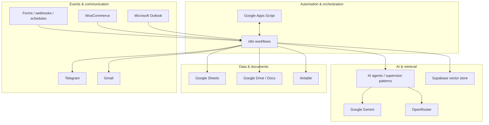

# Omar Ayman Fathi — AI Automation & Agentic AI Engineering Portfolio

**AI Automation Engineering · n8n Workflow Automation · AI Agents · API Integrations**

A curated engineering portfolio of practical automation systems, AI-assisted workflows, retrieval-augmented generation, webhook integrations, document processing and business-process automation. Each project folder contains its available workflow exports, supporting assets and project-specific documentation.

> This repository documents learning, team, educational and independent work transparently. Project context and evidence are described inside each project README; not every project is an independent production deployment.

## Contents

- [About this portfolio](#about-this-portfolio)
- [Technology ecosystem](#technology-ecosystem)
- [Featured projects](#featured-projects)
- [Project directory](#project-directory)
- [Learning and development context](#learning-and-development-context)
- [Repository navigation](#repository-navigation)

## About this portfolio

The projects demonstrate practical work across:
- Workflow orchestration with **n8n**
- AI-assisted classification, analysis and agent workflows
- Multi-agent orchestration patterns
- Retrieval-augmented generation (RAG) and vector search
- Document extraction, validation and human review
- API, webhook and business application integrations
- Operational notifications, logging and workflow recovery patterns

The repository includes importable workflow exports where provided. Credentials and environment-specific configuration are not included; consult each project's setup notes and limitations before attempting to run a workflow.

## Technology ecosystem

Technologies below are included because they appear in project documentation or exported workflow definitions.

| Area | Technologies / services |
|---|---|
| Automation | n8n, Google Apps Script |
| AI and agent components | Google Gemini, OpenRouter, n8n AI Agent nodes, structured output parsers |
| Programming / logic | JavaScript, Apps Script |
| Data and retrieval | Google Sheets, Supabase Vector Store, Airtable |
| Documents and files | Google Drive, Google Docs, PDF extraction, OCR.space |
| Messaging and productivity | Gmail, Telegram, Microsoft Outlook, Google Calendar |
| Commerce and APIs | WooCommerce webhooks, HTTP Request nodes, HMAC signature verification |
| Search | SerpApi |

[Portfolio ecosystem diagram source](assets/diagrams/portfolio-ecosystem.mmd)

## Featured projects

### 1. Intelligent Invoice Processing & Human-in-the-Loop Validation

Processes PDF/image invoices using text extraction or OCR, AI-assisted structured extraction, validation and a human review step before routing records to Google Sheets.

- **Focus:** Intelligent document processing, validation, human-in-the-loop
- **Stack:** n8n, Google Gemini, OCR.space, Google Sheets, JavaScript
- [Project documentation](invoice-processing-system/README.md) · [Architecture](assets/diagrams/invoice-processing-system.mmd) · [Workflow JSON](invoice-processing-system/workflow.json)

### 2. AI Recruitment Assistant

Receives candidate applications, classifies profiles, checks for duplicates, updates candidate sheets and supports HR decisions through Telegram and email.

- **Focus:** AI classification, recruitment workflow, human decision support
- **Stack:** n8n, Google Gemini, Google Sheets, Telegram, Gmail
- [Project documentation](automated-HR-recruitment-assistant/README.md) · [Architecture](assets/diagrams/automated-HR-recruitment-assistant.mmd) · [Workflow JSON](automated-HR-recruitment-assistant/workflow.json)

### 3. Students Booking System — V2 Reliability Upgrade

A post-deployment engineering iteration that moves booking decisions into a Google Apps Script endpoint and records notification outcomes. It is distinct from the V1 workflow used by the educational center.

- **Focus:** Booking reliability, duplicate handling, capacity decisions, operational alerts
- **Stack:** n8n, Google Apps Script, Google Sheets, Telegram
- [Project documentation](students-booking-system-v2/README.md) · [Architecture](assets/diagrams/students-booking-system-v2.mmd) · [Workflow JSON](students-booking-system-v2/workflow/students-booking-v2.public.json)

## Project directory

| Project | Category | Documentation |
|---|---|---|
| Invoice Processing System | Intelligent document processing | [README](invoice-processing-system/README.md) |
| AI Recruitment Assistant | AI agents & business automation | [README](automated-HR-recruitment-assistant/README.md) |
| Supabase RAG AI Agent | RAG & knowledge retrieval | [README](supabase-rag-ai-agent/README.md) |
| Multi-Agent Patterns | Agentic AI | [README](multi-agent-patterns/README.md) |
| Students Booking System (V1) | Business process automation | [README](students-booking-system/README.md) |
| Students Booking System (V2) | Reliability engineering | [README](students-booking-system-v2/README.md) |
| Certificate Automation System | Document & workflow automation | [README](certificate-automation-system/README.md) |
| WooCommerce Order Tracking | API & webhook integrations | [README](order-tracking-workflow/README.md) |
| HSE Incident Weekly Analysis | AI-powered reporting — team project | [README](hse-incident-weekly-analysis/README.md) |
| Alexa Assistant V2 | AI agents & integrations | [README](alexa-assistant-v2/README.md) |

## Learning and development context

- **Team project:** HSE Incident Weekly Analysis is documented as collaborative work in its project README.
- **Educational / guided context:** Where projects were completed as part of a learning initiative or tutorial, the project README should be used for the specific context and scope.
- **V1 and V2 distinction:** Students Booking System V1 represents the original operational workflow; V2 is a later reliability-focused demonstration and must not be described as the client's deployed version.
- **Evidence-first claims:** Performance figures, test results and deployment context are included only where the project documentation records them. Offline logic tests are not represented as end-to-end n8n tests.

## Repository navigation

- [Project index](PROJECTS_INDEX.md)
- [Repository changelog](CHANGELOG.md)
- [Contribution and documentation guide](CONTRIBUTING.md)
- [Architecture diagrams](assets/diagrams/)
- [Project README template](docs/guides/PROJECT_README_TEMPLATE.md)
- [Repository change report](REPOSITORY_CHANGELOG.md)

## Usage and licensing

Workflow exports may require credentials, IDs, environment configuration and external services before they can run. Review the project-specific setup instructions and security notes first.

An MIT `LICENSE` file was present in the supplied repository and has been preserved.
