<div align="center">


<br>

<a href="https://github.com/Omar-Ayman0"></a>
<a href="https://www.linkedin.com/in/omar-ayman-2a2182390/"></a>


### Building practical automation systems with AI, workflows, and connected business tools.

**AI Automation Engineering · n8n · AI Agents · RAG · API Integrations**

[Explore Featured Projects](#-featured-projects) · [Browse All Projects](#-project-directory) · [Technical Skills](#-technical-toolkit) · [Contact](#-connect)

</div>

---

## 👋 About

I’m **Omar Ayman Fathi**, a Computer Science student at **Kafr El-Sheikh University, Egypt**, focused on AI automation engineering and workflow development.

I build automation systems that connect business applications, APIs, data sources, and AI models. My work explores how n8n can orchestrate reliable workflows—from event-driven integrations and document processing to AI agents, retrieval-augmented generation, and human-in-the-loop operations.

This repository brings together independent work, educational projects, team collaborations, and engineering iterations. Each project is documented with its purpose, architecture, workflow evidence, implementation notes, and known limitations. Project context is stated explicitly so that team work, prototypes, demonstrations, and client deployments are not presented as the same thing.

<div align="center">

| **Workflow Automation** | **AI & Agent Systems** | **Integration Engineering** |
|:---:|:---:|:---:|
| Event-driven workflows, routing, retries, and operational handling | AI agents, structured outputs, RAG, and multi-agent patterns | REST APIs, webhooks, authentication, data stores, and messaging |

</div>

## ✨ Portfolio at a Glance

<div align="center">

| 10 | 1 | 2 | 50 |
|:---:|:---:|:---:|:---:|
| Project folders in this repo | External collaborative research project | Booking-system iterations | Synthetic registrations in the V2 demo |

</div>

<sub>ASTROHEALTH is maintained in a separate repository. The 50-registration figure is the recorded synthetic V2 demonstration, not a production throughput benchmark.</sub>

## 🧭 Contents

- [Featured Projects](#-featured-projects)
  - [Intelligent Invoice Processing](#1-intelligent-invoice-processing--human-in-the-loop-validation)
  - [Students Booking System V2](#2-students-booking-system--v2-reliability-upgrade)
  - [Certificate Automation System](#3-certificate-automation-system--hybrid-v2)
  - [HSE Incident Weekly Analysis](#4-hse-incident-weekly-analysis--team-project)
  - [WooCommerce Order Tracking](#5-woocommerce-order-tracking--secure-webhook-automation)
  - [AI Recruitment Assistant](#6-ai-recruitment-assistant--human-approved-candidate-screening)
  - [ASTROHEALTH](#7-astrohealth--astronaut-health-monitoring-research-prototype)
- [Additional Projects](#-additional-projects)
- [Technical Toolkit](#-technical-toolkit)
- [Engineering Principles](#-engineering-principles)
- [Repository Structure](#-repository-structure)
- [Getting Started](#-getting-started)
- [Connect](#-connect)

---

# 🚀 Featured Projects

The projects below are highlighted for the engineering concepts they demonstrate. Open each case study for its complete setup guide, workflow export, implementation notes, and limitations.

## 1. Intelligent Invoice Processing & Human-in-the-Loop Validation

<sub>DOCUMENT INTELLIGENCE · AI EXTRACTION · HUMAN REVIEW</sub>

An n8n workflow that turns PDF invoices and images into structured, reviewable financial records. It combines PDF text extraction, OCR fallback, Google Gemini, deterministic JavaScript validation, and human approval before routing records to Google Sheets.

**The engineering challenge**

An LLM can return valid-looking JSON while still extracting an incorrect amount, missing a required field, or misreading a scanned invoice. This project separates AI extraction from deterministic validation and human review.

**What the workflow does**

1. Receives an invoice through an authenticated webhook.
2. Detects the file type and extracts the PDF text layer when available.
3. Falls back to OCR.space for images and low-text PDFs.
4. Normalizes extracted text, including Arabic-Indic and Persian digits.
5. Uses Gemini with structured output to extract invoice fields and line items.
6. Applies business-rule validation for required fields, dates, arithmetic, source grounding, and extraction quality.
7. Sends flagged records to a Gmail approval form; stores the final status and review outcome in Google Sheets.

**Architecture**

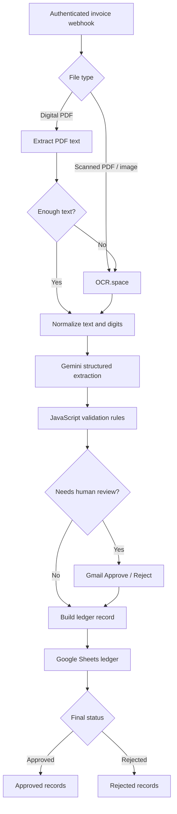

**Workflow evidence**

<div align="center">

<br><sub>n8n workflow canvas — invoice intake, extraction, validation, and review path</sub>
</div>

**Core stack:** n8n · Google Gemini · OCR.space · JavaScript · Gmail · Google Sheets

**Project context:** Developed in the Digital Egypt Pioneers Initiative (DEPI) AI Automation track. This is a portfolio prototype, not a deployed accounts-payable product.

[**Open the full case study →**](invoice-processing-system/README.md) · [Workflow JSON](invoice-processing-system/workflow.json)

---

## 2. Students Booking System — V2 Reliability Upgrade

<sub>RELIABILITY ENGINEERING · IDEMPOTENCY · CAPACITY MANAGEMENT</sub>

A post-deployment engineering iteration of a student enrollment automation originally built for an educational center. V1 handled the original client workflow; V2 explores stronger booking consistency, duplicate protection, repairable writes, and operational visibility.

**Important project distinction:** V2 is a later demonstration and reliability upgrade. It was **not** the version deployed to the original client.

**What changed in V2**

- Moves booking decisions into a Google Apps Script endpoint.
- Uses `LockService` to serialize booking requests that use the same script deployment.
- Tracks event processing and partial-write recovery in `_BookingLedger`.
- Separates booking outcomes from notification outcomes.
- Routes confirmed, waitlisted, duplicate, invalid, and operational-error cases.
- Records Telegram notification status and operational alerts.

**Architecture**

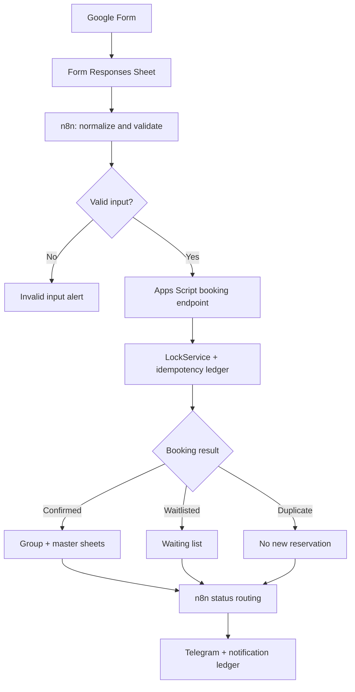

**Recorded demonstration**

The documented demo processed **50 synthetic registrations** in approximately **11 minutes 49 seconds**:

| Observed result | Count |
|---|---:|
| Confirmed | 26 |
| Waitlisted | 14 |
| Duplicate | 10 |
| **Total** | **50** |

The recorded run did not use the intended 10/8 capacity settings, so it should not be treated as proof of that specific capacity-threshold test. Simultaneous last-seat and injected-failure recovery tests are documented as pending independent verification.

<div align="center">

<br><sub>Recorded n8n execution — synthetic 50-registration demo</sub>
</div>

**Core stack:** n8n · Google Apps Script · Google Sheets · Telegram · JavaScript

[**Open V2 case study →**](students-booking-system-v2/README.md) · [V1 vs V2 comparison](students-booking-system-v2/docs/V1_VS_V2.md) · [Test report](students-booking-system-v2/docs/TEST_REPORT.md)

### Original V1 — Client Enrollment Automation

The original version automated student registration, duplicate detection, group capacity checks, waiting lists, dynamic sheet routing, and staff notifications.

<div align="center">

<br><sub>Original V1 workflow canvas</sub>
</div>

The project documentation reports **500+ registrations** processed for an educational center serving approximately **500–600 students**. These figures are project-owner-reported, not independently measured by this repository.

[**Open V1 case study →**](students-booking-system/README.md)

---

## 3. Certificate Automation System — Hybrid V2

<sub>DOCUMENT GENERATION · SAFE DELIVERY · RECOVERY WORKFLOWS</sub>

An end-to-end certificate issuance workflow that validates course-completion requests, prevents duplicate issuance, generates PDF certificates from a Google Docs template, archives them in Drive, and emails them to trainees.

The workflow also includes three operational lanes: nightly catch-up for unfinished requests, manual backfill for older certificates, and a weekly XLSX report.

**Engineering highlights**

- A Google Sheets ledger tracks each certificate through its lifecycle.
- The workflow records `sending` before attempting email delivery.
- Uncertain Gmail outcomes are marked `delivery_unknown` for manual verification rather than blindly retried.
- Backfill regenerates older certificates without emailing them again.
- A weekly report is generated and emailed to a manager.

**Architecture**

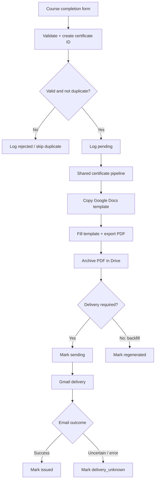

**Workflow and output evidence**

<div align="center">
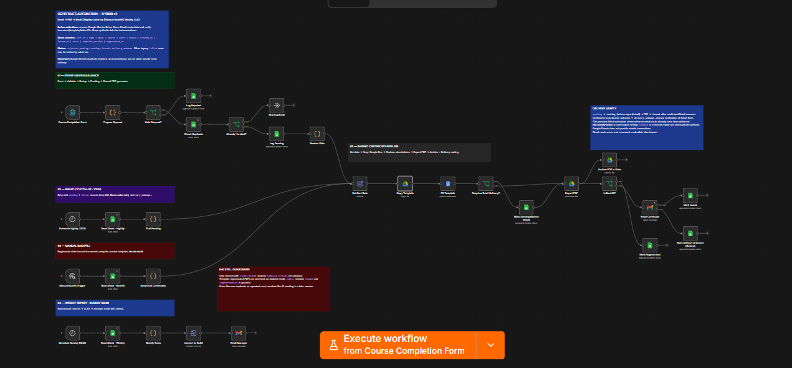
<br><sub>Hybrid certificate workflow — issuance, catch-up, backfill, and reporting lanes</sub>
</div>

<div align="center">

<br><sub>Generated certificate PDF preview</sub>
</div>

**Core stack:** n8n · Google Forms · Google Sheets · Google Docs · Google Drive · Gmail

[**Open the full case study →**](certificate-automation-system/README.md)

---

## 4. HSE Incident Weekly Analysis — Team Project

<sub>AI-POWERED REPORTING · SCHEDULED AUTOMATION · TEAM COLLABORATION</sub>

A scheduled workflow that processes HSE incident notification emails and prepares a structured weekly report for management.

**Workflow overview**

1. Runs on a weekly schedule.
2. Reads the previous seven days of incident emails from Microsoft Outlook.
3. Prepares the source content for AI analysis.
4. Uses an AI agent to extract severity, root causes, and trends into structured output.
5. Generates an HTML report and emails it through Gmail.
6. Sends a heartbeat email when no incidents are found and uses a separate error-alert path.

**Architecture**

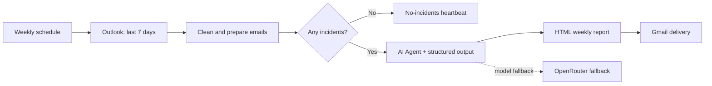

**Workflow and report evidence**

<div align="center">
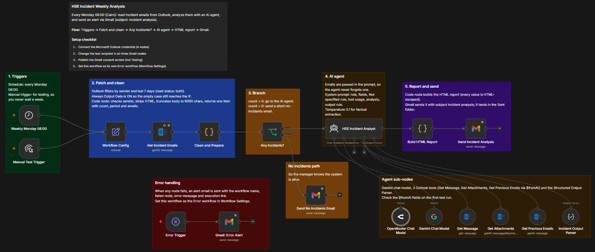
<br><sub>HSE weekly analysis workflow canvas</sub>
</div>

<div align="center">
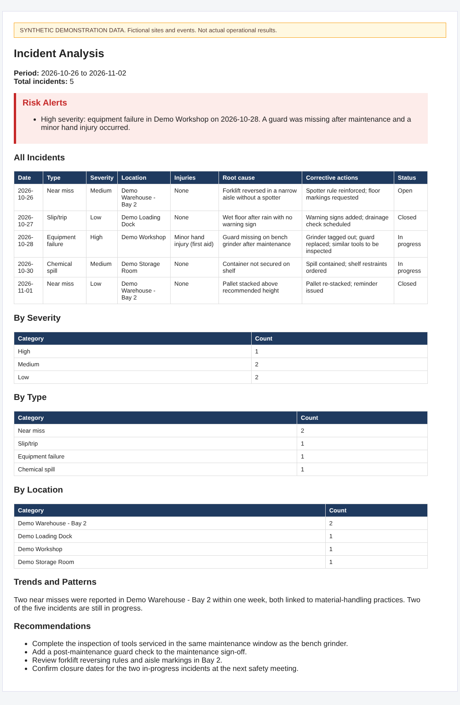
<br><sub>Sample report preview — demonstration content</sub>
</div>

**Core stack:** n8n · Microsoft Outlook · Google Gemini · OpenRouter · Gmail · JavaScript

**Project context:** Collaborative team project. It is not presented as individual work; see the project README for the team and collaboration details.

[**Open the full case study →**](hse-incident-weekly-analysis/README.md)

---

## 5. WooCommerce Order Tracking — Secure Webhook Automation

<sub>API INTEGRATION · WEBHOOK SECURITY · CUSTOMER NOTIFICATIONS</sub>

An order-tracking workflow for small online stores. A WooCommerce event triggers n8n, which verifies the webhook signature, registers the order through a Google Apps Script web app, and emails the customer a tracking link.

**Engineering highlights**

- Verifies the HMAC signature against the raw request body.
- Filters incoming webhook topics before processing.
- Sanitizes incoming order data.
- Checks the upstream Apps Script result explicitly.
- Logs failed requests and returns an unauthorized response for invalid signatures.

**Architecture**

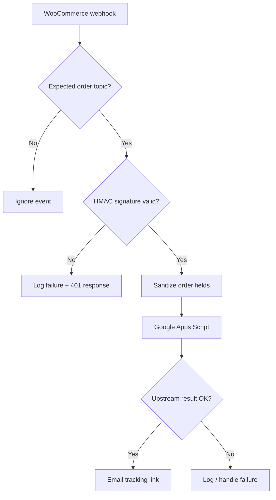

**Workflow evidence**

<div align="center">
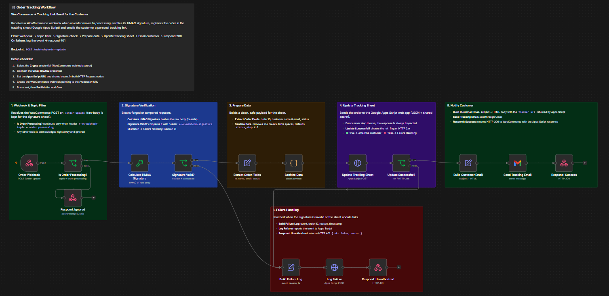
<br><sub>Order tracking n8n workflow canvas</sub>
</div>

**Core stack:** n8n · WooCommerce Webhooks · HMAC · Google Apps Script · Google Sheets · Gmail

**Project context:** Developed in the DEPI AI Automation track and tested with simulated webhook events.

[**Open the full case study →**](order-tracking-workflow/README.md) · [Demo package](order-tracking-workflow/samples/README.md)

---

## 6. AI Recruitment Assistant — Human-Approved Candidate Screening

<sub>AI CLASSIFICATION · HUMAN-IN-THE-LOOP · HR AUTOMATION</sub>

An n8n recruitment pipeline that receives applications, checks for duplicates, classifies candidates with Google Gemini, and notifies a recruiter through Telegram. The recruiter makes the final accept/reject decision with an inline button; the workflow then sends the corresponding email and updates the candidate status.

**Architecture**

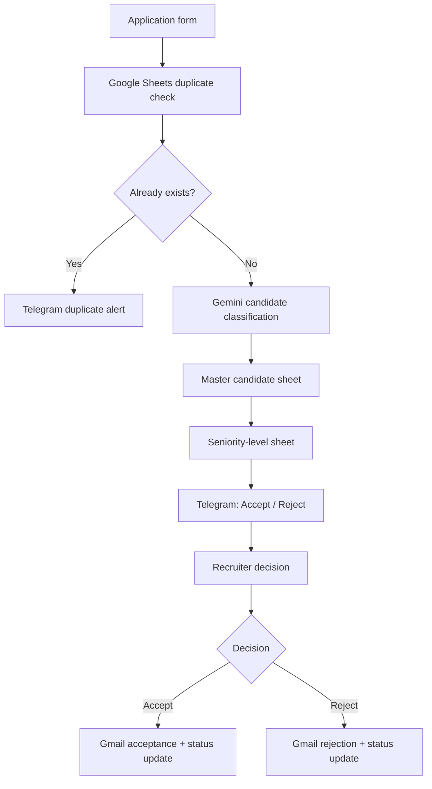

**Workflow and interface evidence**

<div align="center">
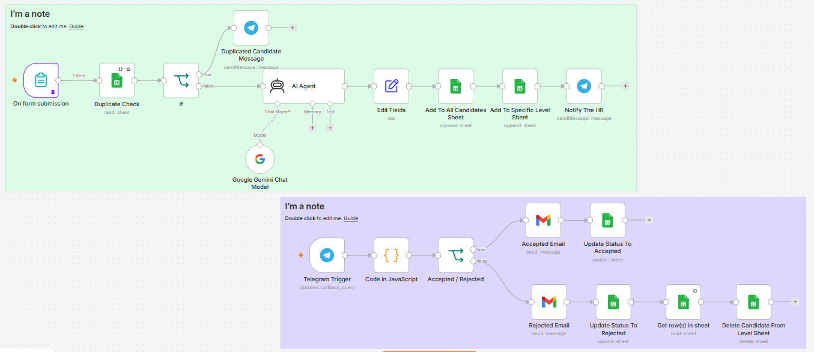
<br><sub>Recruitment intake and human decision workflow</sub>
</div>

<div align="center">

<br><sub>Recruiter notification and human decision interface</sub>
</div>

**Core stack:** n8n · Google Gemini · Google Sheets · Telegram Bot API · Gmail · JavaScript

[**Open the full case study →**](automated-HR-recruitment-assistant/README.md)

---

## 7. ASTROHEALTH — Astronaut Health Monitoring Research Prototype

<sub>COLLABORATIVE PROJECT · AI ASSISTANT · SYSTEM INTEGRATION</sub>

ASTROHEALTH is a separate collaborative research prototype for simulated space missions. Its automation layer contains four n8n workflows that connect a Health Engine and backend services with health alerts, AI-assisted briefings and Q&A, incident review actions, and mission connection monitoring.

**Automation contribution described in the project repository**

- Four n8n workflows for alert intake, AI health assistance, incident review, and connection monitoring.
- Gemini-powered health briefings and evidence-based Q&A.
- Authenticated backend integration, input validation, and error handling.
- Integration and test documentation.

**Architecture**

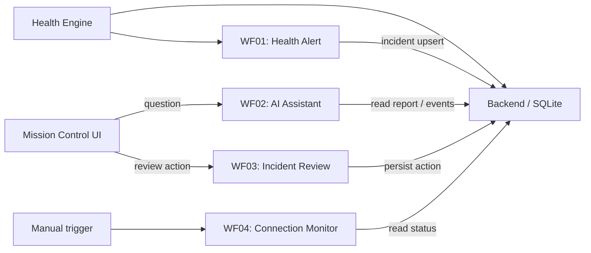

**Project boundaries and status**

This repository contains the n8n automation layer, not the complete Health Engine, backend, or frontend source code. It uses synthetic simulator data and is a research prototype—not a medical device. The external project README documents which workflow paths were tested and which still require end-to-end verification.

[**Open ASTROHEALTH repository →**](https://github.com/Omar-Ayman0/NASA-Space-APP-Project) · [Project documentation](https://github.com/Omar-Ayman0/NASA-Space-APP-Project/blob/main/README.md)

---

# 🧩 Additional Projects

The following projects expand the portfolio across conversational agents, retrieval systems, and multi-agent orchestration.

| Project | What it demonstrates | Documentation |
|---|---|---|
| **Alexa Assistant V2** | Telegram-based tool-calling assistant connected to Gmail, Google Calendar, SerpApi, and Airtable course-management tables | [Case study](alexa-assistant-v2/README.md) |
| **Supabase RAG AI Agent** | Google Drive ingestion, embeddings, Supabase vector retrieval, and Telegram Q&A | [Case study](supabase-rag-ai-agent/README.md) |
| **Multi-Agent Patterns** | Supervisor agent coordinating specialized research and analyst sub-agents | [Case study](multi-agent-patterns/README.md) |

<div align="center">
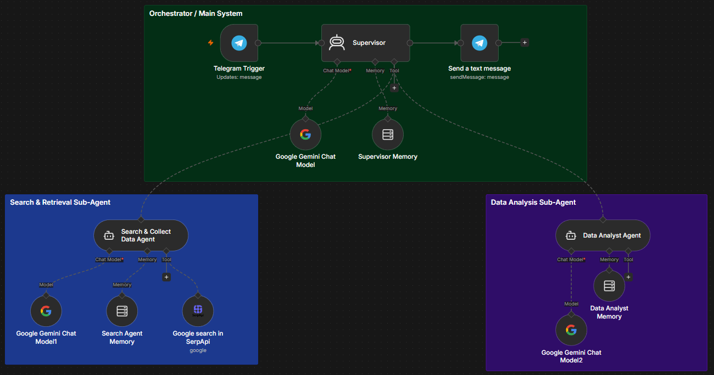
<br><sub>Supervisor and specialist-agent workflow</sub>
</div>

<div align="center">
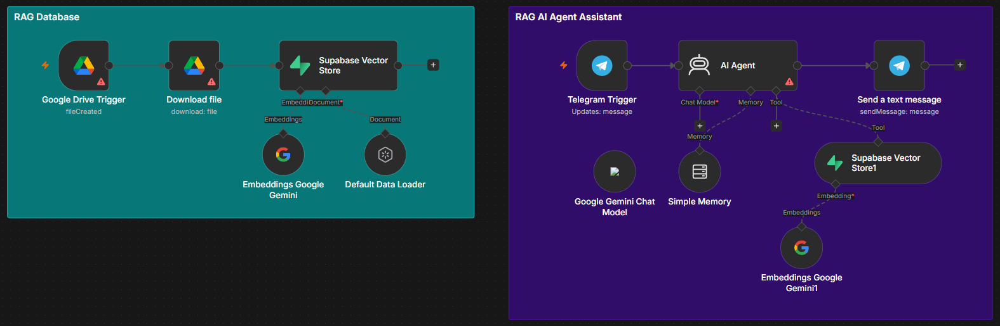
<br><sub>Supabase RAG ingestion and conversational retrieval workflow</sub>
</div>

<div align="center">
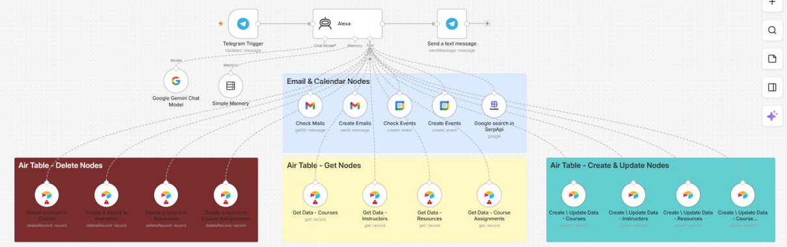
<br><sub>Alexa Assistant V2 — tool-calling integrations</sub>
</div>

---

# 🛠️ Technical Toolkit

| Area | Technologies and concepts |
|---|---|
| **Workflow automation** | n8n, webhook and schedule triggers, loops, routing, retries, error paths |
| **AI and LLMs** | Google Gemini, OpenRouter, AI Agent nodes, tool calling, structured output, prompt design, model fallback |
| **RAG and retrieval** | Supabase Vector Store, embeddings, document loaders, retrieval-as-tool, Google Drive ingestion |
| **APIs and integrations** | REST APIs, HTTP Request, Telegram Bot API, Gmail, Google Sheets, Google Drive, Google Calendar, Microsoft Outlook, Airtable, WooCommerce webhooks |
| **Security and validation** | HMAC signature verification, header authentication, input sanitization, schema validation, deterministic business rules |
| **Programming** | JavaScript, n8n Code nodes, Google Apps Script |
| **Document automation** | PDF text extraction, OCR.space, Google Docs templates, PDF generation, XLSX reporting |

## 🧠 Engineering Principles

- **Deterministic checks around AI:** model output is validated before it drives downstream business actions.
- **Human authority for sensitive decisions:** candidate screening and invoice review retain a human approval step.
- **Explicit workflow states:** status fields and ledgers make processing outcomes easier to inspect.
- **Defensive integration design:** validate webhook signatures, sanitize input, and handle upstream failures.
- **Grounded AI behavior:** prompts and retrieval flows are designed to reduce unsupported answers.
- **Honest evidence:** demonstrations, team projects, client deployments, and pending tests are labeled separately.

---

# 📁 Project Directory

```text
.
├── README.md
├── CHANGELOG.md
├── CONTRIBUTING.md
├── LICENSE
├── PROJECTS_INDEX.md
│
├── alexa-assistant-v2/
├── automated-HR-recruitment-assistant/
├── certificate-automation-system/
├── hse-incident-weekly-analysis/
├── invoice-processing-system/
├── multi-agent-patterns/
├── order-tracking-workflow/
├── students-booking-system/
├── students-booking-system-v2/
└── supabase-rag-ai-agent/
```

ASTROHEALTH is maintained in a separate repository and is linked above.

## ▶️ Getting Started

1. Choose a project folder and read its `README.md` first.
2. Review the architecture, setup requirements, credentials, and known limitations.
3. Import the provided workflow JSON into your n8n instance where an export is included.
4. Configure your own credentials and environment-specific values inside n8n.
5. Test with synthetic or otherwise authorized data before enabling a workflow.

**Security note:** Workflow exports are provided as public templates. Do not commit API keys, access tokens, private webhook URLs, personal records, or configured production credentials. Use each project's setup guide and replace placeholders in your own environment.

## 📬 Connect

<div align="center">

**Interested in AI automation, n8n workflows, or integration engineering?**

<a href="https://github.com/Omar-Ayman0"></a>
<a href="https://www.linkedin.com/in/omar-ayman-2a2182390/"></a>

</div>

---

<div align="center">
<sub>Built to document practical engineering work, technical learning, and continuous improvement.</sub>
</div>
