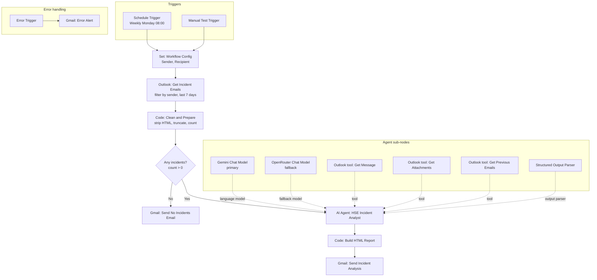

# HSE Incident Weekly Analysis

An n8n workflow that reads a week of incident notification emails from Outlook, has an AI agent turn them into a structured safety analysis, and emails an HTML report through Gmail every Monday at 08:00 (Cairo time).

## Overview

HSE (Health, Safety and Environment) managers receive incident notifications by email and usually compile weekly summaries by hand: extracting dates, severities and root causes, counting incidents, and looking for repeated problems. This workflow automates that routine.

It is aimed at HSE managers and safety teams who receive structured incident emails from a known sender and want a consistent weekly overview, including risk alerts and recommendations. The error-handling path is part of the same workflow and alerts the owner when any step fails.

## Architecture

## How it works

1. **Trigger.** A schedule fires every Monday at 08:00 (workflow timezone `Africa/Cairo`). A manual trigger feeds the same path for testing.
2. **Configuration.** The `Workflow Config` node holds the `Sender` address whose emails are treated as incident notifications.
3. **Fetch.** `Get Incident Emails` reads all Outlook messages from that sender received in the last 7 days (read and unread). It retries on failure and always outputs data so an empty week still continues.
4. **Clean and prepare.** A Code node re-checks the sender and date, removes scripts, styles and HTML tags, decodes common entities, truncates each body to 6,000 characters and returns a single item with `count`, the period dates and the cleaned emails.
5. **Branch.** If `count` is 0, a short "no incidents" email is sent so the manager knows the system is alive. Otherwise the flow continues.
6. **Analyse.** The `HSE Incident Analyst` agent receives all emails in its prompt and extracts date, type, severity, location, injuries, root cause, corrective actions and status for each incident. It counts incidents by severity, type and location, flags repeated issues, raises risk alerts for High and Critical incidents, and gives 3 to 5 recommendations. When needed it can call Outlook tools to open a full message, list attachments, or fetch earlier emails for trend comparison.
7. **Validate.** A structured output parser enforces a JSON schema for the result.
8. **Report.** A Code node builds an HTML report (summary, risk alerts, incident table, count tables, trends, recommendations) with every value HTML-escaped.
9. **Send.** Gmail sends the report with the subject `incident analysis`.
10. **On failure.** Any failing node triggers the error path, which emails the workflow name, failed node, error message and execution link.

## Tech stack

| Tool | Used for |
|---|---|
| n8n | Orchestration: Schedule, Manual, Set, If, Code, Error Trigger and AI Agent nodes |
| Microsoft Outlook | Reading incident emails; also exposed to the agent as three tools |
| Google Gemini (`models/gemini-3.1-flash-lite`) | Primary language model for the agent, temperature 0.1 |
| OpenRouter (`openrouter/free`) | Fallback language model, temperature 0.1 |
| Gmail | Sending the weekly report, the no-incidents notice and error alerts |
| JavaScript (Code nodes) | Email cleaning and the HTML report builder |

## Key features and design decisions

- **Deterministic input.** Emails are filtered by sender in Outlook and again in code, then cleaned and size-limited before the model sees them.
- **All emails in the prompt.** The emails are passed directly to the agent, so it does not depend on tool calls to find them. Tools are only for extra detail.
- **No guessing.** The system prompt requires `Not specified` for any missing field and forbids using outside knowledge.
- **Structured output.** A manual JSON schema with required fields keeps the downstream report builder predictable.
- **Trend comparison without double counting.** Previous-period emails (up to 20) are used only for trends, never in the totals.
- **Model fallback.** The agent has fallback enabled, with Gemini as the primary model and OpenRouter as the second.
- **Bounded agent loop.** `maxIterations` is set to 12.
- **Safe rendering.** Every value placed in the HTML report is escaped.
- **Heartbeat.** The empty-week email confirms the workflow is running.
- **Resilience.** `retryOnFail` is enabled on the Outlook fetch and on the Gmail nodes; a dedicated error path alerts the owner.

## Setup

**Accounts needed:** n8n, Microsoft account with Outlook access, Google account for Gmail, Google AI Studio API key, OpenRouter API key.

1. Import `workflow.json` in n8n (**Workflows → Import from file**).
2. Create these credentials and attach them to the matching nodes (the JSON contains the names only):
   - `Microsoft Outlook account` (OAuth2): `Get Incident Emails`, `Get Message`, `Get Attachments`, `Get Previous Emails`
   - `Gmail account 3` (OAuth2): `Send Incident Analysis`, `Send No Incidents Email`, `Gmail: Error Alert`
   - `Google Gemini(PaLM) Api account` (API key)
   - `OpenRouter account` (API key)
3. Replace the placeholders:

| Placeholder | Where | Replace with |
|---|---|---|
| `incident-reports@example.com` | `Workflow Config` → `Sender` | The address that sends the incident emails |
| `you@example.com` | `Workflow Config` → `Recipient` | Your address (see the first item under improvements) |
| `you@example.com` | `Gmail: Error Alert` → To | The address that should receive failure alerts |

4. In **Workflow Settings**, select this workflow as its own **Error workflow**, and confirm the timezone.
5. Publish the Gmail OAuth consent screen (not "Testing"), as noted on the canvas.
6. Run the **Manual Test Trigger** once and check the `$fromAI` fields of the three Outlook tools, then publish the workflow.

## Screenshots

The canvas screenshot above shows the full workflow, including the error-handling path.

<!-- Add a screenshot of a sample report email (with fictional data) in assets/ and embed it here. -->

## Possible improvements

- **Recipient field is unused.** `Workflow Config` defines `Recipient`, but both report nodes send to `Sender`. Using `Recipient` would let the report go to a different person than the incident sender.
- **Attachments.** The prompt asks the agent to name attachments and to say when their content could not be read, but the output schema has no dedicated attachments field.
- **Input size.** Each email is truncated to 6,000 characters, but there is no limit on the number of emails in one prompt.
- **Report subject.** The subject is fixed (`incident analysis`); adding the period dates would make reports easier to find.
- **Fallback model.** The fallback uses a free router model; pinning a specific model would give more predictable output.
- **Error alerts.** The alert recipient is hardcoded in the node and the error workflow must be set manually after import.
- **History.** Reports are only emailed; storing structured results (for example in a sheet or database) would allow dashboards and long-term trends.
