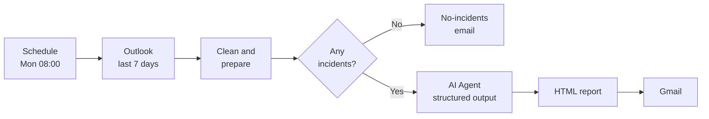
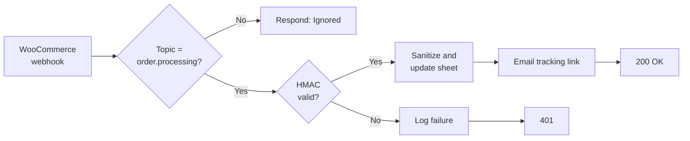
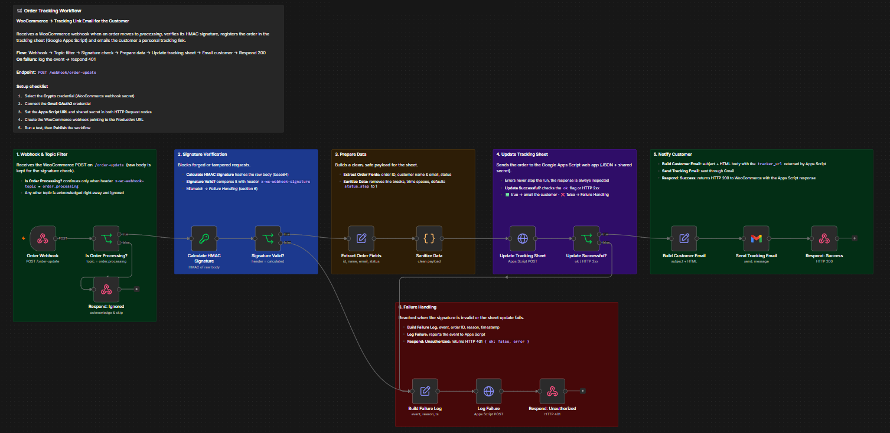
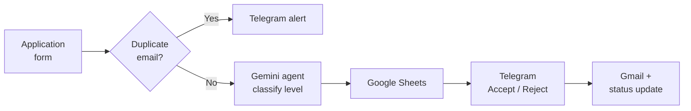
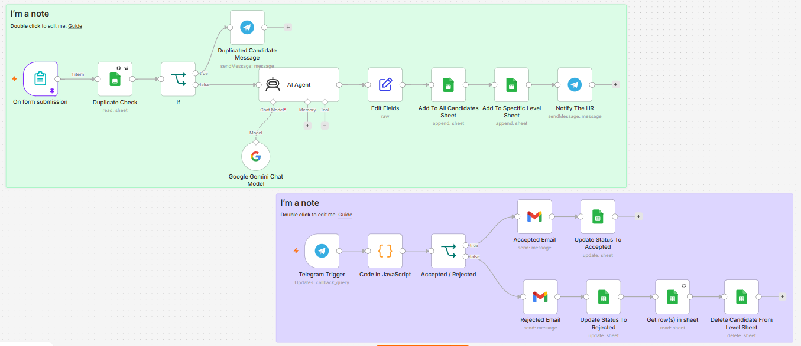
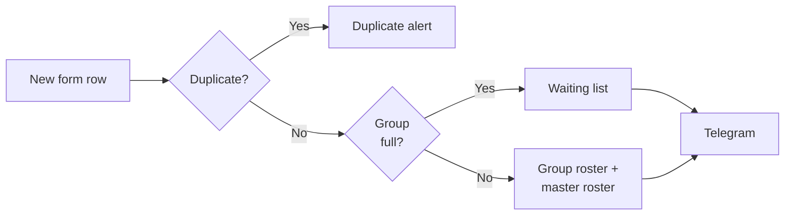
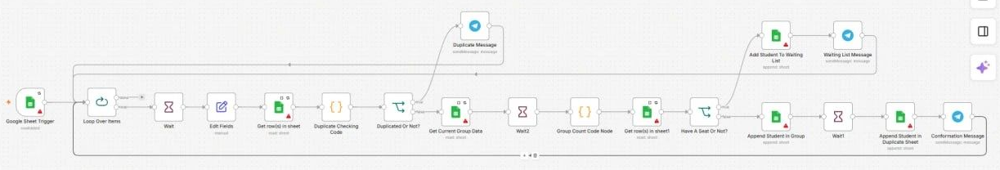

# Omar Ayman Fathi — AI Automation Engineering Portfolio

**AI Automation Engineer | n8n Workflow Automation | API Integrations**

A curated collection of n8n workflows covering AI agents, RAG, human-in-the-loop approvals, signed-webhook integrations and business-process automation. Each project folder contains the importable workflow export, an architecture diagram and documentation of the design, setup, limitations and status.


## About

I am a Computer Science student at Kafr El-Sheikh University (Egypt) and an early-career AI Automation Engineer. I design n8n workflows, integrate REST APIs and business systems, and apply LLMs and AI agents to operational problems. I work as a freelance automation consultant and am an AI Automation trainee and team lead in the Digital Egypt Pioneers Initiative (DEPI).

**Open to:** junior AI automation and n8n developer roles, workflow automation and AI integration positions, technical internships, AI and automation scholarships, and freelance automation projects.

**What this repository shows:** hands-on workflow architecture, AI agent design with prompt-level safeguards, human-in-the-loop decisions, webhook security, data-handling logic in JavaScript, and honest documentation of known limitations.

## Technical Skills

| Area | Demonstrated in this repository |
|---|---|
| Workflow automation | n8n, schedule and webhook triggers, Google Sheets and Drive triggers, error-handling paths, retries, loops |
| AI and LLMs | AI Agent nodes, tool-calling agents, multi-agent (supervisor) design, structured output parsing, model fallback, Google Gemini, OpenRouter, prompt design |
| RAG | Supabase vector store, embeddings, retrieval-as-tool, Drive-triggered ingestion |
| APIs and integrations | Telegram Bot API, Gmail, Google Sheets, Google Drive, Google Calendar, Microsoft Outlook, Airtable, SerpApi, WooCommerce webhooks, Google Apps Script web apps, HMAC signature verification |
| Programming | JavaScript (n8n Code nodes), regular expressions |

Further skills (such as Python) are listed on my CV and are not part of the workflows in this repository.

## Featured Projects

### 1. HSE Incident Weekly Analysis — Team Project

> Developed collaboratively by a team; see the [Team & Collaboration](hse-incident-weekly-analysis/README.md#team--collaboration) section. It is not presented as individual work.

- **Business problem:** HSE managers compile weekly incident summaries by hand from notification emails.
- **Solution:** A scheduled n8n workflow reads a week of Outlook incident emails, has an AI agent extract severity, root causes and trends into a validated JSON schema, and emails an HTML report every Monday at 08:00 (Cairo time).
- **Key features:** Gemini primary model with OpenRouter fallback; Outlook tools for the agent; structured output parser; HTML-escaped report; "no incidents" heartbeat email; dedicated error-alert path.
- **Technologies:** n8n, Google Gemini, OpenRouter, Microsoft Outlook, Gmail, JavaScript.




**[Read the full case study →](hse-incident-weekly-analysis/README.md)** · [Sample report (demo data)](hse-incident-weekly-analysis/samples/README.md)

---

### 2. Order Tracking Workflow

- **Business problem:** Small online stores need to send customers a tracking link without exposing their back office, and a public webhook must reject forged requests.
- **Solution:** A WooCommerce webhook triggers an n8n workflow that verifies the HMAC signature, registers the order through a Google Apps Script web app and emails the customer a tracking URL.
- **Key features:** raw-body HMAC verification, topic filtering, input sanitisation, explicit upstream result check, logged failure path with a 401 response.
- **Technologies:** n8n, Webhooks, Crypto (HMAC), Google Apps Script, Google Sheets, Gmail.
- **Context:** built in the DEPI AI Automation track and tested with Postman-simulated webhooks.





**[Read the full case study →](order-tracking-workflow/README.md)** · [Demo package (synthetic data)](order-tracking-workflow/samples/README.md)

---

### 3. AI Recruitment Assistant

- **Business problem:** Recruiters spend time on duplicate checks, sorting candidates by seniority and standard replies.
- **Solution:** Applications from a form are checked for duplicates, classified by a Gemini agent into four seniority levels, stored in Google Sheets, and sent to the recruiter on Telegram with Accept and Reject buttons. A button tap triggers the email and status update.
- **Key features:** strict JSON output from the model, prompt-injection-aware instructions, duplicate protection, human-in-the-loop decision, status lifecycle.
- **Technologies:** n8n, Google Gemini, Google Sheets, Telegram Bot API, Gmail, JavaScript.





**[Read the full case study →](automated-HR-recruitment-assistant/README.md)**

---

### 4. Students Booking System

- **Business problem:** A tutoring center handled registrations manually, checking duplicates and group capacity by hand.
- **Solution:** New form responses trigger a workflow that detects duplicates, counts seats against a per-group limit, writes the student to the group roster or a waiting list, and notifies staff on Telegram with a prefilled WhatsApp link.
- **Key features:** duplicate detection by student number, per-group seat limits, waiting list, dynamic sheet routing, retries on reads.
- **Technologies:** n8n, Google Sheets, Telegram Bot API, JavaScript.
- **Production deployment:** 500+ registrations processed; delivered within 30 days.





**[Read the full case study →](students-booking-system/README.md)**

## Project Directory

| # | Project | Also known as | Folder | What it demonstrates | Highlight |
|---|---|---|---|---|---|
| 1 | HSE Incident Weekly Analysis | HSE Incident Weekly Analysis — Team Project | [hse-incident-weekly-analysis](hse-incident-weekly-analysis/) | Scheduled AI analysis, structured output, model fallback, error handling | **Team project** · AI-generated weekly HTML reports |
| 2 | Order Tracking Workflow | Order Tracking Workflow | [order-tracking-workflow](order-tracking-workflow/) | Webhook security (HMAC), Apps Script integration, transactional email | HMAC-verified webhook · DEPI project |
| 3 | AI Recruitment Assistant | AI-Driven HR Recruitment & Candidate Evaluation System | [automated-HR-recruitment-assistant](automated-HR-recruitment-assistant/) | LLM classification, human-in-the-loop via Telegram | Human-in-the-loop approvals via Telegram |
| 4 | Students Booking System | Student Booking Automation System | [students-booking-system](students-booking-system/) | Sheet-driven registration logic, capacity limits, waiting list | Production deployment: 500+ registrations processed; delivered within 30 days |
| 5 | Alexa Assistant V2 | Executive AI Assistant | [alexa-assistant-v2](alexa-assistant-v2/) | Tool-calling agent (Gmail, Calendar, SerpApi, Airtable) | 17 integrated tools |
| 6 | Supabase RAG AI Agent | RAG Knowledge Base & AI Chatbot | [supabase-rag-ai-agent](supabase-rag-ai-agent/) | RAG with a Supabase vector store, Drive-triggered ingestion | Vector retrieval pipeline |
| 7 | Multi-Agent Patterns | Marketing Intelligence Multi-Agent System | [multi-agent-patterns](multi-agent-patterns/) | Supervisor agent with research and analyst sub-agents | Multi-agent orchestration |

## Engineering Concepts

- **Human in the loop:** AI classifies, a person approves (recruitment assistant).
- **Webhook security:** signature verification on the raw body before any processing (order tracking).
- **Grounded AI:** retrieval-first prompts, "Not specified" for missing data, anti-fabrication instructions (RAG, HSE, multi-agent).
- **Structured output:** JSON schemas and strict output formats so downstream nodes stay predictable.
- **Agent design:** tool-calling agents, supervisor and sub-agent separation of duties, bounded iterations.
- **Resilience:** retries, fallback models, heartbeat emails and error-alert paths.
- **Data hygiene:** sanitising inputs, escaping HTML, treating user content as untrusted in prompts.

## Technology Stack

n8n · Google Gemini · OpenRouter · Supabase (vector store) · Telegram Bot API · Gmail · Google Sheets · Google Drive · Google Calendar · Google Apps Script · Microsoft Outlook · Airtable · SerpApi · WooCommerce webhooks · JavaScript

## Repository Structure

```text
.
├── README.md
├── LICENSE
├── tests/                              # offline logic tests + manual test plan
├── hse-incident-weekly-analysis/       # team project
├── order-tracking-workflow/
├── automated-HR-recruitment-assistant/
├── students-booking-system/
├── alexa-assistant-v2/
├── supabase-rag-ai-agent/
└── multi-agent-patterns/
    └── multi-agent-system/
```

Each project folder contains `README.md`, `workflow.json` and an `assets/` folder with screenshots.

## Testing

Offline logic tests of the Code nodes and workflow wiring (`node tests/run-code-node-tests.js`) and a manual end-to-end test plan are in [`tests/`](tests/). The offline tests use synthetic data and are not n8n executions; see [TEST_REPORT](tests/TEST_REPORT.md).

## Setup and Usage

1. Open a project folder and read its README (overview, architecture, limitations).
2. In n8n, choose **Import from File** and select the project's `workflow.json` (for multi-agent patterns, `multi-agent-system/workflow.json`).
3. Create the credentials named in the project README. **No secrets are included in this repository.**
4. Replace placeholder values (`YOUR_...`, `REPLACE_WITH_YOUR_CREDENTIAL`, `example.com` addresses) with your own.
5. Run a manual or test execution before activating.

These workflows are exported examples, not packaged products. Each README lists known limitations and the project's status; review them before any real use.

## Contact


- LinkedIn: [linkedin.com/in/omar-ayman-2a2182390](https://www.linkedin.com/in/omar-ayman-2a2182390)
- GitHub: [github.com/Omar-Ayman0](https://github.com/Omar-Ayman0)
- Email: [omarayman.mail@gmail.com](mailto:omarayman.mail@gmail.com)

## License

Released under the [MIT License](LICENSE).
