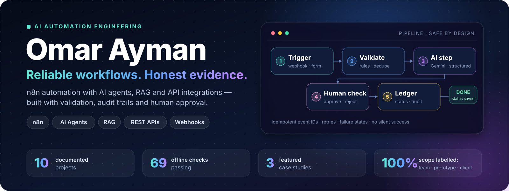
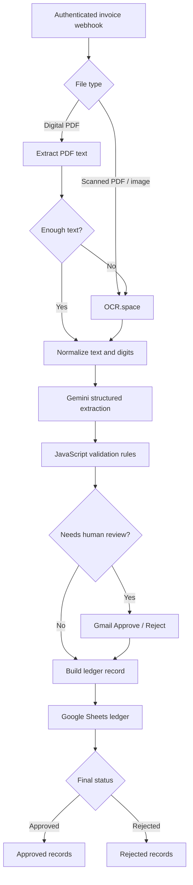
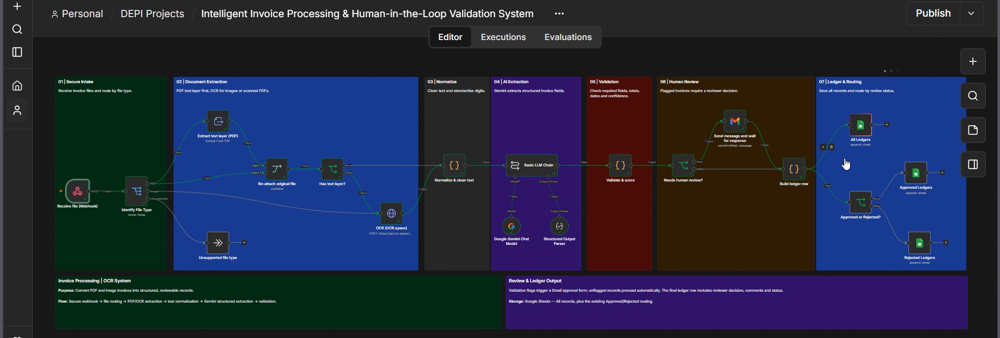
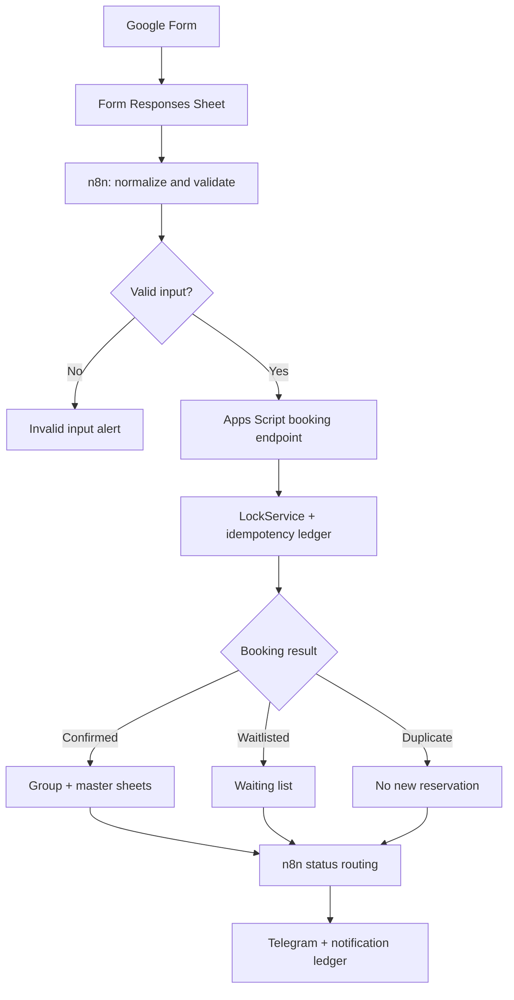
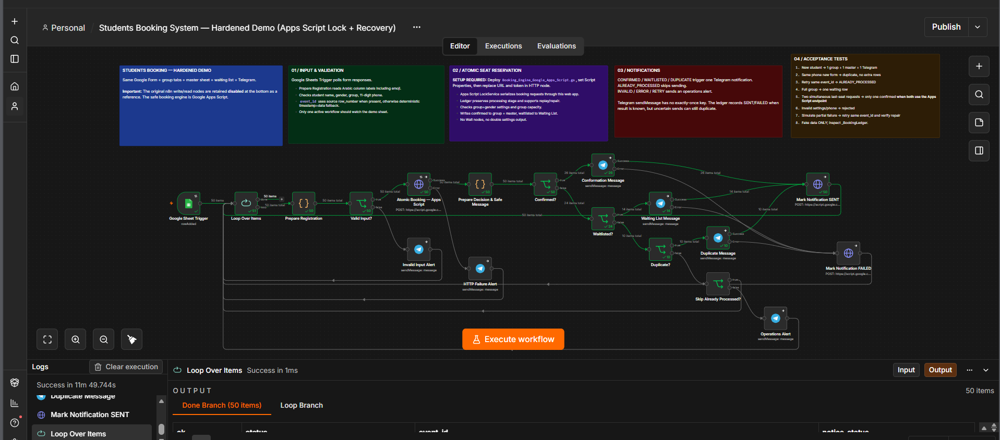
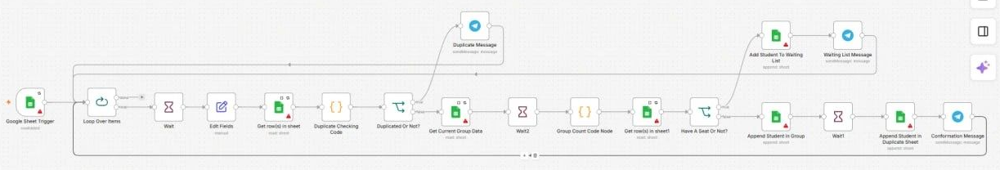
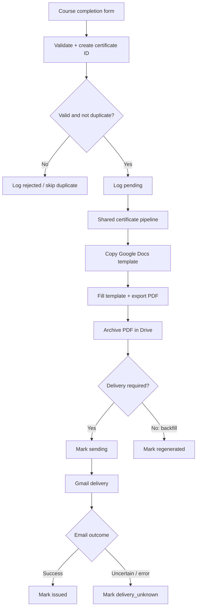
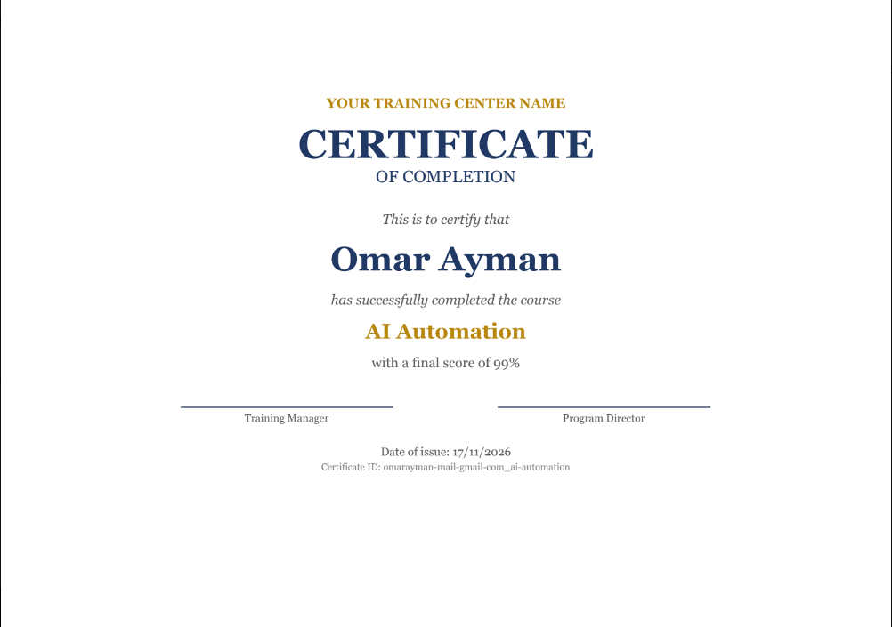

<div align="center">



<br>

<a href="https://github.com/Omar-Ayman0/n8n-ai-automation-projects/actions"></a>


<br>

<a href="https://github.com/Omar-Ayman0"></a>
<a href="https://www.linkedin.com/in/omar-ayman-2a2182390/"></a>
<a href="README.ar.md"></a>

<br><br>

**[Featured projects](#-featured-projects)** &nbsp;·&nbsp; **[More projects](#-more-projects)** &nbsp;·&nbsp; **[Toolkit](#-technical-toolkit)** &nbsp;·&nbsp; **[Quality checks](#-quality-checks)** &nbsp;·&nbsp; **[Contact](#-connect)**

</div>

<br>

## ⚡ 30-second tour

| If you want to see… | Open |
|---|---|
| **Reliability thinking** (idempotency, ledger, partial-write repair) | [Students Booking V2](students-booking-system-v2/README.md) · [Certificate Automation](certificate-automation-system/README.md) |
| **AI with guardrails** (LLM extraction + rules + human approval) | [Invoice Processing](invoice-processing-system/README.md) |
| **Honest testing** (what was observed vs. what is still pending) | [V2 test report](students-booking-system-v2/docs/TEST_REPORT.md) · [V2 limitations](students-booking-system-v2/docs/LIMITATIONS.md) |
| **Real client work** | [Students Booking V1](students-booking-system/README.md) |

<sub>Legend used across the repo: **client deployment** · **team project** · **training-track project (DEPI)** · **prototype**. Numbers marked *author-reported* are not measured by this repository.</sub>

---

## 👋 About

I’m **Omar Ayman Fathi**, a Computer Science student at **Kafr El-Sheikh University, Egypt**, focused on AI automation engineering and workflow development.

I build automation systems that connect business applications, APIs, data sources, and AI models. My work explores how n8n can orchestrate reliable workflows—from event-driven integrations and document processing to AI agents, retrieval-augmented generation, and human-in-the-loop operations.

This repository brings together independent work, educational projects, team collaborations, and engineering iterations. Each project is documented with its purpose, architecture, workflow evidence, implementation notes, and known limitations. Project context is stated explicitly so that team work, prototypes, demonstrations, and client deployments are not presented as the same thing.

<div align="center">

| **Workflow Automation** | **AI & Agent Systems** | **Integration Engineering** |
|:---:|:---:|:---:|
| Event-driven workflows, routing, retries, and operational handling | AI agents, structured outputs, RAG, and multi-agent patterns | REST APIs, webhooks, authentication, data stores, and messaging |

</div>


## 🧭 Contents

- [Featured Projects](#-featured-projects)
- [More Projects](#-more-projects)
- [Technical Toolkit](#-technical-toolkit)
- [Engineering Principles](#-engineering-principles)
- [Quality Checks](#-quality-checks)
- [Repository Structure](#-repository-structure)
- [Connect](#-connect)

---

# 🚀 Featured Projects

Three projects are highlighted for the engineering concepts they demonstrate. Each case study has a setup guide, workflow export, limitations and an honest evidence table.


## 1. Intelligent Invoice Processing & Human-in-the-Loop Validation

<sub>DOCUMENT INTELLIGENCE · AI EXTRACTION · HUMAN REVIEW</sub>

An n8n workflow that turns PDF invoices and images into structured, reviewable financial records. It combines PDF text extraction, OCR fallback, Google Gemini, deterministic JavaScript validation, and human approval before routing records to Google Sheets.

**The engineering challenge**

An LLM can return valid-looking JSON while still extracting an incorrect amount, missing a required field, or misreading a scanned invoice. This project separates AI extraction from deterministic validation and human review.

**What the workflow does**

1. Receives an invoice through an authenticated webhook.
2. Detects the file type and extracts the PDF text layer when available.
3. Falls back to OCR.space for images and low-text PDFs.
4. Normalizes extracted text, including Arabic-Indic and Persian digits.
5. Uses Gemini with structured output to extract invoice fields and line items.
6. Applies business-rule validation for required fields, dates, arithmetic, source grounding, and extraction quality.
7. Sends flagged records to a Gmail approval form; stores the final status and review outcome in Google Sheets.

**Architecture**



**Workflow evidence**

<div align="center">

<br><sub>n8n workflow canvas — invoice intake, extraction, validation, and review path</sub>
</div>

**Core stack:** n8n · Google Gemini · OCR.space · JavaScript · Gmail · Google Sheets

**Project context:** Developed in the Digital Egypt Pioneers Initiative (DEPI) AI Automation track. This is a portfolio prototype, not a deployed accounts-payable product.

[**Open the full case study →**](invoice-processing-system/README.md) · [Workflow JSON](invoice-processing-system/workflow.json)

---

## 2. Students Booking System — V2 Reliability Upgrade

<sub>RELIABILITY ENGINEERING · IDEMPOTENCY · CAPACITY MANAGEMENT</sub>

A post-deployment engineering iteration of a student enrollment automation originally built for an educational center. V1 handled the original client workflow; V2 explores stronger booking consistency, duplicate protection, repairable writes, and operational visibility.

**Important project distinction:** V2 is a later demonstration and reliability upgrade. It was **not** the version deployed to the original client.

**What changed in V2**

- Moves booking decisions into a Google Apps Script endpoint.
- Uses `LockService` to serialize booking requests that use the same script deployment.
- Tracks event processing and partial-write recovery in `_BookingLedger`.
- Separates booking outcomes from notification outcomes.
- Routes confirmed, waitlisted, duplicate, invalid, and operational-error cases.
- Records Telegram notification status and operational alerts.

**Architecture**



**Recorded demonstration**

The documented demo processed **50 synthetic registrations** in approximately **11 minutes 49 seconds**:

| Observed result | Count |
|---|---:|
| Confirmed | 26 |
| Waitlisted | 14 |
| Duplicate | 10 |
| **Total** | **50** |

The recorded run did not use the intended 10/8 capacity settings, so it should not be treated as proof of that specific capacity-threshold test. Simultaneous last-seat and injected-failure recovery tests are documented as pending independent verification.

<div align="center">

<br><sub>Recorded n8n execution — synthetic 50-registration demo</sub>
</div>

**Core stack:** n8n · Google Apps Script · Google Sheets · Telegram · JavaScript

[**Open V2 case study →**](students-booking-system-v2/README.md) · [V1 vs V2 comparison](students-booking-system-v2/docs/V1_VS_V2.md) · [Test report](students-booking-system-v2/docs/TEST_REPORT.md)

### Original V1 — Client Enrollment Automation

The original version automated student registration, duplicate detection, group capacity checks, waiting lists, dynamic sheet routing, and staff notifications.

<div align="center">

<br><sub>Original V1 workflow canvas</sub>
</div>

The project documentation reports **500+ registrations** processed for an educational center serving approximately **500–600 students**. These figures are project-owner-reported, not independently measured by this repository.

[**Open V1 case study →**](students-booking-system/README.md)

---

## 3. Certificate Automation System — Hybrid V2

<sub>DOCUMENT GENERATION · SAFE DELIVERY · RECOVERY WORKFLOWS</sub>

An end-to-end certificate issuance workflow that validates course-completion requests, prevents duplicate issuance, generates PDF certificates from a Google Docs template, archives them in Drive, and emails them to trainees.

The workflow also includes three operational lanes: nightly catch-up for unfinished requests, manual backfill for older certificates, and a weekly XLSX report.

**Engineering highlights**

- A Google Sheets ledger tracks each certificate through its lifecycle.
- The workflow records `sending` before attempting email delivery.
- Uncertain Gmail outcomes are marked `delivery_unknown` for manual verification rather than blindly retried.
- Backfill regenerates older certificates without emailing them again.
- A weekly report is generated and emailed to a manager.

**Architecture**



**Workflow and output evidence**

<div align="center">

<br><sub>Hybrid certificate workflow — issuance, catch-up, backfill, and reporting lanes</sub>
</div>

<div align="center">

<br><sub>Generated certificate PDF preview</sub>
</div>

**Core stack:** n8n · Google Forms · Google Sheets · Google Docs · Google Drive · Gmail

[**Open the full case study →**](certificate-automation-system/README.md)

---

---

# 🧩 More Projects

| Project | Type | What it demonstrates | Case study |
|---|---|---|---|
| **HSE Incident Weekly Analysis** | **Team project** | Scheduled Outlook-to-report pipeline with AI agent, structured output, model fallback and heartbeat/error paths | [Open](hse-incident-weekly-analysis/README.md) |
| **WooCommerce Order Tracking** | DEPI track project | HMAC signature verification on the raw body, topic filtering, sanitization, Apps Script integration | [Open](order-tracking-workflow/README.md) |
| **AI Recruitment Assistant** | Independent | Duplicate check, Gemini classification, human Accept/Reject via Telegram (recruiter-only authorization added) | [Open](automated-HR-recruitment-assistant/README.md) |
| **Supabase RAG AI Agent** | Independent | Drive ingestion, text splitting, Supabase vectors, grounded Telegram answers | [Open](supabase-rag-ai-agent/README.md) |
| **Alexa Assistant V2** | Independent | Tool-calling agent over Gmail, Calendar, SerpApi and Airtable with user allow-list and deletion rules | [Open](alexa-assistant-v2/README.md) |
| **Multi-Agent Patterns** | Independent | Supervisor agent coordinating a search agent and an analyst agent | [Open](multi-agent-patterns/README.md) |
| **ASTROHEALTH** | Collaborative research prototype | Four n8n workflows around a simulated astronaut-health backend; separate repository | [Repository](https://github.com/Omar-Ayman0/NASA-Space-APP-Project) |

> Status labels are deliberate: *team*, *track project*, *prototype* and *client deployment* are different things and are never mixed.

---

# 🛠️ Technical Toolkit

| Area | Technologies and concepts |
|---|---|
| **Workflow automation** | n8n, webhook and schedule triggers, loops, routing, retries, error paths |
| **AI and LLMs** | Google Gemini, OpenRouter, AI Agent nodes, tool calling, structured output, prompt design, model fallback |
| **RAG and retrieval** | Supabase Vector Store, embeddings, document loaders, retrieval-as-tool, Google Drive ingestion |
| **APIs and integrations** | REST APIs, HTTP Request, Telegram Bot API, Gmail, Google Sheets, Google Drive, Google Calendar, Microsoft Outlook, Airtable, WooCommerce webhooks |
| **Security and validation** | HMAC signature verification, header authentication, input sanitization, schema validation, deterministic business rules |
| **Programming** | JavaScript, n8n Code nodes, Google Apps Script |
| **Document automation** | PDF text extraction, OCR.space, Google Docs templates, PDF generation, XLSX reporting |

## 🧠 Engineering Principles

- **Deterministic checks around AI:** model output is validated before it drives downstream business actions.
- **Human authority for sensitive decisions:** candidate screening and invoice review retain a human approval step.
- **Explicit workflow states:** status fields and ledgers make processing outcomes easier to inspect.
- **Defensive integration design:** validate webhook signatures, sanitize input, and handle upstream failures.
- **Grounded AI behavior:** prompts and retrieval flows are designed to reduce unsupported answers.
- **Honest evidence:** demonstrations, team projects, client deployments, and pending tests are labeled separately.

---

## ✅ Quality Checks

Run locally (Node 18+, no dependencies) or automatically on every push through GitHub Actions:

```bash
node scripts/validate-repo.js                                   # JSON validity, wiring, placeholders, secrets, links
node students-booking-system-v2/tests/run-engine-tests.js      # V2 booking engine logic (27 checks)
node certificate-automation-system/tests/run-code-node-tests.js # certificate Code nodes + wiring (32 checks)
node invoice-processing-system/tests/run-code-node-tests.js     # invoice validation + routing (10 checks)
```

These are **offline logic tests**. They do not call Google, Telegram, Gmail or n8n, and they are not a concurrency or end-to-end test. Each project's `TEST_REPORT` / limitations section says which scenarios are still pending.

## 📁 Repository Structure

```text
.
├── README.md  ·  README.ar.md (Arabic summary)
├── CHANGELOG.md  ·  CONTRIBUTING.md  ·  PROJECTS_INDEX.md  ·  LICENSE
├── scripts/validate-repo.js
├── .github/workflows/checks.yml
├── docs/guides/PROJECT_README_TEMPLATE.md
├── invoice-processing-system/
├── students-booking-system/            # V1 (client deployment)
├── students-booking-system-v2/         # V2 reliability upgrade (demo)
├── certificate-automation-system/
├── hse-incident-weekly-analysis/       # team project
├── order-tracking-workflow/
├── automated-HR-recruitment-assistant/
├── supabase-rag-ai-agent/
├── alexa-assistant-v2/
└── multi-agent-patterns/
```

ASTROHEALTH lives in a separate repository (linked above).

## ▶️ Getting Started

1. Choose a project folder and read its `README.md` first.
2. Review the architecture, setup requirements, credentials, and known limitations.
3. Import the provided workflow JSON into your n8n instance where an export is included.
4. Configure your own credentials and environment-specific values inside n8n.
5. Test with synthetic or otherwise authorized data before enabling a workflow.

**Security note:** Workflow exports are provided as public templates. Do not commit API keys, access tokens, private webhook URLs, personal records, or configured production credentials. Use each project's setup guide and replace placeholders in your own environment.

## 📬 Connect

<div align="center">

**Interested in AI automation, n8n workflows, or integration engineering?**

<a href="https://github.com/Omar-Ayman0"></a>
<a href="https://www.linkedin.com/in/omar-ayman-2a2182390/"></a>

</div>

---

<div align="center">
<sub>Built to document practical engineering work, technical learning, and continuous improvement.</sub>
</div>
