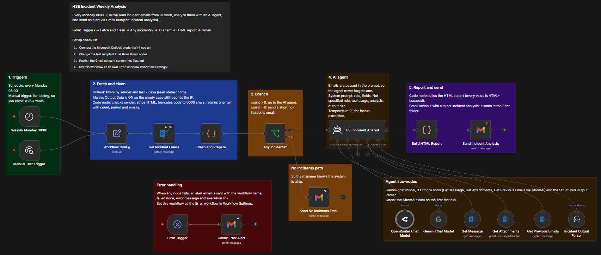
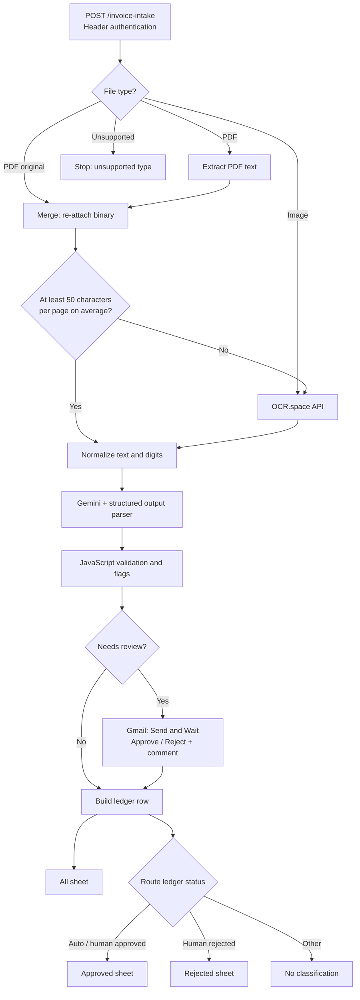

# Intelligent Invoice Processing & Human-in-the-Loop Validation System

[← Back to portfolio](../README.md)



## 1. Project Overview

An n8n workflow that converts PDF invoices and images into structured, reviewable financial records. It combines PDF text extraction, OCR, Google Gemini, JavaScript validation rules and human approval before writing results to Google Sheets.

Developed in the Digital Egypt Pioneers Initiative (DEPI) AI Automation track with Eng. Alaa EL-Dewer. A recorded test execution demonstrated the scanned-invoice path, email review and ledger output. This is a portfolio prototype, not a deployed accounts-payable product.

## 2. Business Problem

Invoices arrive in inconsistent formats: digital PDFs, scanned PDFs and images. Manual entry requires staff to read supplier details, dates, amounts and line items repeatedly. OCR and LLM extraction can reduce that effort, but an apparently valid JSON response may still contain missing fields, incorrect totals or duplicate invoices. A model's own confidence score is not proof of accuracy.

## 3. Proposed Solution

Use the PDF text layer when sufficient, fall back to OCR when necessary, and normalize the extracted text before passing it to Gemini. Validate the resulting structured data with deterministic business rules. Records without flags proceed automatically; flagged records pause for a human Approve/Reject decision. Store the completed record, validation flags and review outcome in a ledger.

## 4. System Architecture



The diagram describes the included workflow, which contains a small routing correction relative to the recorded demo (see section 12).

## 5. Key Features

- **Authenticated intake:** a header-authenticated POST webhook accepts one invoice in binary field `file`.
- **Hybrid extraction:** digital PDFs use their text layer where sufficient; images and low-text PDFs use OCR.space. A Merge node preserves the original binary for fallback.
- **Text normalization:** JavaScript removes control characters and normalizes Arabic-Indic and Persian digits and separators to ASCII.
- **Structured AI extraction:** Gemini returns invoice metadata, amounts and line items using a JSON schema. Prompt instructions treat document text as untrusted data, discourage guessing and request uncertainty indicators.
- **Deterministic validation:** business rules check missing fields, dates, amounts, arithmetic, source-text presence and extraction quality independently of model confidence.
- **Human-in-the-loop:** flagged invoices trigger a Gmail custom form; execution resumes after the reviewer responds.
- **Traceable output:** 20 ledger fields preserve extraction method, flags, status and reviewer decision. Approved and rejected records are separately routed.
- **Documented canvas:** seven colored sections and two overview notes explain the original architecture.

## 6. Technology Stack

| Tool | Used for |
| --- | --- |
| n8n | Webhook, Switch, Extract from File, Merge, IF, HTTP Request, Code and orchestration |
| OCR.space API | OCR for images and scanned PDFs (English, Engine 2) |
| Google Gemini | LLM-based extraction of invoice fields |
| Basic LLM Chain + Structured Output Parser | Schema-based extraction |
| JavaScript | Text normalization, validation, duplicate hints and ledger construction |
| Gmail | Send and Wait for Response with a custom review form |
| Google Sheets | All, Approved and Rejected ledgers |

## 7. Workflow Execution

1. **Receive and classify.** `Receive file (Webhook)` authenticates the request. `Identify File Type` routes by MIME type.
2. **Extract.** `Extract text layer (PDF)` reads PDF text. `Re-attach original file` combines the result with the original binary by position. `Has text layer?` uses a 50-character-per-page heuristic. Low-text PDFs and images go to `OCR (OCR.space)`; the request enables table recognition, scaling and orientation detection with a 60-second timeout.
3. **Normalize.** `Normalize & clean text` combines OCR page text, cleans whitespace and digits, and retains metadata (`request_id`, `filename`, extraction method, OCR failure and text length).
4. **Extract fields.** `Basic LLM Chain` uses Gemini and `Structured Output Parser` to produce supplier name, invoice number, invoice/due dates, currency, subtotal, tax, total, line items, confidence and uncertain fields.
5. **Validate.** `Validate & score` adds flags using the rules below. Any flag makes `needs_review` true and sets `pending_review`; otherwise status is `auto_approved`.
6. **Review.** `Needs human review?` sends flagged records to `Send message and wait for response`. The reviewer selects Approve or Reject and may enter a comment. The automatic path bypasses Gmail.
7. **Persist.** `Build ledger row` adds reviewer decision and status. `All Ledgers` appends the completed record. `Route ledger status` sends approved and rejected statuses to the matching sheet; unknown states are not classified.

### Validation rules

| Rule | Trigger |
| --- | --- |
| Required fields | Missing supplier, invoice number, invoice date or total |
| Dates | Invalid/future invoice date, older than 400 days, or due date before invoice date |
| Amount | Non-positive total or total above 50,000 currency units |
| Arithmetic | Subtotal + tax differs from total by more than 0.02 |
| Line items | Sum of item amounts differs from subtotal by more than 0.05 |
| Source grounding | Invoice number or total not found in normalized source text |
| Extraction quality | OCR error, text shorter than 100 characters, confidence below 0.8, or uncertain fields |
| Possible duplicate | Supplier name + invoice number already seen in workflow static data |

Thresholds are demonstration defaults, not accounting policy. The confidence score is model-reported, not calibrated accuracy.

## 8. Project Structure

```text
invoice-processing-system/
├── README.md
├── workflow.json
├── PORTFOLIO-ENTRY.md
├── assets/
│   └── n8n-workflow-canvas.png
├── samples/
│   ├── demo-invoice.png
│   ├── example-extraction.json
│   └── ledger-headers.csv
└── tests/
    └── run-code-node-tests.js
```

## 9. Installation & Configuration

1. Import `workflow.json` into an n8n instance with the Google Gemini, Gmail and Google Sheets integrations available. The export is inactive and contains no credential assignments.
2. Create and attach credentials:

   | Node | Credential |
   | --- | --- |
   | Receive file (Webhook) | HTTP Header Auth (e.g. `X-Webhook-Secret` with your own random value) |
   | OCR (OCR.space) | HTTP Header Auth (`apikey` with your OCR.space API key) |
   | Google Gemini Chat Model | Google Gemini API credential |
   | Send message and wait for response | Gmail OAuth2 |
   | All / Approved / Rejected Ledgers | Google Sheets OAuth2 |

3. Confirm that the configured Gemini model (`models/gemini-3.1-flash-lite`) is available to your credential; select a compatible model if needed.
4. Create a Google spreadsheet with tabs `All`, `Approved`, `Rejected`. Copy the 20 headers from `samples/ledger-headers.csv` into row 1 of every tab. Replace `YOUR_SPREADSHEET_ID` in all three Google Sheets nodes, select the matching tabs and verify the column mapping.
5. Replace `reviewer@example.com` in the Gmail node with a reviewer address you control. Ensure the review form's resume URL is reachable by the reviewer (configure your n8n public HTTPS URL if self-hosted).
6. In n8n, start a test webhook listener. Send a multipart request using your test URL and secret:

   ```bash
   curl -X POST 'https://YOUR_N8N_HOST/webhook-test/invoice-intake' \
     -H 'X-Webhook-Secret: YOUR_SECRET' \
     -F 'file=@samples/demo-invoice.png;type=image/png'
   ```

   For a PDF use `file=@invoice.pdf;type=application/pdf`. On Windows PowerShell use `curl.exe` if needed. The webhook normally acknowledges workflow start, not final approval. Keep the test execution available until the review completes.
7. Approve or reject via the Gmail form and verify `All` plus the appropriate status sheet. Test the automatic path and rejected path separately before publishing.

## 10. Screenshots & Demonstrations

The canvas above is a cropped frame from the recorded execution, before the public-export routing correction. It shows the scanned-PDF OCR path and review flow. The original recording demonstrated a test invoice with printed subtotal USD 500, tax USD 38 and total USD 538, dated 2017, with a handwritten annotation. The printed total was extracted and the record was sent for human review. Handwriting extraction accuracy is not established.

The public demo uses a newly generated synthetic image with the same arithmetic, rather than redistributing the original invoice or raw recording (which exposed a test webhook credential).


`example-extraction.json` is an illustrative structured response, not a captured model result. The 2017 date should trigger `stale_date` under the current policy even when the amounts reconcile.

### Manual test plan

| Scenario | Expected behavior |
| --- | --- |
| Digital PDF with sufficient text | Text-layer path; no OCR call |
| Image or low-text scanned PDF | OCR path |
| Missing field / total mismatch / old invoice | Flag and reviewer form |
| Current clean invoice with no flags | Auto-approved; All + Approved |
| Reviewer approves flagged invoice | All + Approved; reviewer decision retained |
| Reviewer rejects flagged invoice | All + Rejected; reviewer comment retained |
| Unknown review status | All only; no Approved/Rejected classification |
| Unsupported MIME type | Stops at unsupported branch |

Run the offline logic checks with `node tests/run-code-node-tests.js`. These checks exercise the exported JavaScript and routing configuration with fixtures, not live n8n, OCR, Gemini, Gmail or Sheets.

## 11. Limitations & Future Improvements

- **Review completeness:** the email contains basic extracted fields, but not the original invoice or validation reasons. Include both and authenticate reviewer identity before using the workflow in a real finance process.
- **Pending records:** ledger writes occur after the human response, not when review starts. Persist pending requests first and update by stable ID after review.
- **Duplicates:** workflow static data is a demo mechanism and may not persist during manual tests; it is not concurrency-safe. Use a database uniqueness constraint and define when a record becomes committed.
- **Extraction:** the OCR is configured for English. Digit normalization does not establish Arabic OCR support. Average text length can miss mixed scanned/digital pages. Test layouts and handwriting explicitly.
- **Validation:** literal substring grounding is weak; it can accept unrelated matches or reject localized numbers. Currency-aware limits, strict dates, line-level quantity × unit-price checks, discounts and rounding policies are future work.
- **Failure handling:** OCR HTTP failures, parser exceptions, API timeouts and sheet errors lack a dedicated retry/error workflow. Unsupported types stop without a custom error response. No explicit review timeout/escalation is configured.
- **Security and privacy:** add file-size/signature validation, access control, rate limits, and data retention controls. OCR.space and Gemini receive document content; check applicable data-handling requirements. Treat extracted text as untrusted and guard spreadsheet formulas and review-email HTML.
- **Storage:** Sheets appends are not transactional; the All and classification writes can diverge on failure. Add durable storage, idempotency and reconciliation for production.

## 12. Project Status

Prototype exported and demonstrated with a scanned test invoice and human approval. Public workflow sanitized and corrected so `auto_approved` and `approved_by_human` both route to Approved, while only `rejected_by_human` routes to Rejected. Unknown states take a separate no-op branch. The public version has offline logic checks; a live end-to-end run of this exact corrected export has not been performed here. No production deployment, measured accuracy or time savings are claimed.
