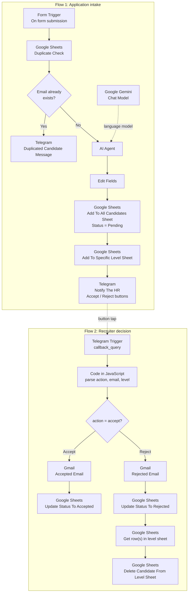

# HR Recruitment AI Agent

An n8n pipeline that receives job applications, classifies each candidate with Gemini, notifies the recruiter on Telegram, and lets the recruiter accept or reject with one button tap.

## Overview

Recruitment teams spend a lot of time on repetitive steps: copying application data, checking for duplicates, sorting candidates by seniority, and sending standard replies. This workflow automates that routine for a **Data Analyst** opening while keeping the final accept/reject decision with a human.

It is useful for small HR teams or hiring managers who collect applications through a form and track candidates in Google Sheets.

## Architecture

## How it works

**Flow 1: Application intake**

1. A candidate submits the "Data Analyst Job Application" form (name, email, phone, skills, experience range, optional note).
2. `Duplicate Check` looks up the email in the `ALL Candidates` sheet.
3. If the email is found, a Telegram message warns the recruiter that a duplicate application was attempted, and the flow stops.
4. Otherwise, the `AI Agent` (Gemini) classifies the candidate as `JUNIOR`, `MID_LEVEL`, `SENIOR` or `EXPERT` and returns `{"level": "..."}`.
5. The candidate is appended to `ALL Candidates` with `Status = Pending`, then to the sheet tab named after the level.
6. The recruiter receives a Telegram message with the candidate summary and two inline buttons: **Accept & Schedule** and **Rejected**.

**Flow 2: Recruiter decision**

1. Tapping a button triggers the Telegram `callback_query` trigger.
2. A Code node reads the action from the callback data, and extracts the candidate email and level from the original message text with regular expressions.
3. **Accept:** a Gmail message is sent to the candidate, then the status in `ALL Candidates` is updated to `Accepted`.
4. **Reject:** a Gmail message is sent, the status is updated to `Rejected`, and the candidate's row is looked up and deleted from the level sheet.

## Tech stack

| Tool | Used for |
|---|---|
| n8n | Workflow orchestration (Form Trigger, Telegram Trigger, If, Set, Code nodes) |
| Google Gemini (via n8n AI Agent node) | Classifying candidates into four seniority levels |
| Google Sheets | Candidate database, per-level tabs, duplicate lookup, status tracking |
| Telegram Bot API | Recruiter notifications and inline Accept/Reject buttons |
| Gmail | Acceptance and rejection emails to candidates |
| JavaScript (Code node) | Parsing the button callback and the Telegram message text |

## Key features and design decisions

- **Strict model output.** The system prompt requires a JSON object with a single `level` key limited to four values, and forbids explanations or extra text. This keeps the downstream sheet routing predictable.
- **Prompt hygiene.** The prompt tells the model to treat candidate-provided content as untrusted, to ignore embedded instructions, and not to use name, email, phone or other personal characteristics for the classification.
- **Duplicate protection.** The email is checked before any AI call or write. `Duplicate Check` has `alwaysOutputData` and `retryOnFail` enabled, so an empty lookup still reaches the `If` node.
- **Dynamic routing by level.** The level-sheet node takes its tab name from the AI result, so there is one node for all four tabs.
- **Human in the loop.** The system never decides on its own: the AI only classifies, and the recruiter confirms each candidate.
- **Defensive parsing.** The Code node tolerates `Email`, `E-mail` and `Candidate Email` labels and several spellings of `MID_LEVEL`, and falls back to `unknown` / `UNKNOWN` instead of throwing.
- **Status lifecycle.** `Pending`, `Accepted` and `Rejected` are tracked in the master sheet.

## Setup

**Accounts needed:** n8n (cloud or self-hosted, reachable over HTTPS for the Telegram trigger), Google account, Telegram bot (via BotFather), Gmail account, Google AI Studio API key.

1. Import `workflow.json` in n8n (**Workflows → Import from file**).
2. Create these credentials and attach them to the matching nodes (the JSON contains the names only):
   - `Google Sheets account` (OAuth2)
   - `Telegram account` (bot token)
   - `Gmail account` (OAuth2)
   - `Google Gemini(PaLM) Api account` (API key)
3. Create a Google spreadsheet with these tabs:
   - `ALL Candidates` with columns `Name, Email, Phone, Skills, Experience, Level, Status`
   - `JUNIOR`, `MID_LEVEL`, `SENIOR`, `EXPERT`, each with columns `Name, Email, Phone, Skills, Experience`
4. Replace the placeholders:

| Placeholder | Where | Replace with |
|---|---|---|
| `YOUR_SHEET_ID` | All Google Sheets nodes | Select your spreadsheet again in each node |
| `YOUR_TELEGRAM_CHAT_ID` | `Notify The HR`, `Duplicated Candidate Message` | The recruiter's Telegram chat ID |
| `[Insert Calendly or Scheduling Link Here]` | `Accepted Email` | Your scheduling link |

5. Activate the workflow and submit a test application using the form's test URL.

## Screenshots

**Recruiter notification in Telegram** (candidate details redacted)

**Candidate sheet** (candidate details redacted). The row shows the final `Rejected` status after a button tap.

## Known issues and possible improvements

These come from reading the workflow JSON; they are worth testing before production use.

- **Level name normalisation.** The Code node converts `MID_LEVEL` to `MID LEVEL` (with a space), and that value is used as the sheet tab name in the reject path (`Get row(s) in sheet`, `Delete Candidate From Level Sheet`). The append step uses `MID_LEVEL`. Keeping one canonical value would make both paths consistent.
- **Email personalisation.** The email templates use a `name` field that the Code node does not output, so the greeting falls back to "Candidate". The acceptance email also contains a fixed sentence about specific skills and a scheduling-link placeholder.
- **Telegram callback.** `callback_query_id` is extracted but no node acknowledges the callback, so the recruiter gets no confirmation and the buttons stay active. Telegram also limits `callback_data` to 64 bytes, which a long email plus level could exceed.
- **Double decisions.** The current status is not checked before sending an email, so pressing both buttons would send two emails.
- **Data stored.** The `Note` field is used by the AI but not saved to the sheet; `Skills` and `Experience` are stored wrapped in quotes.
- **Error handling.** There is no error workflow or retry on the Gmail, Telegram and Gemini steps.
- **Scale.** The prompt and form are specific to a Data Analyst role; parameterising the role would make the pipeline reusable.
