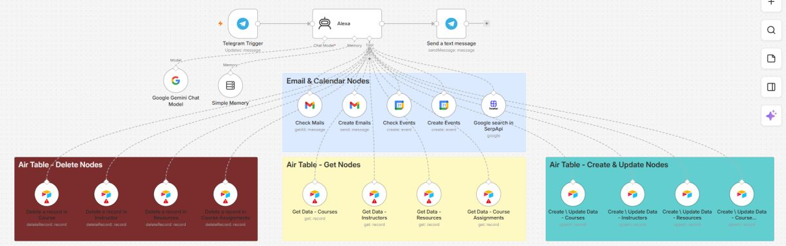
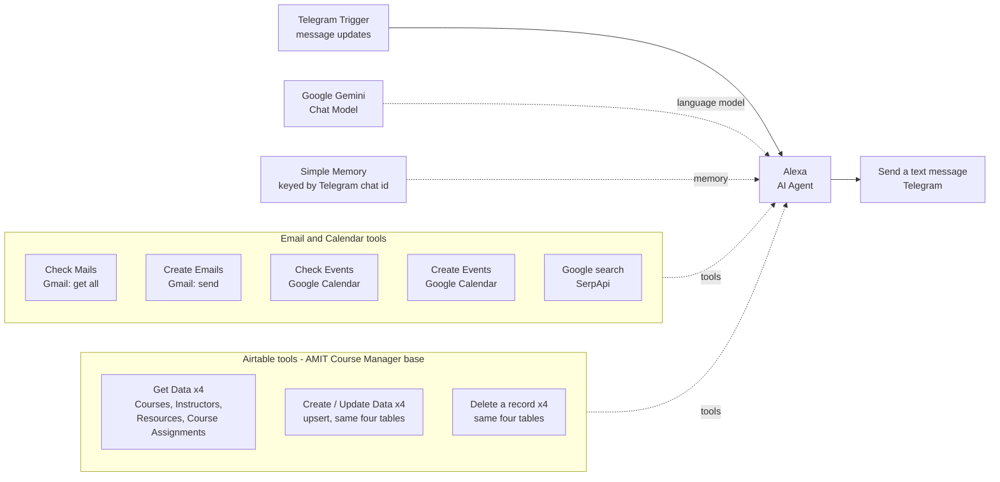

# Alexa Assistant V2

[← Back to portfolio](../README.md)

## 1. Project Overview

A Telegram-based AI agent built in n8n that uses Google Gemini to manage email, calendar events, web search and a four-table Airtable course database from a single chat. The agent is configured as a project-manager-style assistant named *Alexa*.



## 2. Business Problem

Managing an inbox, a schedule and a small course-management database (courses, instructors, resources and course assignments) normally means switching between several apps. This assistant is designed for a single user who wants to handle all of it through one conversational interface.

## 3. Proposed Solution

Alexa Assistant V2 extends a simple chat assistant into a tool-using agent. Instead of only replying to messages, the agent decides which external system to call (Gmail, Google Calendar, SerpApi or Airtable) and runs the action on the user's behalf.

## 4. System Architecture



## 5. Key Features

- **Tool-calling agent.** All integrations are attached to the agent as tools, so the model chooses the action instead of following a fixed branch.
- **Prompt-level safeguards.** The system prompt instructs the agent to draft rather than send unless explicitly asked, to ask for missing details, to check the calendar before claiming availability, and to report tool failures instead of assuming success.
- **Airtable tool coverage.** Each of the four tables has a dedicated get, upsert and delete tool, and the upsert tools expose their fields to the model through n8n's `$fromAI` mechanism. The get and delete tools still need their record lookup configured (see Possible improvements).
- **Grounded answers.** For database questions the prompt tells the agent to query Airtable first and not to guess missing information.
- **Per-chat memory.** Memory is keyed by the Telegram chat id.
- **Readable canvas.** Tools are grouped with colour-coded sticky notes (email and calendar, Airtable get, create and update, delete).

## 6. Technology Stack

| Tool / service | Role in this workflow |
|---|---|
| n8n | Workflow orchestration and AI Agent node |
| Telegram | Chat interface (trigger and reply) |
| Google Gemini | Language model powering the agent |
| Simple Memory (window buffer) | Conversation memory per Telegram chat |
| Gmail | Read recent emails and send emails |
| Google Calendar | Calendar event tools |
| SerpApi | Google web search tool |
| Airtable | Course database: Courses, Instructors, Resources, Course Assignments |

## 7. Workflow Execution

1. **Telegram Trigger** starts the workflow whenever a new message update arrives.
2. The message text is passed to the **Alexa** agent as the user prompt.
3. The agent runs on **Google Gemini** and follows a detailed system prompt that defines its role (a professional project manager named Alexa), when to use each tool, and rules such as only sending an email when explicitly asked, checking for conflicts before creating events, and never inventing data.
4. **Simple Memory** keeps conversation context, using the Telegram chat id as the session key.
5. The agent selects from 17 connected tools: two Gmail tools, two Google Calendar tools, one SerpApi search tool and twelve Airtable tools (get, upsert and delete for each of four tables).
6. The agent's output is cleaned (asterisks removed, `<`, `>` and `&` escaped) and returned through the **Send a text message** Telegram node.

## 8. Project Structure

```text
alexa-assistant-v2/
├── README.md
├── workflow.json            # n8n export (import this file)
└── assets/
    └── alexa-assistant-v2.png
```

## 9. Installation & Configuration

1. In n8n, choose **Import from File** and select `workflow.json`.
2. Create these credentials (names only; no secrets are included in this repository):
   - Telegram account (Telegram API)
   - Google Gemini (PaLM) API
   - Gmail account (OAuth2)
   - Google Calendar account (OAuth2)
   - SerpApi account
   - Airtable Personal Access Token account
3. Open each node and select your credential in place of `REPLACE_WITH_YOUR_CREDENTIAL`.
4. Replace the remaining placeholders:
   - `YOUR_TELEGRAM_CHAT_ID` in **Send a text message**
   - `YOUR_AIRTABLE_BASE_ID` and `YOUR_AIRTABLE_TABLE_ID` in every Airtable node (select your own base and the matching table in each node)
5. Create an Airtable base with Courses, Instructors, Resources and Course Assignments tables whose fields match the nodes' field mappings.
6. Activate the workflow and message your Telegram bot.

## 10. Screenshots & Demonstrations


## 11. Limitations & Future Improvements

- Review the two Google Calendar tool nodes so that the checking tool uses a read operation and the creating tool also maps event details such as the title.
- Reply to the chat that sent the message by reading the chat id from the trigger instead of a fixed value.
- Complete the record lookup and delete configuration on the Airtable get and delete tools.
- Add a confirmation step before delete operations.
- Add error handling and logging for failed tool calls.

## 12. Project Status

Workflow exported and documented. Several tool nodes need configuration review (see above) before reliable use. No deployment or usage metrics are claimed.
