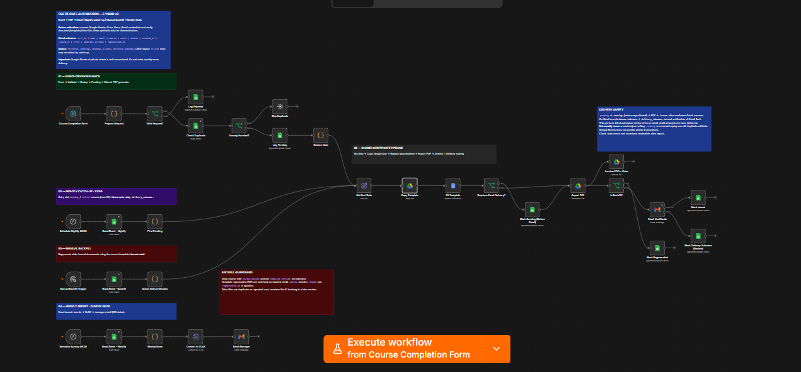
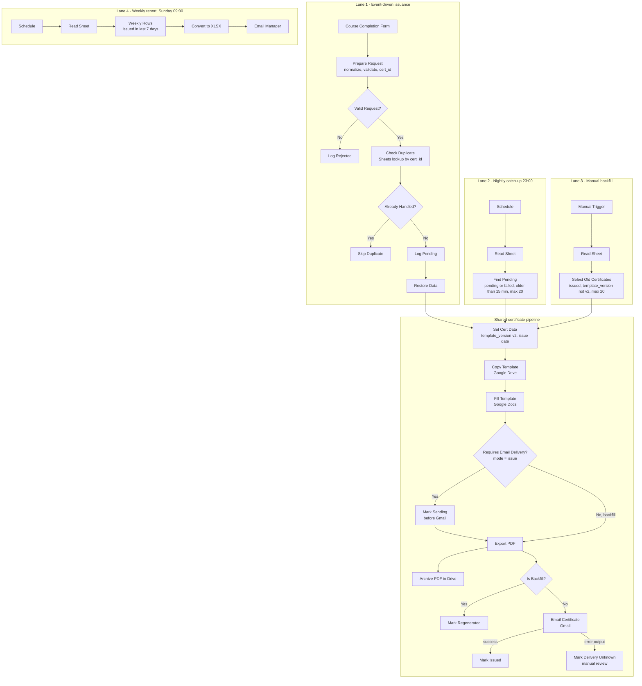
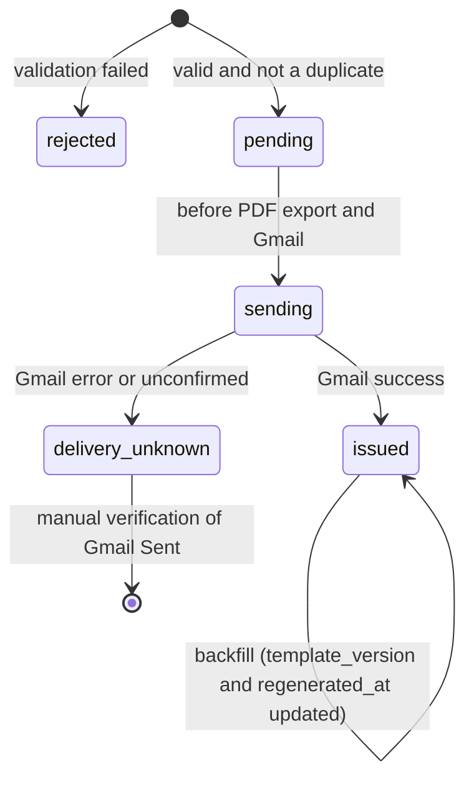
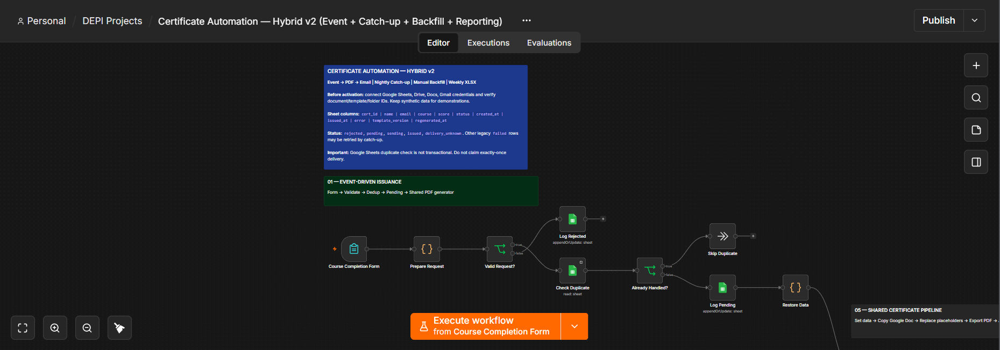
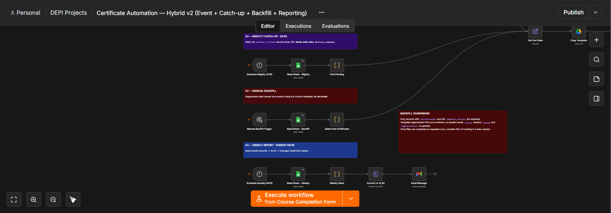
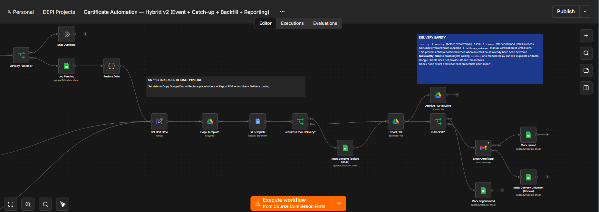
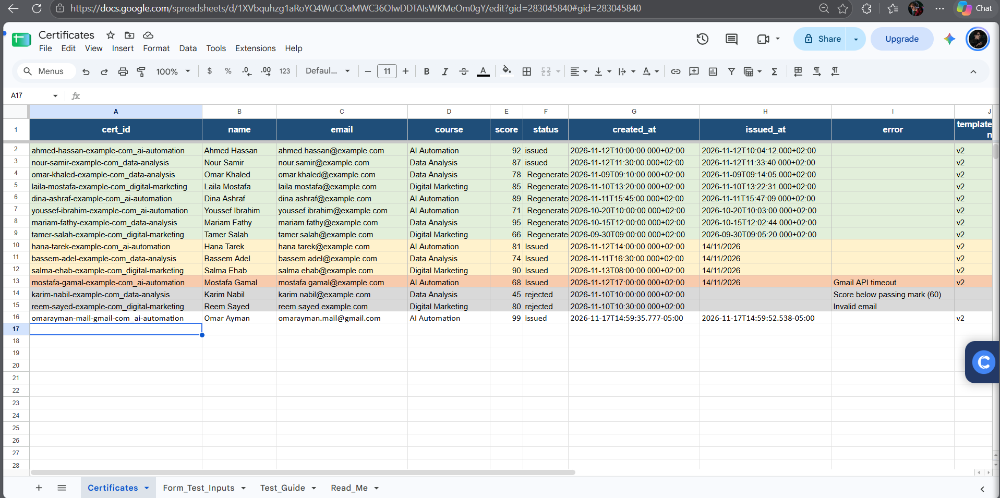
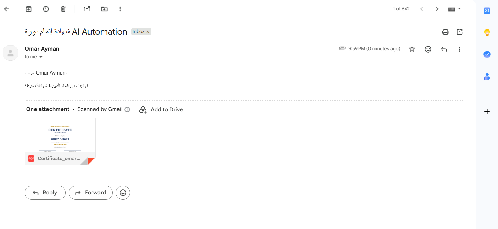
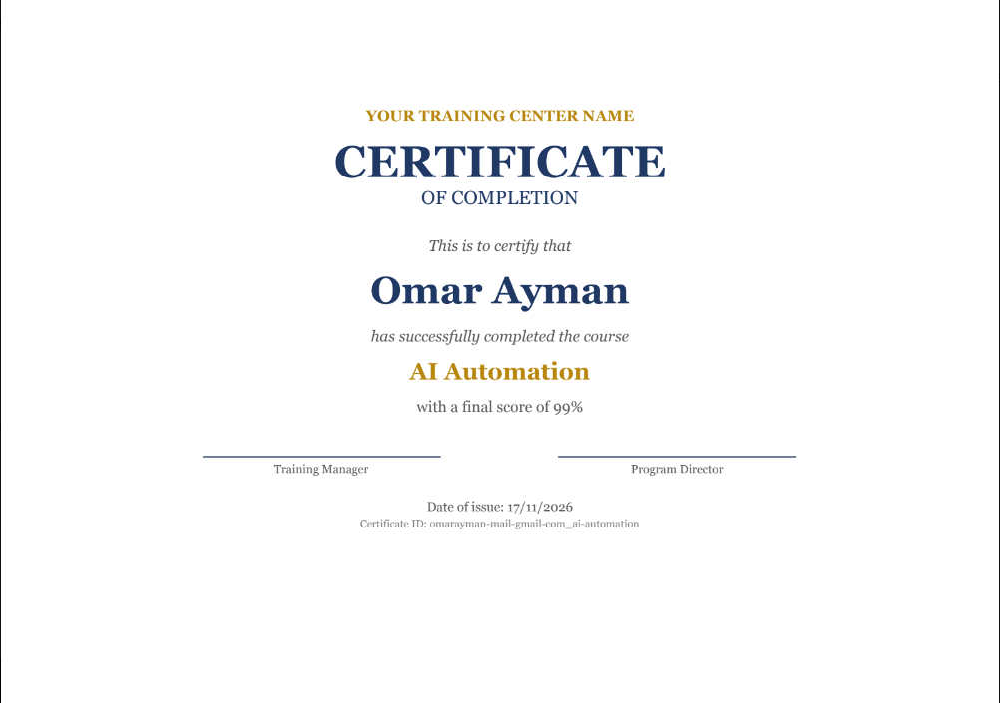
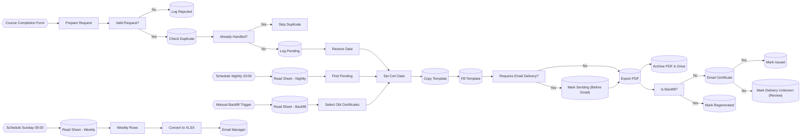

# Certificate Automation System — Hybrid v2

[← Back to portfolio](../README.md)

## 1. Project Overview

An n8n workflow that issues course-completion certificates. A trainer submits a form, the workflow validates the request, checks for duplicates, records it in a Google Sheets status ledger, generates a PDF certificate from a Google Docs template and emails it to the trainee. Three more lanes live in the same workflow: a nightly catch-up for unfinished requests, a manual backfill that regenerates older certificates with a newer template, and a weekly XLSX report emailed to a manager.

The design goal is safe delivery rather than raw speed: the ledger records `sending` before the email is attempted and `delivery_unknown` when Gmail's outcome is uncertain, so the workflow never retries an email that may already have been delivered. The canvas screenshots show it in the author's *DEPI Projects* n8n folder. The additional demonstration captures below show one successful certificate issuance with a ledger entry, delivered Gmail attachment, and generated PDF.



## 2. Business Problem

A training provider that issues certificates by hand has to edit a document per trainee, export it, email it and remember who has already received one. That is slow, and mistakes are easy: a trainee gets two certificates, none, or one with an outdated design.

Automating it creates its own risk. If an email send fails halfway, a naive retry can send the same certificate twice, and a spreadsheet used as a database gives no transactions. The workflow is built around those two problems.

## 3. Proposed Solution

1. **Issue.** A form submission is validated (name, email format, score 60–100), checked against the ledger by `cert_id`, logged as `pending`, then passed to a shared certificate pipeline.
2. **Generate.** The pipeline copies a Google Docs template, replaces the placeholders, exports a PDF and archives it in Drive.
3. **Deliver safely.** The status moves `pending → sending → issued` around the Gmail step. A Gmail error moves it to `delivery_unknown` for manual verification instead of retrying.
4. **Recover.** A nightly run re-processes old `pending` rows (max 20). It deliberately ignores `sending` and `delivery_unknown`.
5. **Regenerate.** A manual run rebuilds `issued` certificates whose `template_version` is outdated, archives the new PDFs and does **not** email anyone.
6. **Report.** Every Sunday the workflow emails a manager an XLSX of certificates issued in the last 7 days.

## 4. System Architecture



Status model kept in the `status` column of the ledger sheet:



## 5. Key Features

- **Validation before anything is written to a document:** name required, email format, numeric score between 60 and 100. Invalid requests are logged as `rejected` with the reason.
- **Duplicate protection:** `cert_id` is built from the email and course; `issued`, `pending`, `sending`, `delivery_unknown` (and `regenerated`) rows are skipped.
- **Delivery-safety status model:** `sending` is written before Gmail, `issued` only after Gmail reports success, and an error goes to `delivery_unknown` with a note to check Gmail Sent.
- **One shared pipeline for three lanes.** Form, nightly catch-up and backfill all go through the same `Set Cert Data → Copy Template → Fill Template → Export PDF` chain, distinguished by a `mode` field (`issue` or `backfill`).
- **Backfill that never emails.** `Is Backfill?` routes regenerated PDFs to `Mark Regenerated` and away from `Email Certificate`.
- **Bounded batches:** nightly catch-up and backfill each handle at most 20 rows per run.
- **Weekly XLSX report** with legacy `dd/MM/yyyy` dates handled and an explicit "No certificates issued this week" case.
- **Self-documenting canvas:** eight sticky notes explain setup, lanes, delivery safety and backfill guardrails.

## 6. Technology Stack

| Tool | Used for |
|---|---|
| n8n | Form Trigger, Schedule Trigger (x2), Manual Trigger, Code, IF, Set, No-Op, Convert to File |
| Google Sheets | Status ledger (10 nodes: lookups, appends/updates, reads) |
| Google Docs | Certificate template with `{{name}}`, `{{course}}`, `{{score}}`, `{{date}}`, `{{cert_id}}` |
| Google Drive | Copy the template, export the PDF, archive it in a folder |
| Gmail | Certificate delivery (with PDF attachment) and the weekly manager report |
| JavaScript | Four Code nodes: request normalization, catch-up selection, backfill selection, weekly filtering |

No AI nodes, webhooks with signature checks or external APIs are used.

## 7. Workflow Execution

### Lane 1 — Event-driven issuance

1. `Course Completion Form` collects Full Name, Email, Course (AI Automation / Data Analysis / Digital Marketing) and Score. The form title and description are in Arabic.
2. `Prepare Request` trims and lower-cases the input, builds `cert_id` as `<email slug>_<course slug>` and sets `valid` / `error`.
3. `Valid Request?` sends invalid items to `Log Rejected` (a unique `rejected_<id>_<timestamp>` row) and valid ones to `Check Duplicate`.
4. `Already Handled?` skips existing records via `Skip Duplicate`; otherwise `Log Pending` writes the row and `Restore Data` restores the request data for the shared pipeline.

### Lane 2 — Nightly catch-up (23:00)

`Find Pending` selects rows with status `pending` or `failed` whose `created_at` is older than 15 minutes (or unreadable), up to 20. They re-enter the shared pipeline in `issue` mode. Rows in `sending` or `delivery_unknown` are intentionally excluded.

### Lane 3 — Manual backfill

`Select Old Certificates` selects `issued` rows whose `template_version` is not `v2` (optional course filter in the code), up to 20, in `backfill` mode.

### Lane 4 — Weekly report (Sunday 09:00)

`Weekly Rows` keeps `issued` rows from the last 7 days → `Convert to XLSX` (`weekly_certificates.xlsx`) → `Email Manager` with the count in the body.

### Shared pipeline

`Set Cert Data` (adds `template_version: v2` and an `issue_date` in `dd/MM/yyyy`) → `Copy Template` → `Fill Template` (five placeholder replacements) → `Requires Email Delivery?`. In `issue` mode, `Mark Sending (Before Gmail)` runs before `Export PDF`. After the export, `Archive PDF in Drive` and `Is Backfill?` run. Issue mode continues to `Email Certificate` (retry off, error output enabled), then `Mark Issued` or `Mark Delivery Unknown (Review)`. Backfill mode goes to `Mark Regenerated`.

### Status reference

| Status | Written by | Meaning |
|---|---|---|
| `rejected` | `Log Rejected` | Failed validation; reason in `error` |
| `pending` | `Log Pending` | Accepted, not yet processed |
| `sending` | `Mark Sending (Before Gmail)` | PDF export and email in progress or interrupted |
| `issued` | `Mark Issued`, `Mark Regenerated` | Delivered, or regenerated by backfill |
| `delivery_unknown` | `Mark Delivery Unknown (Review)` | Gmail errored or was unconfirmed; check Sent before retrying |
| `failed` | *(nothing in this workflow)* | Legacy value; catch-up still retries it |

### Ledger sheet columns

`cert_id | name | email | course | score | status | created_at | issued_at | error | template_version | regenerated_at`

## 8. Project Structure

```text
certificate-automation-system/
├── README.md
├── workflow.json                         # sanitized n8n export (inactive, no credentials)
├── assets/
│   ├── canvas-1-event-driven-issuance.png
│   ├── canvas-2-catchup-backfill-report.png
│   ├── canvas-3-shared-pipeline-delivery-safety.png
│   ├── demo-1-certificates-ledger.png
│   ├── demo-2-gmail-certificate-delivery.png
│   ├── demo-3-generated-certificate-pdf.png
│   └── demo-4-complete-workflow-v2.png
└── tests/
    ├── run-code-node-tests.js            # offline logic tests (node)
    └── OFFLINE_TEST_REPORT.md            # generated report
```

## 9. Installation & Configuration

**Accounts needed:** an n8n instance, a Google account (Sheets, Docs, Drive) and a Gmail account. Use synthetic data until everything works.

1. Create a Google Sheet with a tab named `Certificates` and the header row from the ledger columns above.
2. Create a Google Docs certificate template that contains the placeholders `{{name}}`, `{{course}}`, `{{score}}`, `{{date}}` and `{{cert_id}}`. Create a Drive folder for the generated PDFs.
3. Import `workflow.json` in n8n (**Workflows → Import from file**). The workflow is inactive and the export contains no credential blocks.
4. Create Google OAuth2 credentials (Sheets, Drive, Docs) and a Gmail credential, and attach them to the matching nodes.
5. Replace the placeholders and re-select the resources the nodes point to:

| Placeholder | Where | Replace with |
|---|---|---|
| `REPLACE_WITH_RESOURCE_ID` (spreadsheet) | The 10 Google Sheets nodes (`documentId`) | Your ledger spreadsheet |
| Sheet tab selection | Same nodes | The `Certificates` tab. `Log Rejected` selects the tab **by name**, the others **by tab ID**: all must point to the same tab |
| `REPLACE_WITH_RESOURCE_ID` (file) | `Copy Template` | Your Google Docs template |
| `REPLACE_WITH_RESOURCE_ID` (folder) | `Archive PDF in Drive` | Your PDF archive folder |
| `REPLACE_WITH_MANAGER_EMAIL` | `Email Manager` | The report recipient |

6. The form uses a fixed demo path (`certificate-demo-…`); set your own path in `Course Completion Form`. The export configures **no authentication on the form**, so anyone with the URL can submit. Restrict it before real use.
7. Set the n8n instance timezone. The cron schedules (`0 23 * * *`, `0 9 * * 0`) and the certificate date use it; the export stores none.
8. Test with one synthetic submission, then a repeat of the same one (should be skipped), then check each status in the sheet before activating.

## 10. Screenshots & Demonstrations

The complete workflow canvas is shown at the top of this README. The additional canvas captures below zoom into the main parts of the design, and the demonstration screenshots show one example output from a successful certificate issuance. The screenshots **do not** independently establish recovery behavior, delivery-timeout handling, concurrent-request safety, catch-up execution, backfill execution, or reporting execution. No execution log export or failure-injection recording is included.

### Workflow canvas details

**1. Event-driven issuance lane.** The form intake path validates the request, checks duplicates, logs `pending`, and hands the data to the shared certificate pipeline.



**2. Catch-up, backfill, and weekly report lanes.** These scheduled and manual paths handle unfinished rows, controlled regeneration, and weekly reporting.



**3. Shared pipeline and delivery safety.** The shared section covers template copy/fill, PDF export, archival, email delivery, and delivery-safety status handling.



### Demonstrated output — certificate issuance

These three captures are from a demonstration run with sample certificate data. They supplement the architecture diagrams rather than replace executable evidence.

**1. Google Sheets certificate ledger.** The newest visible row is recorded as `issued` with an ISO timestamp and template version `v2`. Other rows in the sheet are test fixtures or earlier data; the screenshot does not demonstrate those individual scenarios being executed.



**2. Gmail delivery.** The inbox shows the certificate email received with one PDF attachment. This illustrates a successful delivery outcome, not a timeout or retry test.



**3. Generated PDF.** The PDF preview shows the recipient name, course, score, date, and certificate ID populated in the certificate template.



> **Privacy note:** Demo screenshots may show the author's email address, Google document IDs, and account UI. Review/redact these details before making the images public if you do not want them disclosed. No OAuth access tokens or passwords appear in the workflow JSON export.

**Offline logic tests.** `node tests/run-code-node-tests.js` runs the four Code nodes and the duplicate-check expression with synthetic rows and checks the node wiring (32 checks, report in [OFFLINE_TEST_REPORT.md](tests/OFFLINE_TEST_REPORT.md)). They cover validation boundaries, catch-up and backfill selection, report date handling, the status written at each step, and that the backfill path cannot reach the email node. They are not an n8n run: Sheets, Drive, Docs and Gmail are never called.

## 11. Limitations & Future Improvements

**Known limitations**

- **Not exactly-once.** Google Sheets has no transactions. A crash before `sending` is written, two simultaneous submissions for the same trainee, or a manual replay can still duplicate artifacts.
- **Failures after `sending` need a human.** `Export PDF`, `Archive PDF in Drive` and the Sheets update nodes have no error branch in the export, so a failure there stops the run with the row left in `sending`, and neither the nightly catch-up nor the duplicate check will retry it. (Inferred from the export; not observed in an execution.)
- **`delivery_unknown` is manual.** Someone must check Gmail Sent and fix the row.
- **Temporary Google Docs copies are never deleted.** Each run leaves a `Certificate_<cert_id>` document in Drive next to the PDF. Repeated backfills also create duplicate PDFs.
- **`cert_id` can collide.** Different emails such as `a.b@x.com` and `a-b@x.com` produce the same ID, and the second trainee would be treated as a duplicate. The same person can only receive one certificate per course.
- **Public form.** No authentication is configured on the form trigger.
- **Personal data.** The weekly report emails names and email addresses as an attachment to the manager.
- **Backfill does not deliver.** Regenerated PDFs are archived but not sent to trainees.
- **Legacy values.** Nothing in the workflow writes `failed` or `regenerated`, though catch-up and the duplicate check still recognize them.
- **Schedules and dates depend on the instance timezone**, which the export does not store.
- **Arabic-only text.** The form, email subject and body are fixed Arabic strings.

**Possible improvements**

- Add error branches to `Export PDF`, `Archive PDF in Drive` and the final Sheets updates that write `delivery_unknown` or `failed` and alert the operator.
- Track generated Drive file IDs to avoid duplicate PDFs, and delete the temporary Docs copy.
- Use a collision-proof `cert_id` (for example a hash of normalized email and course).
- Protect the form with authentication and add an n8n error workflow.
- Replace the sheet with a database that enforces a unique key.
- Record a reproducible end-to-end execution (with run logs and synthetic data), including recovery and delivery-timeout injection; the screenshots here show one successful issuance outcome only.

## 12. Project Status

Sanitized export of a demonstrated prototype, documented from the workflow file. The export is inactive, contains placeholders instead of resource IDs and has no credential blocks. Its Code nodes and wiring pass **32 offline checks**. Added screenshots show one example of successful PDF generation, Gmail delivery, and an `issued` ledger entry. There is still no saved n8n execution log or independently reproduced end-to-end test in this repository, and **no verified concurrency, catch-up, backfill, or delivery-timeout failure-injection test**. This is a portfolio prototype; no production deployment or business metrics are claimed.


## Architecture Diagram



