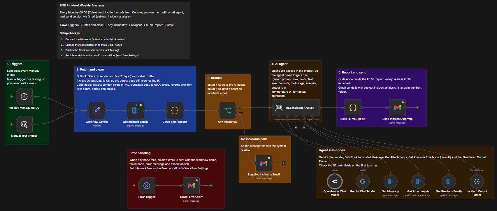
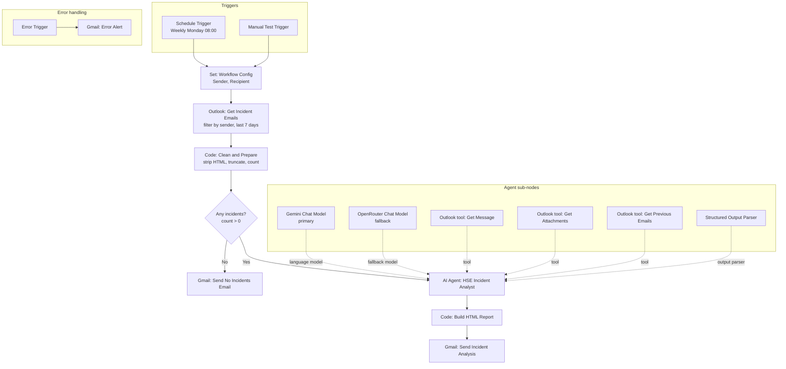
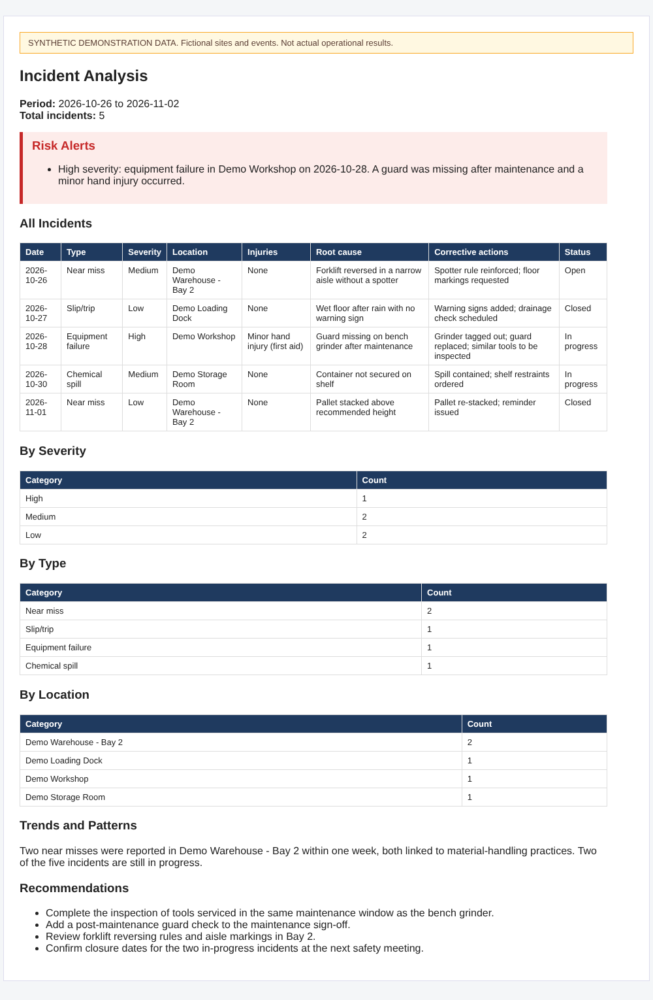
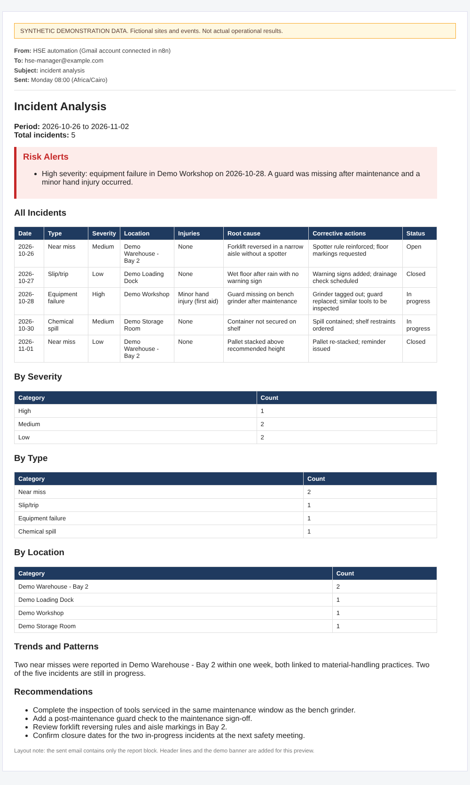

# HSE Incident Weekly Analysis

> **Team Project.** This workflow was developed collaboratively. See [Team & Collaboration](#team--collaboration).

[← Back to portfolio](../README.md)

## 1. Project Overview

An n8n workflow that reads a week of incident notification emails from Outlook, has an AI agent turn them into a structured safety analysis, and emails an HTML report through Gmail every Monday at 08:00 (Cairo time).



## 2. Business Problem

HSE (Health, Safety and Environment) managers receive incident notifications by email and usually compile weekly summaries by hand: extracting dates, severities and root causes, counting incidents, and looking for repeated problems. The work is repetitive and the output varies from week to week.

The workflow is aimed at HSE managers and safety teams who receive structured incident emails from a known sender and want a consistent weekly overview, including risk alerts and recommendations.

## 3. Proposed Solution

A scheduled n8n workflow fetches the last seven days of emails from the incident sender, cleans and size-limits them, and passes them to an AI agent (the *HSE Incident Analyst*). The agent returns JSON that is validated against a schema and rendered into an HTML report. A "no incidents" branch and a dedicated error path keep the owner informed when the week is empty or a step fails.

## 4. System Architecture



## 5. Key Features

- **Deterministic input.** Emails are filtered by sender in Outlook and again in code, then cleaned and size-limited before the model sees them.
- **All emails in the prompt.** The emails are passed directly to the agent, so it does not depend on tool calls to find them. Tools are only for extra detail.
- **No guessing.** The system prompt requires `Not specified` for any missing field and forbids using outside knowledge.
- **Structured output.** A manual JSON schema with required fields keeps the downstream report builder predictable.
- **Trend comparison without double counting.** Previous-period emails (up to 20) are used only for trends, never in the totals.
- **Model fallback.** Gemini is the primary model; OpenRouter is the fallback.
- **Bounded agent loop.** `maxIterations` is set to 12.
- **Safe rendering.** Every value placed in the HTML report is escaped.
- **Heartbeat.** An empty-week email confirms the workflow is running.
- **Resilience.** `retryOnFail` is enabled on the Outlook fetch and the Gmail nodes, and a dedicated error path alerts the owner.

## 6. Technology Stack

| Tool | Used for |
|---|---|
| n8n | Orchestration: Schedule, Manual, Set, If, Code, Error Trigger and AI Agent nodes |
| Microsoft Outlook | Reading incident emails; also exposed to the agent as three tools |
| Google Gemini (`models/gemini-3.1-flash-lite`) | Primary language model for the agent, temperature 0.1 |
| OpenRouter (`openrouter/free`) | Fallback language model, temperature 0.1 |
| Gmail | Sending the weekly report, the no-incidents notice and error alerts |
| JavaScript (Code nodes) | Email cleaning and the HTML report builder |

## 7. Workflow Execution

1. **Trigger.** A schedule fires every Monday at 08:00 (workflow timezone `Africa/Cairo`). A manual trigger feeds the same path for testing.
2. **Configuration.** `Workflow Config` holds the `Sender` address whose emails are treated as incident notifications.
3. **Fetch.** `Get Incident Emails` reads all Outlook messages from that sender received in the last 7 days (read and unread). It retries on failure and always outputs data so an empty week still continues.
4. **Clean and prepare.** A Code node re-checks the sender and date, removes scripts, styles and HTML tags, decodes common entities, truncates each body to 6,000 characters and returns one item with `count`, the period dates and the cleaned emails.
5. **Branch.** If `count` is 0, a short "no incidents" email is sent. Otherwise the flow continues.
6. **Analyse.** The `HSE Incident Analyst` agent extracts date, type, severity, location, injuries, root cause, corrective actions and status for each incident; counts incidents by severity, type and location; flags repeated issues; raises risk alerts for High and Critical incidents; and gives 3 to 5 recommendations. It can call Outlook tools to open a full message, list attachments or fetch earlier emails for trend comparison.
7. **Validate.** A structured output parser enforces a JSON schema.
8. **Report.** A Code node builds an HTML report (summary, risk alerts, incident table, count tables, trends, recommendations).
9. **Send.** Gmail sends the report with the subject `incident analysis`.
10. **On failure.** Any failing node triggers the error path, which emails the workflow name, failed node, error message and execution link.

## 8. Project Structure

```text
hse-incident-weekly-analysis/
├── README.md
├── workflow.json            # n8n export (import this file)
├── samples/                 # synthetic demo report, HTML preview, email layout
└── assets/
    ├── n8n-workflow-canvas.png
    ├── sample-report-preview.png
    └── sample-email-preview.png
```

## 9. Installation & Configuration

**Accounts needed:** n8n, Microsoft account with Outlook access, Google account for Gmail, Google AI Studio API key, OpenRouter API key.

1. Import `workflow.json` in n8n (**Workflows → Import from file**).
2. Create these credentials and attach them to the matching nodes (the JSON contains names only):
   - `Microsoft Outlook account` (OAuth2): `Get Incident Emails`, `Get Message`, `Get Attachments`, `Get Previous Emails`
   - `Gmail account 3` (OAuth2): `Send Incident Analysis`, `Send No Incidents Email`, `Gmail: Error Alert`
   - `Google Gemini(PaLM) Api account` (API key)
   - `OpenRouter account` (API key)
3. Replace the placeholders:

| Placeholder | Where | Replace with |
|---|---|---|
| `incident-reports@example.com` | `Workflow Config` → `Sender` | The address that sends the incident emails |
| `you@example.com` | `Workflow Config` → `Recipient` | Your address (see Limitations) |
| `you@example.com` | `Gmail: Error Alert` → To | The address that should receive failure alerts |

4. In **Workflow Settings**, select this workflow as its own **Error workflow**, and confirm the timezone.
5. Publish the Gmail OAuth consent screen (not "Testing"), as noted on the canvas.
6. Run the **Manual Test Trigger** once, check the `$fromAI` fields of the three Outlook tools, then publish the workflow.

## 10. Screenshots & Demonstrations

The canvas screenshot in the overview shows the full workflow, including the error-handling path.

**Sample weekly report** (synthetic demonstration data, not actual operational results)



**Sample management email layout** (synthetic demonstration data)



Source files and an explanation of the report structure are in [`samples/`](samples/README.md).

## 11. Limitations & Future Improvements

- **Recipient field is unused.** `Workflow Config` defines `Recipient`, but both report nodes send to `Sender`.
- **Attachments.** The prompt asks the agent to name attachments, but the output schema has no dedicated attachments field.
- **Input size.** Each email is truncated to 6,000 characters, but the number of emails in one prompt is not limited.
- **Report subject.** The subject is fixed (`incident analysis`); adding the period dates would make reports easier to find.
- **Fallback model.** The fallback uses a free router model; pinning a specific model would give more predictable output.
- **Error alerts.** The alert recipient is hardcoded in the node and the error workflow must be set manually after import.
- **History.** Reports are only emailed; storing structured results (for example in a sheet or database) would allow dashboards and long-term trends.

## 12. Project Status

Workflow exported and documented. Setup steps above are required before it can run. This repository contains no evidence of a live deployment or measured results, so none are claimed.

## Team & Collaboration

**HSE Incident Weekly Analysis is a team project**, developed collaboratively by:

1. Abdullah Mohamed Abdullah Mohamed
2. Abdalla Mohamed Abdalla Awad
3. Ali Ashour Ali Mohamed
4. Amin Reda Amin Mahmoud
5. Menatallah Ibrahim Hassan Muhammed

**Team work vs. individual portfolio ownership.** The workflow design and implementation documented here are the result of team collaboration and are not presented as individual work by the repository owner. This repository is a personal portfolio, and this project is included as a documented team project. Individual responsibilities of team members are not described, because they are not recorded in the repository files.
