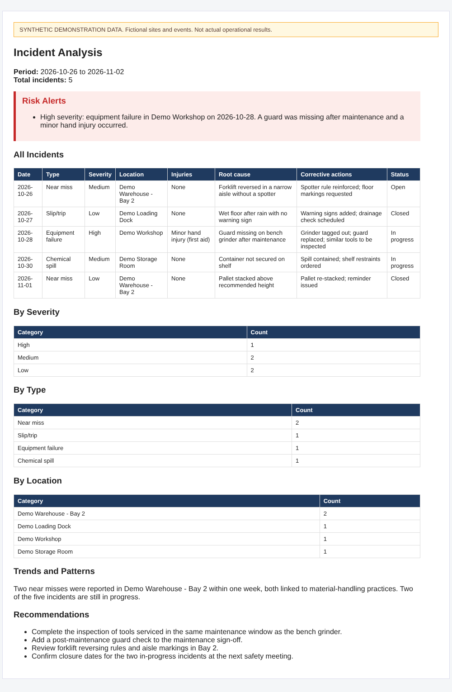
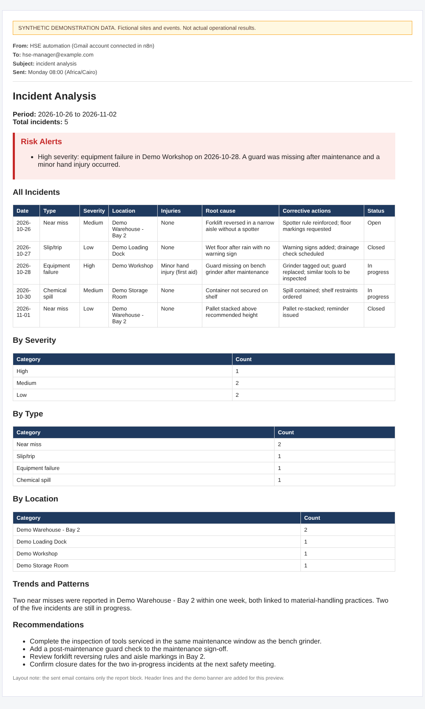

# HSE Sample Report (Demonstration Data)

[← Back to HSE Incident Weekly Analysis](../README.md) · *Team Project*

> **All content in this folder is synthetic.** Sites, incidents, counts and recommendations are invented to show the report layout. They are **not** actual operational results, and no real incident data is used.

## Files

| File | Purpose |
|---|---|
| [`sample-report.json`](sample-report.json) | Synthetic agent output in the schema enforced by the workflow's `Incident Output Parser` |
| [`sample-report.html`](sample-report.html) | Browser preview of the report. The report block was produced by running the workflow's own `Build HTML Report` code on the sample JSON |
| [`sample-email.html`](sample-email.html) | The same report inside a mock email header (From, To, Subject, Sent) |

Open the HTML files in any browser.

## Report preview

## Management email layout

The sent email contains only the report block. The yellow demo banner and the header lines are added in this preview.

## Report structure

The report is built by the `Build HTML Report` Code node from the agent's validated JSON. Sections appear in this order:

| # | Section | Source field | Notes |
|---|---|---|---|
| 1 | Heading, period and total | `period`, `total_incidents` | Missing values are shown as `Not specified` |
| 2 | Risk Alerts (red box) | `risk_alerts` | Shown only when the list is not empty; the prompt asks for alerts on High and Critical incidents |
| 3 | All Incidents table | `incidents[]` | Date, Type, Severity, Location, Injuries, Root cause, Corrective actions, Status |
| 4 | By Severity / By Type / By Location | `by_severity`, `by_type`, `by_location` | Category and count tables |
| 5 | Trends and Patterns | `trends_and_patterns` | Free text; previous-period emails inform trends but are not counted in totals |
| 6 | Recommendations | `recommendations` | The prompt asks for 3 to 5 items |

Every value is HTML-escaped before it enters the report. Other emails sent by the workflow: a short "no incidents" notice (when the weekly count is 0) and a plain-text error alert.

## Honesty notes

- The sample JSON was written by hand to match the schema. It was not generated by the AI model.
- The workflow's subject line is fixed as `incident analysis`, and the recipient is the `Sender` address (see the project's limitations).
- Sample addresses use `example.com`.
