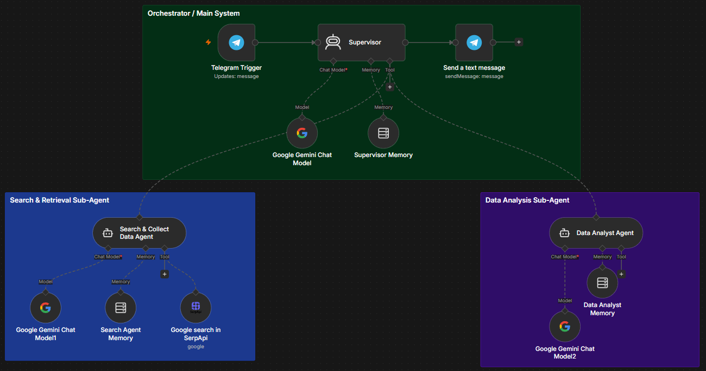
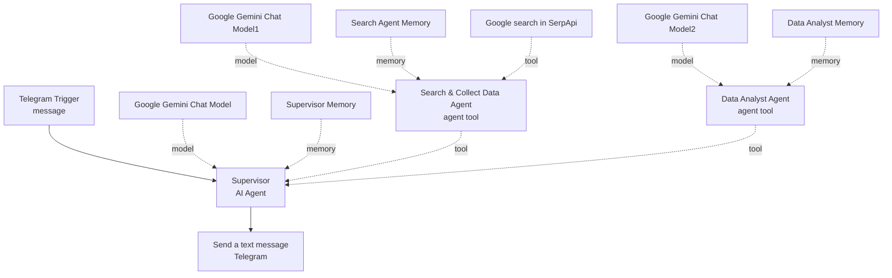

# Multi-Agent Patterns

[← Back to portfolio](../README.md)

n8n workflows that coordinate several AI agents. This folder currently documents one pattern: a supervisor agent that delegates to a research sub-agent and an analyst sub-agent.

| Pattern | Folder | Summary |
|---|---|---|
| Supervisor with two specialist sub-agents | [multi-agent-system](multi-agent-system/) | A Telegram-facing supervisor calls a web-search agent, then an analyst agent, to answer marketing questions |

---

# Pattern: Multi-Agent System (supervisor and specialists)

## 1. Project Overview

A Telegram-based multi-agent workflow in n8n where a supervisor agent answers marketing questions by calling a web research agent and a data analyst agent.



## 2. Business Problem

Marketing questions need two different jobs: finding current information and turning it into a short, structured brief. A single agent doing both tends to receive long, competing instructions. The workflow is aimed at someone who wants a quick, sourced marketing brief from a chat message.

## 3. Proposed Solution

Split the jobs between two specialist agents and put a supervisor in front of them, so each agent has one narrow instruction set.

## 4. System Architecture



## 5. Key Features

- **Supervisor pattern.** `Supervisor` receives the user message and calls the two sub-agents as tools (`Search & Collect Data Agent` and `Data Analyst Agent`).
- **Separation of duties.** The search agent's prompt forbids writing a final report, and the analyst's prompt forbids searching, which keeps each agent's task narrow.
- **Structured hand-off.** The search agent's output format (findings, statistics, sources) is what the analyst consumes.
- **Anti-fabrication instructions.** All three prompts tell the agent not to invent information or statistics.
- **Separate model and memory per agent.** `Google Gemini Chat Model`, `Google Gemini Chat Model1` and `Google Gemini Chat Model2` are all set to the same model, and each agent has its own memory node.
- **Telegram-friendly output.** `Send a text message` strips Markdown characters before sending.

## 6. Technology Stack

| Tool / service | Role in this workflow |
|---|---|
| n8n | Workflow orchestration, AI Agent and Agent Tool nodes |
| Google Gemini | Language model for all three agents (`models/gemini-3.5-flash-lite`) |
| SerpApi | Google search tool used by the search agent |
| Telegram | Chat interface (trigger and reply) |
| Simple Memory (window buffer) | One memory per agent, keyed by the Telegram chat id |

Node counts in the export: 15 nodes, of which 12 are functional and 3 are sticky notes (3 chat models, 3 memories, 2 agent tools, 1 supervisor agent, 1 SerpApi tool, 1 Telegram trigger, 1 Telegram send node). Temperature and other model settings are not specified in the export.

## 7. Workflow Execution

1. **Telegram Trigger** receives a message and passes its text to **Supervisor**.
2. **Supervisor** follows its system prompt: understand the request, call the search agent, give the search result to the analyst agent, and return the analyst's report. The prompt forbids the supervisor from searching itself or inventing statistics, and asks for a short answer of about 750 characters.
3. **Search & Collect Data Agent** searches the web through **Google search in SerpApi** and returns a structured result: research question, key findings, important statistics and sources.
4. **Data Analyst Agent** receives that research and writes a report with six sections: executive summary, top marketing trends, important statistics, key insights, marketing implications and sources. It is told not to search and to use only the provided research.
5. **Send a text message** sends the supervisor's output to the chat, after removing the characters `* _ ` # > |` and converting literal `\n` sequences to line breaks.

## 8. Project Structure

```text
multi-agent-patterns/
├── README.md
├── assets/
│   └── multi-agent-system.png
└── multi-agent-system/
    └── workflow.json        # n8n export (import this file)
```

## 9. Installation & Configuration

1. In n8n, choose **Import from File** and select `multi-agent-system/workflow.json`.
2. Create these credentials (names only):
   - Telegram account (Telegram API)
   - Google Gemini (PaLM) API account
   - SerpApi account
3. Replace `REPLACE_WITH_YOUR_CREDENTIAL` on each credential.
4. Check that `Google search in SerpApi` has its search query configured, then activate the workflow and message your Telegram bot.

## 10. Screenshots & Demonstrations


## 11. Limitations & Future Improvements

**Known limitations**

- **`Google search in SerpApi` has no search-query parameter set in the export.** The export shows only empty additional fields and request options.
- **Prompt names differ from node names.** The supervisor prompt refers to "Search Agent" and "Analyst Agent", while the tool nodes are named `Search & Collect Data Agent` and `Data Analyst Agent`.
- **The canvas label "Search & Retrieval Sub-Agent" does not match the node.** It performs web search, not retrieval from a vector store.
- **Competing instructions on length.** The supervisor must return the analyst's report and also keep the answer to about 750 characters, while the analyst is asked for six sections.
- **The sub-agent memory nodes use `$json.message.chat.id` as the session key.** Whether the sub-agents receive that value when called as tools is not shown in the export.
- **Sub-agents have no tools beyond search.** `Data Analyst Agent` has no tools, so it can only work with the text it is given.

**Possible improvements**

- Set the search query on the SerpApi tool so the search agent controls it.
- Align the names used in the prompts with the tool node names.
- Reconcile the length limit with the analyst's six-section format.
- Add a second search tool or a vector store so the search agent can compare sources.
- Add error handling for failed searches.

## 12. Project Status

Workflow exported and documented. One pattern is available. The SerpApi tool's search query is not configured in the export, so confirm it before use. No deployment or quality metrics are claimed.
