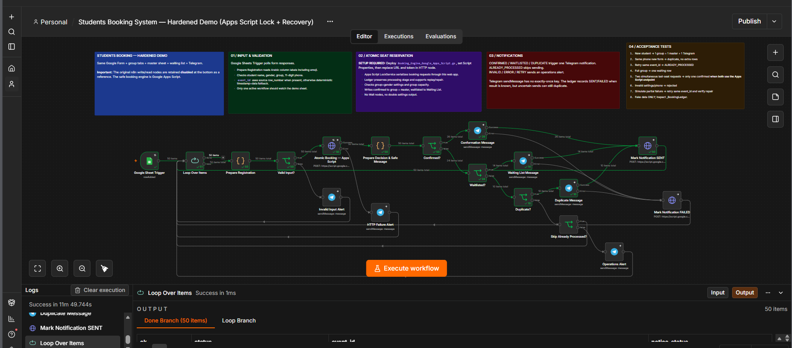
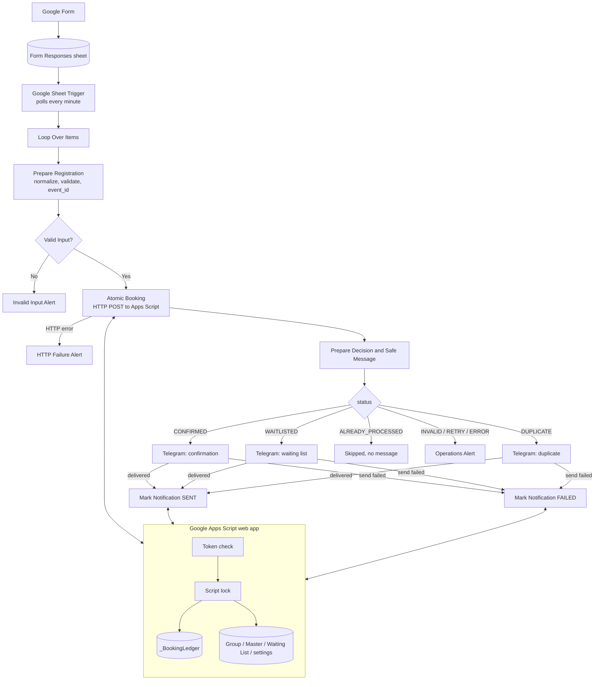
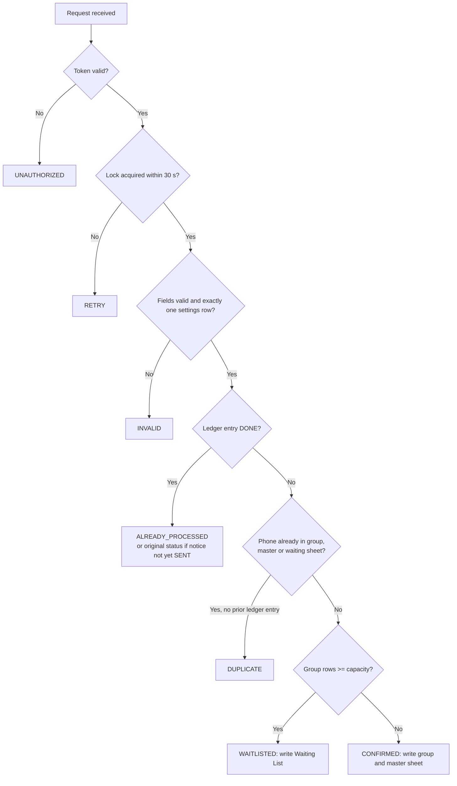
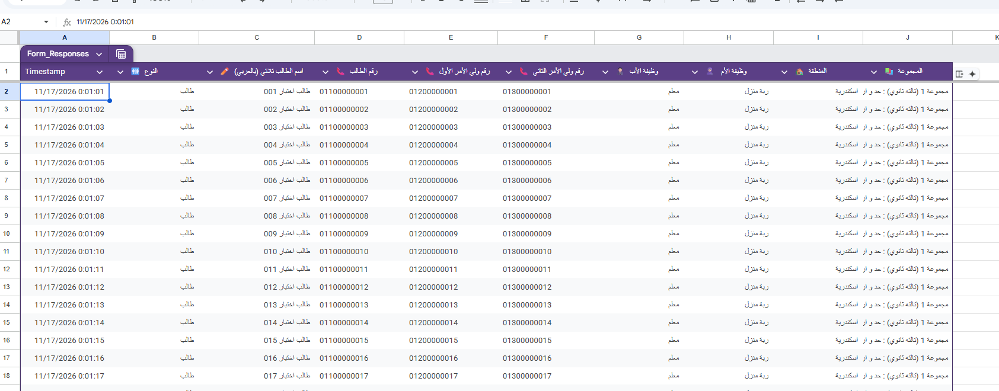
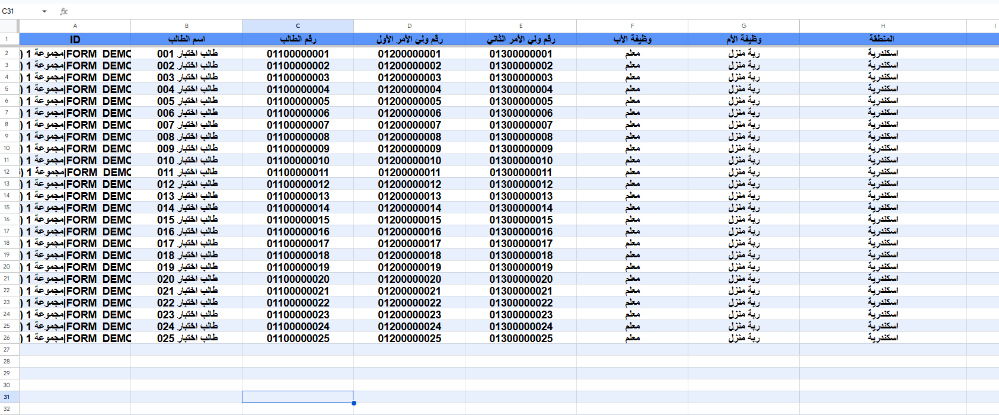
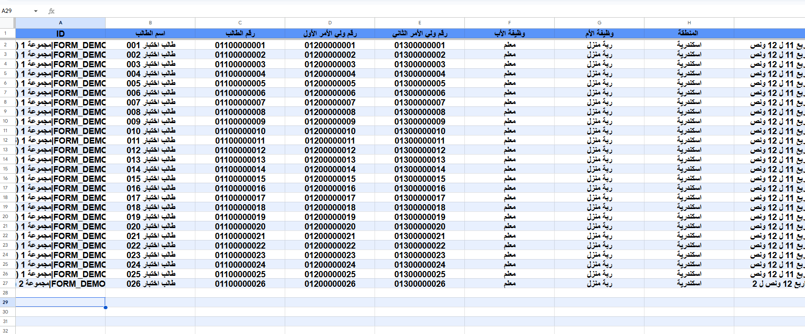
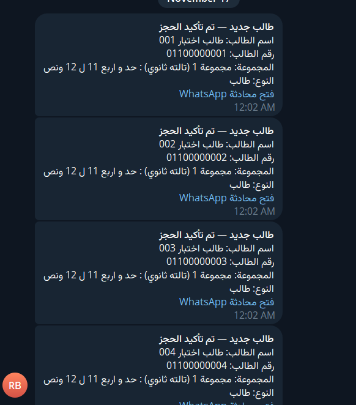
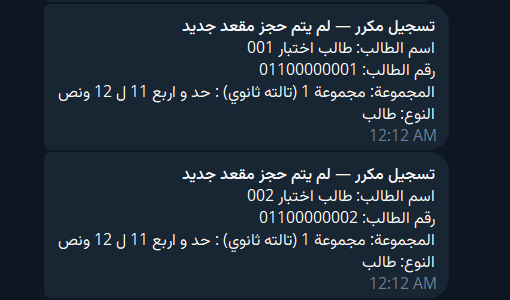
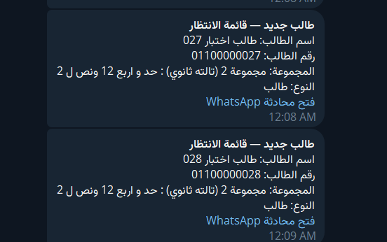

# Students Booking System — V2 Reliability Upgrade

[← Back to portfolio](../README.md)

## 1. Project Overview

An n8n workflow plus a Google Apps Script web app that process student registrations from a Google Form: they validate the input, detect duplicates, enforce group capacity, place overflow on a waiting list and notify staff on Telegram. V2 moves the booking decision into one locked Apps Script endpoint that records each registration's progress in a ledger sheet.

V2 is a later improvement and demo of the [original Students Booking System](../students-booking-system/README.md). **It was not the version deployed to the client.** V1 was built for an educational center serving roughly 500–600 students during a time-limited enrollment period; according to the author it was used for 500+ registrations.



## 2. Business Problem

An education center needed a low-cost way to collect registrations, reject repeated submissions, respect per-group capacity, put overflow on a waiting list and notify staff. Google Forms, Sheets, n8n and Telegram fit the volume, budget and non-technical staff.

The V1 design reads and writes sheets in separate n8n steps. Two overlapping requests for the last seat can both pass the capacity check, and a failure between writes can leave the group and master sheets inconsistent. V2 explores how far those risks can be reduced **without replacing the stack**.

## 3. Proposed Solution

1. n8n polls the form-responses sheet, normalizes the Arabic form fields and validates them.
2. Valid registrations are sent to an Apps Script web app, which takes a script lock, makes the booking decision and writes the result.
3. Every registration carries an `event_id`. The script records its progress (`PROCESSING` → `DONE`) in a `_BookingLedger` sheet, so a replayed event does not book twice and an interrupted write can be completed on retry.
4. n8n routes on the returned status, sends one Telegram message and writes the notification outcome (`SENT` / `FAILED`) back to the ledger.

## 4. System Architecture

The diagrams reflect the node connections in [`workflow/students-booking-v2.public.json`](workflow/students-booking-v2.public.json) and the logic in [`apps-script/Code.gs`](apps-script/Code.gs).



Decision order inside the booking engine:



Node-by-node detail, the ledger schema and the status table are in [docs/ARCHITECTURE.md](docs/ARCHITECTURE.md).

## 5. Key Features

- **Input normalization and validation** of the Arabic form fields, including 11-digit phone format, in n8n and again in the engine.
- **Capacity per group and gender** from a `settings` sheet, with an exactly-one-row check.
- **Duplicate detection** by student phone across the group, master and waiting sheets.
- **Locked booking decision.** `LockService.getScriptLock()` wraps every booking, so requests entering this deployment are serialized.
- **Idempotency ledger.** The first decision is stored per `event_id`; replays do not book twice and unfinished writes can be repaired on retry.
- **Notification tracking.** Telegram outcome is written back as `SENT` or `FAILED`; a replay only re-sends a notice that was not acknowledged.
- **Three alert paths:** invalid input, HTTP failure, and operations alerts for `INVALID`, `RETRY` and `ERROR` results.
- **Telegram messages** for confirmed, waitlisted and duplicate cases, with a WhatsApp deep link to the student.
- **Documented canvas.** Five sticky notes describe the system, input, engine, notifications and acceptance tests.

## 6. Technology Stack

| Tool | Used for |
|---|---|
| n8n | Google Sheets Trigger, Loop Over Items, Code, IF, HTTP Request and Telegram nodes |
| Google Apps Script (web app) | Booking engine: token check, `LockService`, decision logic, sheet writes, ledger |
| Google Forms and Google Sheets | Input, group tabs, master roster, waiting list, settings, ledger |
| Telegram Bot API | Staff notifications and alerts |
| JavaScript | Both Code nodes and `Code.gs` |

The project uses no AI nodes, database, webhook trigger or HMAC signing.

## 7. Workflow Execution

1. **Ingest.** `Google Sheet Trigger` polls every minute for new rows. `Loop Over Items` processes them one at a time.
2. **Normalize and validate.** `Prepare Registration` finds columns by label fragment (labels may contain emoji), cleans phone numbers, builds `event_id` and checks name, group, gender and phone. Invalid input goes to `Invalid Input Alert`.
3. **Book.** `Atomic Booking — Apps Script` posts the registration plus token to the web app (45 s timeout, 3 tries). An HTTP error goes to `HTTP Failure Alert`.
4. **Decide.** `Prepare Decision & Safe Message` parses the response, HTML-escapes user text and builds the Telegram message and WhatsApp link.
5. **Route.** Chained status checks send `CONFIRMED`, `WAITLISTED` and `DUPLICATE` to their Telegram nodes. `ALREADY_PROCESSED` is skipped. Anything else goes to `Operations Alert`.
6. **Close.** `Mark Notification SENT` or `FAILED` updates the ledger, then the loop continues.

### Request and response contract

Shapes come from `Code.gs` and the workflow's Code nodes. Values are placeholders.

```json
{
  "event_id": "FORM_DEMO:<source row number, or timestamp|phone|group|gender>",
  "student_name": "…", "student_number": "01XXXXXXXXX",
  "parent_number1": "01XXXXXXXXX", "parent_number2": "",
  "dad_job": "…", "mom_job": "…", "place": "…",
  "group": "<must match a settings row and a sheet tab>",
  "gender": "طالب | طالبة",
  "token": "<BOOKING_API_TOKEN>"
}
```

```json
{ "ok": true,  "status": "CONFIRMED | WAITLISTED", "event_id": "…", "group": "…", "gender": "…", "group_link": "…" }
{ "ok": true,  "status": "DUPLICATE", "event_id": "…", "group": "…", "gender": "…" }
{ "ok": true,  "status": "ALREADY_PROCESSED | CONFIRMED | WAITLISTED | DUPLICATE", "replayed": true, "original_status": "…", "event_id": "…" }
{ "ok": false, "status": "INVALID | RETRY | UNAUTHORIZED | ERROR", "error": "…" }
```

A replay returns the original status again only while the ledger's `notice_status` is not `SENT`; otherwise it returns `ALREADY_PROCESSED`.

## 8. Project Structure

```text
students-booking-system-v2/
├── README.md
├── LICENSE
├── workflow/
│   └── students-booking-v2.public.json   # sanitized n8n import template
├── apps-script/
│   └── Code.gs                           # booking engine source, no secrets
├── tests/
│   ├── run-engine-tests.js               # offline logic tests (node)
│   └── OFFLINE_TEST_REPORT.md            # generated report
├── assets/
│   └── screenshots/                      # synthetic-data demo evidence
└── docs/
    ├── ARCHITECTURE.md                   # nodes, statuses, ledger, contract
    ├── SETUP.md                          # setup and placeholder table
    ├── TEST_REPORT.md                    # observed vs. pending tests
    ├── LIMITATIONS.md                    # constraints and risks
    └── V1_VS_V2.md                       # original vs. upgraded design
```

The workflow file lives in `workflow/` and is named `*.public.json` because it is a sanitized template; other projects use `workflow.json`.

## 9. Installation & Configuration

This is a template, not a one-click install. You need a Google Form, a workbook with the expected tabs, an n8n instance and a Telegram bot.

1. Create **demo copies** of the form and workbook with no real student data.
2. Deploy [`apps-script/Code.gs`](apps-script/Code.gs) as a web app and set the Script Properties `BOOKING_SHEET_ID` and `BOOKING_API_TOKEN`.
3. Import [`workflow/students-booking-v2.public.json`](workflow/students-booking-v2.public.json) into a **separate, inactive** n8n workflow.
4. Select your Google Sheets and Telegram credentials and replace the placeholders:

| Placeholder | Where | Replace with |
|---|---|---|
| `REPLACE_WITH_FORM_RESPONSES_SPREADSHEET_ID` / `..._SHEET_GID` | `Google Sheet Trigger` | Your demo form-responses spreadsheet and tab |
| `REPLACE_WITH_YOUR_DEPLOYMENT_ID` | `Atomic Booking`, `Mark Notification SENT`, `Mark Notification FAILED` | Your Apps Script `/exec` URL |
| `REPLACE_WITH_PRIVATE_BOOKING_TOKEN` | Same three nodes | The value of `BOOKING_API_TOKEN` |
| `REPLACE_WITH_TEST_CHAT_ID` | All six Telegram nodes | Your private demo chat ID |

5. Test with one fake registration, then duplicate and full-group cases.

Full steps, sheet header requirements and secret-rotation guidance: [docs/SETUP.md](docs/SETUP.md). Run the offline checks with `node tests/run-engine-tests.js`.

## 10. Screenshots & Demonstrations

A 50-registration synthetic batch was run through the workflow. The n8n execution view shows 50 items processed in about 11m 49s.

| Outcome | Count |
|---|---:|
| Confirmed | 26 |
| Waitlisted | 14 |
| Duplicate | 10 |
| **Total** | **50** |

These are observed routing counts, **not a throughput benchmark**. Group capacities were not set to the intended 10 / 8 for this run, so it does **not** validate the capacity-threshold scenario. All data is synthetic. Details: [docs/TEST_REPORT.md](docs/TEST_REPORT.md).

**Form responses (synthetic)**



**Group sheet and master sheet (synthetic)**





**Telegram messages (synthetic)**







**Offline logic tests.** `tests/run-engine-tests.js` runs `Code.gs` unmodified against in-memory fakes of Sheets, the lock and script properties, and the workflow's Code nodes with mocked helpers: see [OFFLINE_TEST_REPORT.md](tests/OFFLINE_TEST_REPORT.md). These cover validation, duplicates, capacity, replay and partial-write repair (with an injected failure in the fake). They are not a real Apps Script run and not a concurrency test.

## 11. Limitations & Future Improvements

- **Not ACID.** Google Sheets is not a transactional database. This design is repair-and-retry, not rollback.
- **Script-scoped lock.** It covers only requests entering this Apps Script deployment, not manual edits or other writers.
- **Telegram is not exactly-once.** An uncertain send can produce a duplicate message.
- **No automatic re-submission.** A `RETRY` or `ERROR` result raises an operations alert and the workflow moves on; recovery means re-submitting the same `event_id`.
- **Event IDs.** The timestamp-based fallback is not guaranteed unique. Whether the Sheets Trigger supplies a row number in your n8n version has not been verified here.
- **Token in the request body.** A shared secret, not an authorization layer.
- **Personal data in Telegram.** Staff messages contain names and phone numbers; use a private chat.
- **Scale.** Every request scans sheets, so volume is bounded by Sheets and Apps Script quotas.
- **Pending tests.** Simultaneous last-seat requests, controlled replay after an uncertain failure, real partial-write injection, unauthorized-request check against a deployment and backup restore are listed in the [test report](docs/TEST_REPORT.md#follow-up-tests-required-for-stronger-claims).

Future improvements, if the load or criticality justified it: an automatic retry path for `RETRY`, a database with uniqueness constraints instead of Sheets, and re-running the demo with the intended 10 / 8 capacities.

Full list: [docs/LIMITATIONS.md](docs/LIMITATIONS.md).

## 12. Project Status

Template exported and documented, with a 50-item synthetic demo run and offline logic tests. Concurrency, real failure recovery and live replay behaviour are implemented in the code but **not yet verified by a real test**. V2 is a demonstration, not a deployed system: no production use, measured performance or client deployment is claimed. No real student data, credentials, deployment URLs or chat IDs are included; the workflow export contains placeholders only.

V2 is a later, assisted engineering iteration; judge it by its source, demo and tests. Comparison with the original: [docs/V1_VS_V2.md](docs/V1_VS_V2.md).
