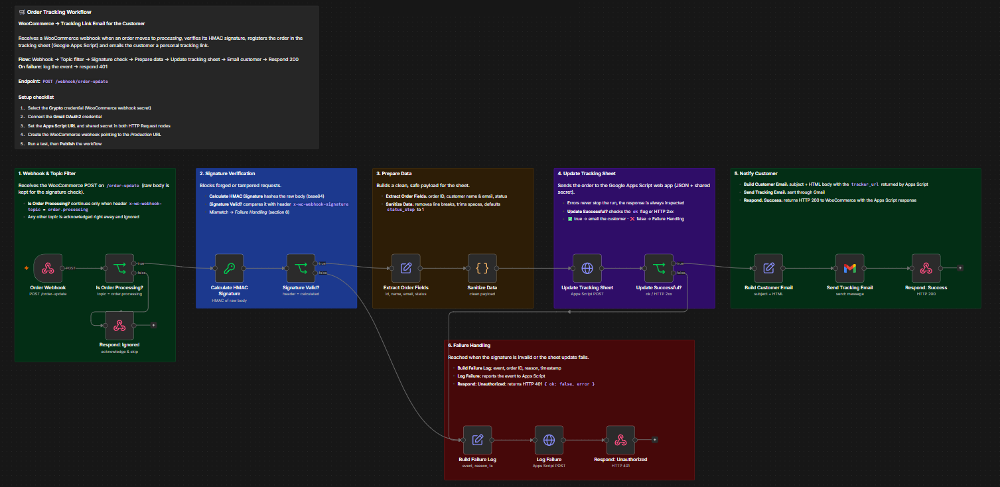
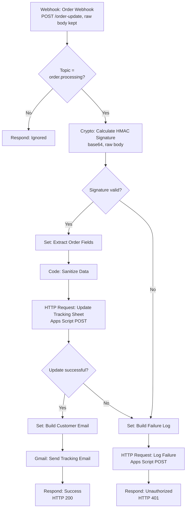
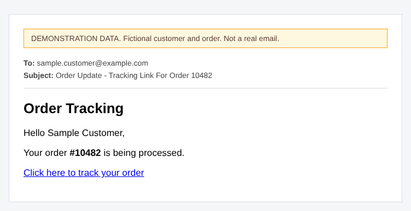

# Order Tracking Workflow

[← Back to portfolio](../README.md)

## 1. Project Overview

An n8n webhook workflow that receives a WooCommerce order event, verifies its HMAC signature, registers the order in a tracking sheet through a Google Apps Script web app, and emails the customer a personal tracking link.

It was built as a project in the Digital Egypt Pioneers Initiative (DEPI) AI Automation track and tested with Postman requests that simulate the WooCommerce webhook.



## 2. Business Problem

Online stores often need to give customers a way to follow their order without exposing the store's back office. Small e-commerce teams that do not use a dedicated order-tracking plugin have to notify customers manually. Because the webhook endpoint is public, it must also reject forged requests.

## 3. Proposed Solution

When an order reaches the processing stage, the workflow verifies the webhook signature, records the order in a Google Sheet (via Apps Script) and emails the customer the tracking URL returned by that script. Invalid signatures and failed sheet updates take a separate logged failure path.

## 4. System Architecture



## 5. Key Features

- **Signed requests only.** The signature is verified before any data is processed or any email is sent; mismatches never reach the sheet or the customer.
- **Raw body hashing.** `rawBody` is enabled on the webhook so the HMAC is calculated on the original payload rather than re-serialised JSON.
- **Cheap rejection of irrelevant events.** Other topics are acknowledged right away, so the webhook sender does not retry them.
- **Input hygiene.** Line breaks are removed and values trimmed before the data is sent to the sheet.
- **Explicit upstream result check.** The Apps Script call does not throw on errors; success is decided from the `ok` flag or the HTTP status, and both outcomes are routed deliberately.
- **Single failure handler.** Both failure causes share one logging and response path.
- **Documented canvas.** Each section carries a sticky note describing its purpose, and the overview note lists the setup checklist.

## 6. Technology Stack

| Tool | Used for |
|---|---|
| n8n | Webhook, If, Set, Code, Crypto, HTTP Request and Respond to Webhook nodes |
| WooCommerce | Source of the order webhook |
| n8n Crypto node | HMAC-based verification of the webhook signature |
| Google Apps Script (web app) | Writing the order to the tracking sheet and returning a tracking URL |
| Google Sheets | Tracking data store (behind the Apps Script, not part of this repo) |
| Gmail | Sending the tracking email to the customer |
| JavaScript (Code node) | Input sanitisation |

## 7. Workflow Execution

1. **Receive.** `Order Webhook` accepts `POST /order-update`. The raw request body is preserved so the signature can be verified byte for byte. The workflow answers through Respond to Webhook nodes.
2. **Filter by topic.** `Is Order Processing?` continues only when the `x-wc-webhook-topic` header equals `order.processing`. Any other topic is acknowledged immediately by `Respond: Ignored`.
3. **Verify the signature.** `Calculate HMAC Signature` computes a base64 HMAC of the raw body using the secret stored in an n8n Crypto credential. `Signature Valid?` compares it with the `x-wc-webhook-signature` header.
4. **Prepare the data.** `Extract Order Fields` maps the order ID, customer name, customer email and status. `Sanitize Data` strips line breaks, trims whitespace, and defaults `status_step` to 1 when it is missing or not numeric.
5. **Register the order.** `Update Tracking Sheet` posts the order (JSON plus a shared secret) to the Apps Script web app. The request is set not to fail the run on errors, so the response is always inspected.
6. **Check the result.** `Update Successful?` passes when the response contains `ok: true` or an HTTP 2xx status.
7. **Notify the customer.** `Build Customer Email` creates the subject and an HTML body containing the `tracker_url` returned by Apps Script. `Send Tracking Email` sends it through Gmail, and `Respond: Success` returns HTTP 200 to WooCommerce.
8. **Failure path.** An invalid signature or a failed sheet update goes to `Build Failure Log`, then `Log Failure` reports the event to Apps Script, and `Respond: Unauthorized` returns HTTP 401 with `{ "ok": false, "error": ... }`.

## 8. Project Structure

```text
order-tracking-workflow/
├── README.md
├── workflow.json            # n8n export (import this file)
├── samples/                 # synthetic demo payload, responses, email preview
└── assets/
    ├── n8n-workflow-canvas.png
    └── sample-email-preview.png
```

The Google Apps Script web app is **not** included in this repository.

## 9. Installation & Configuration

**Accounts needed:** n8n instance reachable over HTTPS, a WooCommerce store, a Google account with an Apps Script web app (and its sheet), and a Gmail account.

1. Import `workflow.json` in n8n (**Workflows → Import from file**).
2. Create these credentials and attach them to the matching nodes (the JSON contains the names only):
   - `Crypto account`: holds the WooCommerce webhook secret used for the HMAC
   - `Gmail account 3` (OAuth2): used by `Send Tracking Email`
3. Replace the placeholders in both HTTP Request nodes (`Update Tracking Sheet` and `Log Failure`):

| Placeholder | Replace with |
|---|---|
| `YOUR_APPS_SCRIPT_DEPLOYMENT_ID` | The deployment ID in your Apps Script web app URL |
| `YOUR_SHARED_SECRET` | The shared secret your Apps Script checks |

4. Make sure your Apps Script matches the contract used here. It receives JSON with `secret`, `order_id`, `customer_name`, `customer_email` and `status_step`, and returns `ok` and `tracker_url`. The failure log request sends the fields `event` and `secter` (the node uses this exact spelling), so the script must read the same names. The Apps Script code is not included in this repository.
5. In WooCommerce, create a webhook whose delivery URL is the **production** URL of `/webhook/order-update`, using the same secret as the Crypto credential. The workflow was developed against Postman requests, so before connecting a live store compare its real deliveries with what the workflow expects: the `x-wc-webhook-topic` value checked by `Is Order Processing?`, and the payload fields read by `Extract Order Fields` (`id`, `customer.email`, `customer.name`, `status`).
6. Run a test, then publish the workflow.

## 10. Screenshots & Demonstrations

The canvas screenshot in the overview shows the full workflow with its sections.

**Sample customer email** (demonstration data with a fictional customer and order)



A full demonstration package (sample webhook payload, tracking response, successful run output and email preview) is in [`samples/`](samples/README.md). All values are synthetic.

## 11. Limitations & Future Improvements


- **Shared secret handling.** The shared secret lives inside the HTTP Request nodes. Moving it to an n8n credential (or environment variable) would keep it out of the exported workflow.
- **Failure path references.** `Build Failure Log` reads values from `Sanitize Data` and `Update Tracking Sheet`. On the invalid-signature path those nodes have not run, so the lookups may fail instead of producing the intended log; test this path explicitly.
- **Status codes.** The 401 response is also returned when the sheet update fails. A 5xx code for upstream errors would let WooCommerce and monitoring tell the two cases apart.
- **Failure details.** `Build Failure Log` prepares the order ID, reason and timestamp, but `Log Failure` only sends the event name and the secret.
- **Success response.** `Respond: Success` returns the whole Apps Script response object to WooCommerce, which includes the tracking URL. A minimal `{ "ok": true }` would be safer.
- **HTML escaping.** The customer name and order ID are inserted into the email HTML without escaping.
- **Unused mappings.** `Extract Order Fields` also maps `sig`, `event_topic` (from the computed HMAC value) and `secret` (from the `postman-token` header, a leftover of Postman testing); none of them is used by the sheet request. Removing them would simplify the data flow.
- **Duplicate deliveries.** There is no check for the same order being delivered twice, so a repeated webhook would send another email.
- **Observability.** Failures are logged only to Apps Script; an alert to the store owner would shorten reaction time.

## 12. Project Status

Workflow exported and documented. It was developed against Postman-simulated webhooks; this repository contains no evidence of a live store connection, so none is claimed. Compare real WooCommerce deliveries with the expectations listed in the setup steps before connecting a live store.
