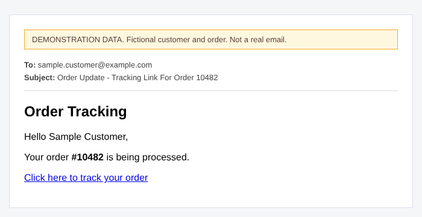

# Order Tracking Demonstration Package

[← Back to Order Tracking Workflow](../README.md)

> **All content in this folder is demonstration data.** The customer, order number, signature, secret and tracking URL are fictional. The demo secret (`DEMO_SECRET_NOT_REAL`) is not used anywhere. Nothing here comes from a live store or a real deployment.

## Files

| File | Purpose |
|---|---|
| [`sample-webhook-payload.json`](sample-webhook-payload.json) | Fictional WooCommerce `order.processing` delivery (headers, raw body, parsed body). The signature is a real HMAC-SHA256 of the raw body computed with the demo secret |
| [`sample-tracking-response.json`](sample-tracking-response.json) | Illustrative Apps Script response following the contract the workflow expects (`ok`, `tracker_url`) |
| [`sample-workflow-output.json`](sample-workflow-output.json) | Step-by-step output of a successful run, ending in HTTP 200 |
| [`sample-customer-email.html`](sample-customer-email.html) | Customer email preview; open in a browser |

## 1. Sample order information

| Field | Demo value | Read by |
|---|---|---|
| `x-wc-webhook-topic` header | `order.processing` | `Is Order Processing?` |
| `body.id` | `10482` | `Extract Order Fields` → `order_id` |
| `body.customer.name` | `Sample Customer` | `customer_name` |
| `body.customer.email` | `sample.customer@example.com` | `customer_email` |
| `body.status` | `processing` | `order_status` |

After `Sanitize Data`, the item sent to the sheet is `{ order_id: "10482", customer_name: "Sample Customer", status_step: 1, customer_email: "sample.customer@example.com", secret: "" }`. The `status_step` defaults to 1 because the payload does not provide one. This output was produced by running the workflow's own sanitising code on the sample.

## 2. Order confirmation email preview



The email body is rendered from the `Build Customer Email` template. The subject is `Order Update - Tracking Link For Order 10482`. The demo banner and header lines are added for this preview only.

## 3. Tracking URL presentation

The tracking URL is returned by the Apps Script web app in the field `tracker_url` and placed behind the link text "Click here to track your order".

```text
https://tracking.example.com/track?order=10482&token=DEMO-TOKEN
```

The real URL format is defined by the Apps Script, which is **not** part of this repository. This example URL is an assumption for illustration, and the tracking page behind it is not included.

## 4. Successful workflow output

For the sample delivery, a successful run passes these stages (details in `sample-workflow-output.json`):

1. `Is Order Processing?` is true, and `Signature Valid?` is true.
2. `Update Tracking Sheet` receives `{ ok: true, tracker_url: ... }` from Apps Script.
3. `Send Tracking Email` sends the email above.
4. `Respond: Success` returns HTTP 200 to WooCommerce.

```json
{
  "statusCode": 200,
  "body": { "ok": true, "tracker_url": "https://tracking.example.com/track?order=10482&token=DEMO-TOKEN" }
}
```

As noted in the project's limitations, the workflow currently returns the whole Apps Script response (including the tracking URL) to WooCommerce.
