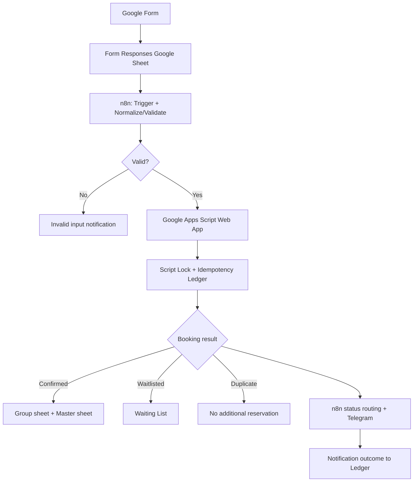
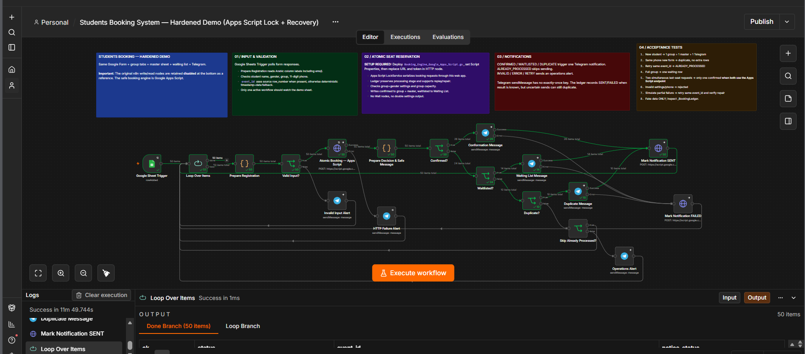
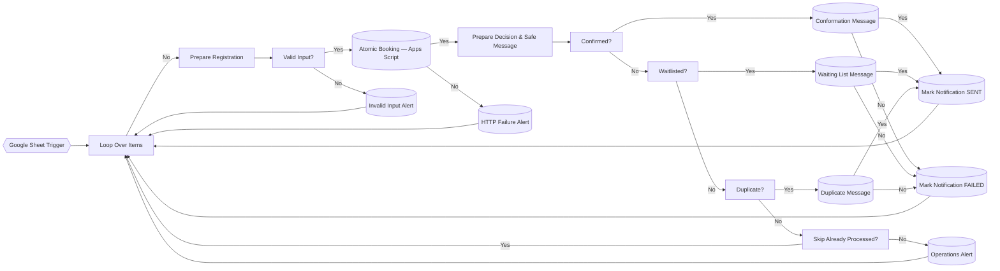

# Students Booking System — V2 Reliability Upgrade

**A post-deployment engineering improvement of a real educational enrollment workflow.**

> **Project context:** The original workflow (V1) was built for an educational center serving approximately **500–600 students**, during a time-limited enrollment period. The original solution was used for **500+ registrations**, according to the project owner. V2 is a *subsequent improvement/demo*, **not** the version deployed to that client.

[Original V1 portfolio project](https://github.com/Omar-Ayman0/n8n-ai-automation-projects/tree/main/students-booking-system) · [V1 → V2 comparison](docs/V1_VS_V2.md) · [Test evidence](docs/TEST_REPORT.md) · [Setup](docs/SETUP.md)

## Problem and scope

A teacher/education center needed a manageable way to collect registrations, detect repeated submissions, respect capacity limits, assign overflow to a waiting list, and notify staff. The practical V1 choice—**Google Forms, Google Sheets, n8n, and Telegram**—fit limited volume, budget and nontechnical staff workflows. This repository documents a later exploration of **retries, consistency, observability and concurrent bookings** without replacing that entire stack.

## V2 architecture



Apps Script serializes booking decisions **that use this same script deployment** using `LockService`, and records event-processing stages in `_BookingLedger`. It uses repair/retry of partial writes—not a database ACID transaction or true rollback. Other writers/manual edits are outside that lock.

## Features in V2

- Input normalization/validation of Arabic Google Form fields, including phone format.
- Stable event identifiers when the source provides stable input; fallback based on timestamp+fields is **not guaranteed globally unique**.
- Capacity and group+gender settings validation.
- Duplicate student checks and event replay detection via `_BookingLedger`.
- Repairable partial writes to group + master sheets.
- Telegram confirmation/waitlist/duplicate messages, notification-status logging and operational alerts.
- n8n sticky notes for system overview, input, booking engine, routing and acceptance tests.

## Recorded demonstration

The operator ran a **50-registration demo batch**. The n8n execution screenshot shows **50 processed items**, routed as **26 confirmed, 14 waitlisted, 10 duplicates**, over approximately **11m 49s**. These are **actual observed test counts**, not throughput benchmarks. The group capacity settings were *not* set to the intended 10/8 for that run; therefore this test **does not validate the expected capacity-threshold scenario**. Screenshots use synthetic data.



| Observed result | Count |
|---|---:|
| Confirmed | 26 |
| Waitlisted | 14 |
| Duplicate | 10 |
| **Total** | **50** |

See [TEST_REPORT.md](docs/TEST_REPORT.md) for what was observed vs. what is **not yet independently tested**, and [LIMITATIONS.md](docs/LIMITATIONS.md) for operational/security constraints.

## Repository layout

```text
workflow/students-booking-v2.public.json    # sanitized n8n import template
apps-script/Code.gs                         # booking engine source, no secrets
assets/screenshots/                        # test evidence; cropped
 docs/SETUP.md                              # setup instructions
 docs/V1_VS_V2.md                          # original vs upgraded design
 docs/TEST_REPORT.md                        # demo counts and pending tests
 docs/LIMITATIONS.md                        # important limitations
```

## Setup

1. Import `workflow/students-booking-v2.public.json` into a **separate inactive** n8n workflow.
2. Create **fresh demo copies** of the Google Form and workbooks. The workflow needs the `Form Responses` sheet, group-named tabs, `الكشف المجمع`, `Waiting List`, and `settings`.
3. Deploy `apps-script/Code.gs` as a Google Apps Script Web App with `BOOKING_SHEET_ID` and a random `BOOKING_API_TOKEN` in Script Properties.
4. Replace **public template placeholders** for the Form Responses sheet, the Apps Script `/exec` URL, private API token, Telegram chat ID, and credentials. **Never publish the configured export.**
5. Test with fake students and inspect n8n Executions, group/master/waiting sheets and `_BookingLedger`.

Full instructions: [docs/SETUP.md](docs/SETUP.md).

## Public-data note

**No real student records, credentials, real Web App deployment URLs or real Telegram chat IDs are included in this public template.** Screenshots show synthetic data from a demo run. Tokens/IDs need private configuration in a demo environment.

## Engineering provenance

V1 was built for the original client and retained as a separate historical artifact. V2 is a later assisted engineering iteration; functionality should be evaluated from its source, demo and tests rather than from claims of unverified production history. No claim is made that the new V2 code was in the client deployment.


## Architecture Diagram

Source: [Architecture diagram](../assets/diagrams/students-booking-system-v2.mmd)


