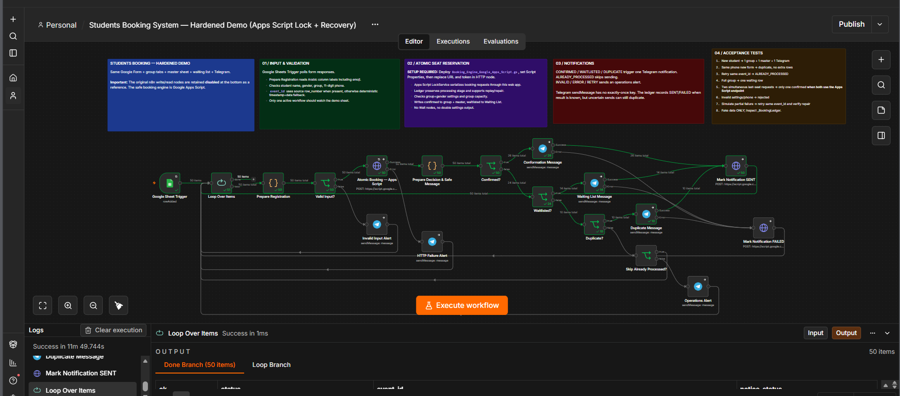

# Test report — 2026-11-17 demo

## Scope and evidence

Evidence consists of the supplied n8n execution and synthetic Google Sheets/Telegram screenshots. No access to a live backend, test logs beyond those screenshots, or controlled simultaneous-request tests was available during documentation.

| Test / observation | Evidence | Status |
|---|---|---|
| Batch routed through the n8n loop | Done Branch shows 50 items | **Observed** |
| Confirmed routing | 26 items on confirmation branch | **Observed** |
| Waiting-list routing | 14 items on waitlist branch | **Observed** |
| Duplicate routing | 10 items on duplicate branch | **Observed** |
| Writes in master and group sheets | Synthetic records visible in provided screenshots | **Observed in screenshots** |
| Telegram notifications | Confirmed/waitlist/duplicate examples shown | **Observed in screenshots** |
| Capacity exactly 10 and 8 | Limits were not set to the intended values during the run | **Not established** |
| Two simultaneous requests for final seat | No independent concurrency test artifact | **Pending** |
| Replay same event ID after uncertain failure | No controlled retry evidence | **Pending** |
| Partial-write fault injection and repair | No controlled failure evidence | **Pending** |
| Unauthorized administrative operation | No custom admin API/authorization layer | **Not implemented** |
| Restore from backup / rollback | No proven backup restoration exercise | **Pending** |

## Actual run

- **50** event items completed in the n8n execution (about **11 minutes 49 seconds**, from the execution UI).
- Results: **26 CONFIRMED / 14 WAITLISTED / 10 DUPLICATE**.
- These counts sum to 50 but **should not be presented as proof that the intended 10/8 seat caps worked**; the operator reported forgetting to set those values before the test.
- Screenshot evidence is cropped and uses fake/test students only.

## Follow-up tests required for stronger claims

1. Clean demo group + master + waitlist + ledger, set explicit capacities, submit controlled sequence, compare to exact expected counts.
2. Submit two simultaneous distinct registration requests for one remaining seat **through the same Apps Script endpoint**; collect response+sheet evidence.
3. Re-submit same `event_id`; confirm no extra booking.
4. Simulate failure between group and master writes in isolated demo copy; recover with the same event ID.
5. Force Telegram send failure, verify booking stays confirmed and failure reporting is visible.
6. Verify unauthorized API token is rejected and no data changes.
7. Verify backup restoration procedure with a disposable copy of the demo workbooks.

Record timestamp, setup, data, expected, actual, n8n execution ID and result for each case before marking passed.
