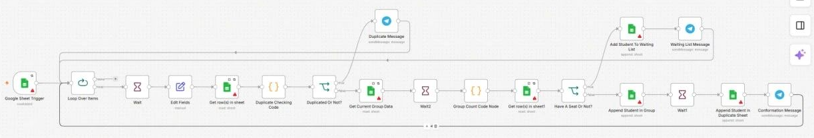
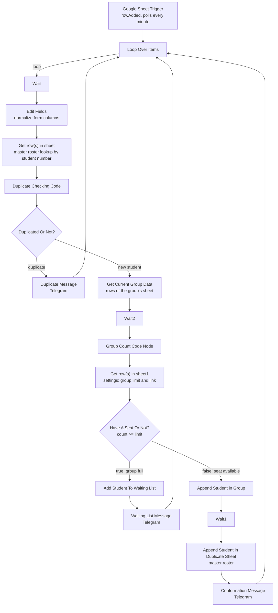

# Students Booking System

[← Back to portfolio](../README.md)

## 1. Project Overview

An n8n workflow that processes student registration form responses: it checks for duplicate registrations, enforces a per-group seat limit, records the student in the right Google Sheet, and notifies staff on Telegram with a prefilled WhatsApp message.

It is the version used in production for a tutoring center. The author reports that it has processed 500+ registrations and that the registration pipeline was delivered to production within 30 days; these figures come from the author, not from the workflow file.



## 2. Business Problem

Registering students for tutoring groups by hand means reading each request, checking whether the student is already registered, checking whether the chosen group still has room, and copying the details into a roster. Previously, bookings were handled manually over WhatsApp and phone. Doing this per student is slow and error-prone.

## 3. Proposed Solution

A Google Sheets-triggered workflow that automates the desk work: duplicate detection by student number, seat counting against a per-group limit read from a settings tab, automatic placement on the group roster or a waiting list, and a Telegram notification to staff in each case.

## 4. System Architecture



## 5. Key Features

- **Duplicate detection by student number.** `Get row(s) in sheet`, `Duplicate Checking Code` and `Duplicated Or Not?` compare the incoming student number with the master roster.
- **Per-group seat limit.** `Get Current Group Data` and `Group Count Code Node` count the group's rows, `Get row(s) in sheet1` reads the limit from the settings tab, and `Have A Seat Or Not?` decides between roster and waiting list.
- **Waiting list.** `Add Student To Waiting List` and `Waiting List Message` handle students whose group is full.
- **Dynamic sheet routing.** `Get Current Group Data` and `Append Student in Group` select the sheet tab by name from the group value in the form response.
- **Ready-to-send WhatsApp message.** `Waiting List Message` and `Conformation Message` include a link that opens WhatsApp with a prefilled message. The confirmation text includes the student's details and the group link read from the settings tab.
- **Retries on reads.** The trigger retries 3 times and the three read nodes (`Get row(s) in sheet`, `Get Current Group Data`, `Get row(s) in sheet1`) retry up to 5 times, with a 5 second wait between tries. These three read nodes also have Always Output Data enabled.
- **Staff-facing messages are in Egyptian Arabic.** The sheet column headers used by the nodes are Arabic as well.

## 6. Technology Stack

| Tool / service | Role in this workflow |
|---|---|
| n8n | Workflow orchestration |
| Google Sheets | Form responses, master roster, one tab per group, waiting list, and a settings tab (group limits and links) |
| Telegram Bot API | Staff notifications (3 message nodes) |
| WhatsApp deep link | `api.whatsapp.com/send` link inside the Telegram messages that opens a chat with the student using a prefilled text |
| JavaScript (Code nodes) | Duplicate check and group row count (2 nodes) |

Node counts in the export: 19 nodes in total (1 trigger, 6 Google Sheets, 3 Telegram, 3 Wait, 2 Code, 2 IF, 1 Set, 1 Loop Over Items).

## 7. Workflow Execution

1. **Google Sheet Trigger** polls the form-responses sheet every minute and fires on each new row (`rowAdded`).
2. **Loop Over Items** passes the new rows through the rest of the flow. Every branch ends by returning to this node. The batch size is not specified in the export.
3. **Wait**, then **Edit Fields** maps seven form columns to named fields: `student_name`, `student_number`, `parent_number1`, `parent_number2`, `dad_job`, `mom_job` and `group`.
4. **Get row(s) in sheet** looks up the student number in the master roster tab, and **Duplicate Checking Code** returns `isDuplicate`.
5. **Duplicated Or Not?** routes duplicates to **Duplicate Message**, a Telegram alert to staff, and then back to the loop.
6. For new students, **Get Current Group Data** reads the rows of the sheet tab named after the chosen group. After **Wait2**, **Group Count Code Node** counts those rows.
7. **Get row(s) in sheet1** reads the group's limit and group link from the `settings` tab, and **Have A Seat Or Not?** compares the count with the limit.
8. If the count is at or above the limit, **Add Student To Waiting List** appends the student to the `Waiting List` tab and **Waiting List Message** notifies staff.
9. Otherwise **Append Student in Group** writes the student to the group's tab, and after **Wait1**, **Append Student in Duplicate Sheet** writes the student to the master roster tab.
10. **Conformation Message** sends staff a Telegram message with the student's details, and the flow returns to the loop.

## 8. Project Structure

```text
students-booking-system/
├── README.md
├── workflow.json            # n8n export (import this file)
└── assets/
    └── students-booking-system.png
```

## 9. Installation & Configuration

1. In n8n, choose **Import from File** and select `workflow.json`.
2. Create these credentials (names only):
   - Telegram account (Telegram API)
   - A Google Sheets credential (not specified in the export)
3. Prepare two Google spreadsheets:
   - **Form responses spreadsheet**: a tab that receives the registration form answers. Its column headers must match the expressions in the `Edit Fields` node.
   - **Student roster spreadsheet** with these tabs:
     - a master roster tab (`الكشف المجمع` in the original)
     - `Waiting List`
     - `settings`, with the group name, the student limit and the group link
     - one tab per group, named exactly like the group value in the form
4. Replace the placeholders:
   - `YOUR_FORM_RESPONSES_SPREADSHEET_ID` and `YOUR_STUDENT_ROSTER_SPREADSHEET_ID` in the Google Sheets nodes. In practice, reselect the spreadsheet and tab in each node from the node's dropdown.
   - `YOUR_SHEET_GID` in the nodes that pick a tab from a list
   - `YOUR_TELEGRAM_CHAT_ID` in the three Telegram nodes
   - `YOUR_NAME` in the signature of the WhatsApp message text
   - `REPLACE_WITH_YOUR_CREDENTIAL` on each credential
5. Check the unit on the three Wait nodes, then activate the workflow.

## 10. Screenshots & Demonstrations


This repository contains no real student data, and no screenshots of production sheets are included.

## 11. Limitations & Future Improvements

**Known limitations**

- **Credentials are not in the export for the Google Sheets nodes.** Only the three Telegram nodes carry a credential block, and the Google Sheets nodes show warning icons on the canvas.
- **Waitlisted students are not added to the master roster.** The duplicate check only reads the master roster, so a waitlisted student who submits again is not detected as a duplicate.
- **Duplicates are matched on student number only.**
- **No input validation node.** Apart from the duplicate and capacity checks, form values are copied as they are. The export has no phone-number or name format checks.
- **Notifications go to one fixed Telegram chat.** The chat ID is hard-coded in each Telegram node.
- **Wait duration unit is not specified in the export.** The three Wait nodes store an amount of 2.5 and no unit, so the unit is whatever the n8n default is.
- **Node names that do not match behavior.** `Append Student in Duplicate Sheet` writes to the master roster tab, and the true branch of `Have A Seat Or Not?` means the group is full.
- **Duplicate Message** contains Markdown-style `*` markers but has no parse mode set.
- **Personal data.** The workflow handles student and parent names, phone numbers and parent jobs. This repository contains no real data.

**Possible improvements**

- Add a validation step for phone number and name format before the duplicate check.
- Write waitlisted students to the master roster, or check the `Waiting List` tab as well in the duplicate check.
- Send notifications to a configurable chat instead of a hard-coded ID.
- Add an error workflow so failed Google Sheets writes alert staff.
- Rename nodes to match what they do, for example `Append Student in Master Roster` and `Group Is Full?`.

## 12. Project Status

Reported by the author as used in production at a tutoring center. The exported workflow in this repository still needs its Google Sheets credentials and placeholders configured (see Installation). The 500+ registrations figure is author-reported and cannot be verified from the files here.
