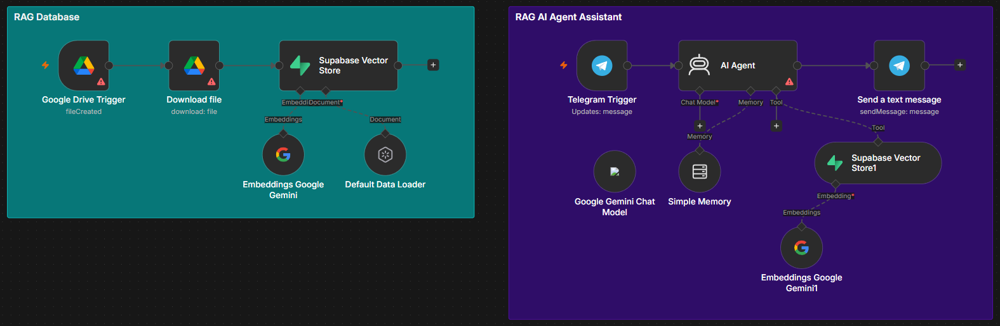
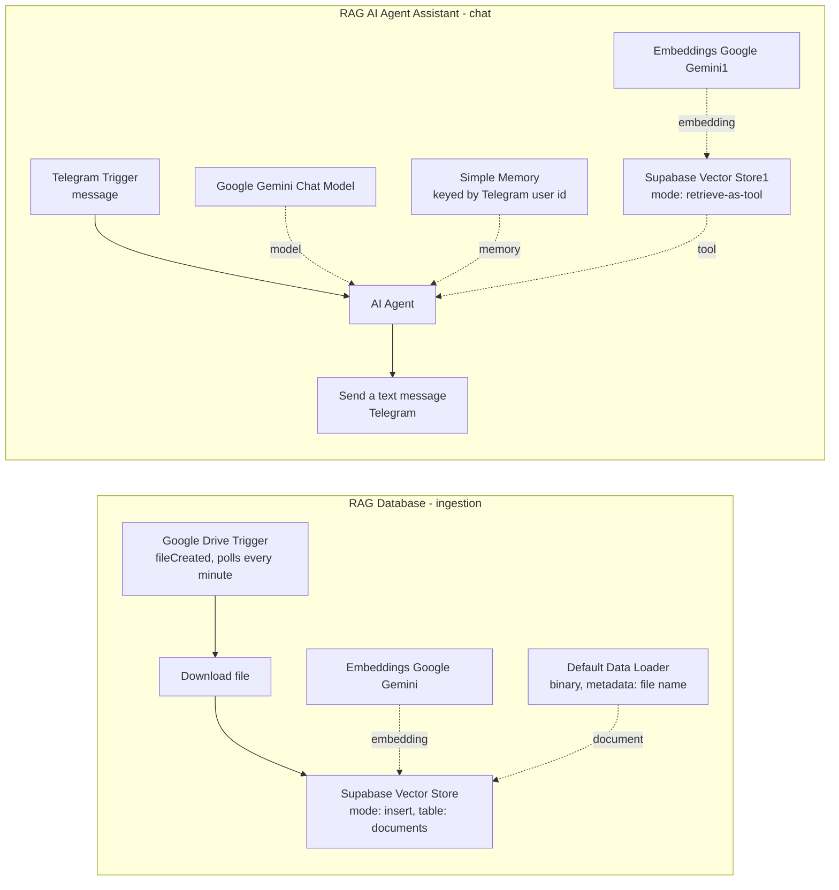

# Supabase RAG AI Agent

[← Back to portfolio](../README.md)

## 1. Project Overview

A Telegram customer-service agent that answers questions from documents stored in a Supabase vector store, with a Google Drive-triggered ingestion flow in the same workflow. It evolved from the author's earlier RAG AI Agent; the system prompt still mentions Pinecone, although this workflow stores vectors in Supabase.



## 2. Business Problem

A support assistant is only as reliable as the documents behind it. Teams that want a Telegram assistant for customer questions need answers grounded in their own files rather than in the model's general knowledge.

## 3. Proposed Solution

The workflow keeps a Supabase vector store as the knowledge base and instructs the agent to consult it before answering. A Google Drive trigger watches a folder and embeds new files into the store, so the knowledge base can grow without touching the chat flow.

## 4. System Architecture



## 5. Key Features

- **Ingestion and chat in one workflow.** The two flows are separated visually by the sticky notes "RAG Database" and "RAG AI Agent Assistant".
- **Automatic ingestion trigger.** `Google Drive Trigger` watches a specific folder for new files, and `Supabase Vector Store` inserts the embedded content.
- **Retrieval as an agent tool.** `Supabase Vector Store1` is set to retrieve-as-tool with the description "Retrieve data from a file".
- **Retrieval-first instruction.** The `AI Agent` system prompt asks the agent to check the vector store before answering.
- **Source file kept as metadata.** `Default Data Loader` stores a `data` metadata field set from the file name expression.
- **Per-user memory.** `Simple Memory` uses the Telegram user id as the session key and a context window of 500.

## 6. Technology Stack

| Tool / service | Role in this workflow |
|---|---|
| n8n | Workflow orchestration and AI Agent node |
| Google Drive | Source of documents (trigger and download) |
| Supabase (vector store) | Stores embeddings in a `documents` table and serves retrieval |
| Google Gemini | Chat model and embeddings (model names not specified in the export) |
| Telegram | Chat interface (trigger and reply) |
| Simple Memory (window buffer) | Per-user conversation memory |

Node counts in the export: 14 nodes, of which 12 are functional and 2 are sticky notes (2 vector store nodes, 2 embeddings nodes, 2 Telegram nodes, 2 Google Drive nodes, 1 data loader, 1 agent, 1 chat model, 1 memory).

## 7. Workflow Execution

**Ingestion**

1. **Google Drive Trigger** watches a specific folder every minute and fires when a file is created.
2. **Download file** downloads a file from Google Drive.
3. **Default Data Loader** reads the binary data and stores the file name as metadata.
4. **Embeddings Google Gemini** creates the embeddings, and **Supabase Vector Store** inserts them into the `documents` table with an embedding batch size of 20.

**Chat**

1. **Telegram Trigger** receives each incoming message.
2. **AI Agent** answers using Google Gemini, with **Simple Memory** keyed by the Telegram user id and a context window of 500.
3. The system prompt tells the agent to act as a customer-service agent and to check the vector store first to confirm the answer.
4. The agent calls **Supabase Vector Store1**, configured as a retrieval tool over the same `documents` table, with **Embeddings Google Gemini1** for the query embedding.
5. **Send a text message** returns the agent's output to the sender.

## 8. Project Structure

```text
supabase-rag-ai-agent/
├── README.md
├── workflow.json            # n8n export (import this file)
└── assets/
    └── supabase-rag-ai-agent.png
```

## 9. Installation & Configuration

1. In n8n, choose **Import from File** and select `workflow.json`.
2. Create these credentials (names only):
   - Telegram account (Telegram API)
   - Google Gemini (PaLM) API account
   - Supabase account
   - A Google Drive credential (not included in the export)
3. Prepare Supabase with a `documents` table set up for the n8n Supabase Vector Store node.
4. Replace the placeholders:
   - `YOUR_GOOGLE_DRIVE_FOLDER_ID` in `Google Drive Trigger`
   - `YOUR_GOOGLE_DRIVE_FILE_ID` in `Download file`
   - `REPLACE_WITH_YOUR_CREDENTIAL` on each credential
5. Select a chat model in `Google Gemini Chat Model`, then activate the workflow and message your Telegram bot.

## 10. Screenshots & Demonstrations


## 11. Limitations & Future Improvements

**Known limitations**

- **`Download file` is set to a fixed Drive file.** Its file is selected from a list rather than mapped from the trigger's output, so as exported, every trigger run would download the same file instead of the newly created one.
- **Credentials are missing in the export for the two Google Drive nodes and for `Google Gemini Chat Model`.** The canvas shows warning icons on `Google Drive Trigger`, `Download file` and `AI Agent`.
- **The chat model name is not specified** in the export for `Google Gemini Chat Model`, and the embeddings model is not specified for either embeddings node.
- **The system prompt mentions Pinecone**, but the workflow uses Supabase.
- **No text splitter node** is connected to `Default Data Loader`, and retrieval options such as number of results are not specified.
- **Only newly created files are ingested** (`fileCreated`). Edited or deleted files are not handled.

**Possible improvements**

- Map `Download file` to the file ID from `Google Drive Trigger` so each new file is ingested.
- Attach the missing credentials and set the chat model explicitly.
- Update the system prompt to reference Supabase instead of Pinecone.
- Add a text splitter and set retrieval options such as the number of results returned.
- Handle updated and deleted files to keep the vector store in sync.
- Ask the agent to name the source file when it answers.

## 12. Project Status

Workflow exported and documented, with known configuration gaps (see limitations). In particular, `Download file` is fixed to a single Drive file in this export, so automatic ingestion of each new file is not working as exported. No deployment or accuracy metrics are claimed.
