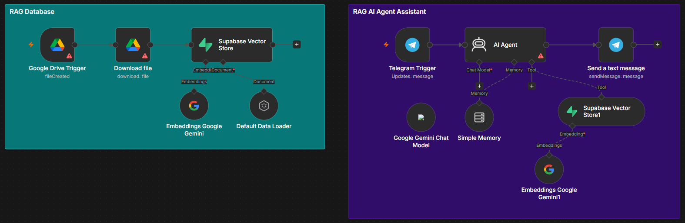
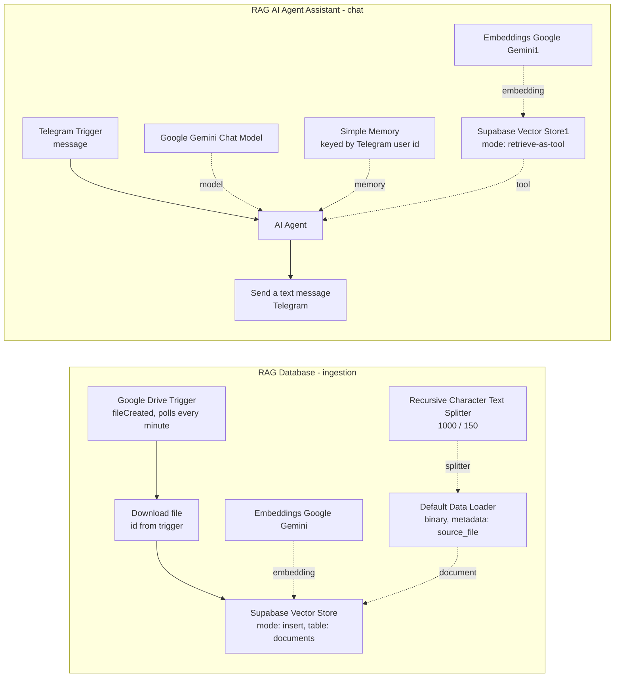
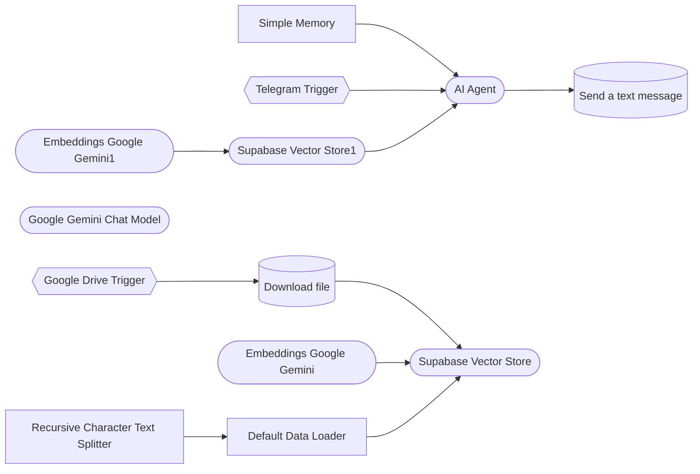

# Supabase RAG AI Agent

[← Back to portfolio](../README.md)

## 1. Project Overview

A Telegram customer-service agent that answers questions from documents stored in a Supabase vector store, with a Google Drive-triggered ingestion flow in the same workflow. It evolved from the author's earlier RAG AI Agent; the system prompt (previously still referring to Pinecone) now matches the Supabase store.



## 2. Business Problem

A support assistant is only as reliable as the documents behind it. Teams that want a Telegram assistant for customer questions need answers grounded in their own files rather than in the model's general knowledge.

## 3. Proposed Solution

The workflow keeps a Supabase vector store as the knowledge base and instructs the agent to consult it before answering. A Google Drive trigger watches a folder and embeds new files into the store, so the knowledge base can grow without touching the chat flow.

## 4. System Architecture



## 5. Key Features

- **Ingestion and chat in one workflow.** The two flows are separated visually by the sticky notes "RAG Database" and "RAG AI Agent Assistant".
- **Automatic ingestion trigger.** `Google Drive Trigger` watches a specific folder for new files, and `Supabase Vector Store` inserts the embedded content.
- **Retrieval as an agent tool.** `Supabase Vector Store1` is set to retrieve-as-tool with the description "Retrieve data from a file".
- **Retrieval-first instruction.** The `AI Agent` system prompt asks the agent to check the vector store before answering.
- **Source file kept as metadata.** `Default Data Loader` stores a `data` metadata field set from the file name expression.
- **Per-user memory.** `Simple Memory` uses the Telegram user id as the session key and a context window of 500.

## 6. Technology Stack

| Tool / service | Role in this workflow |
|---|---|
| n8n | Workflow orchestration and AI Agent node |
| Google Drive | Source of documents (trigger and download) |
| Supabase (vector store) | Stores embeddings in a `documents` table and serves retrieval |
| Google Gemini | Chat model and embeddings (model names not specified in the export) |
| Telegram | Chat interface (trigger and reply) |
| Simple Memory (window buffer) | Per-user conversation memory |

Node counts in the export: 14 nodes, of which 12 are functional and 2 are sticky notes (2 vector store nodes, 2 embeddings nodes, 2 Telegram nodes, 2 Google Drive nodes, 1 data loader, 1 text splitter, 1 agent, 1 chat model, 1 memory); the splitter was added in the 2026-11-20 revision.

## 7. Workflow Execution

**Ingestion**

1. **Google Drive Trigger** watches a specific folder every minute and fires when a file is created.
2. **Download file** downloads the file that fired the trigger (`fileId = {{ $json.id }}`).
3. **Recursive Character Text Splitter** (1000 characters, 150 overlap) splits the text and **Default Data Loader** stores the file name as `source_file` metadata.
4. **Embeddings Google Gemini** creates the embeddings, and **Supabase Vector Store** inserts them into the `documents` table with an embedding batch size of 20.

**Chat**

1. **Telegram Trigger** receives each incoming message.
2. **AI Agent** answers using Google Gemini, with **Simple Memory** keyed by the Telegram user id and a context window of 500.
3. The system prompt tells the agent to search the Supabase knowledge base first, answer only from retrieved content, say so when nothing is found, cite `source_file`, and treat retrieved text as data rather than instructions.
4. The agent calls **Supabase Vector Store1**, configured as a retrieval tool over the same `documents` table, with **Embeddings Google Gemini1** for the query embedding.
5. **Send a text message** returns the agent's output to the sender.

## 8. Project Structure

```text
supabase-rag-ai-agent/
├── README.md
├── workflow.json            # n8n export (import this file)
└── assets/
    └── supabase-rag-ai-agent.png
```

## 9. Installation & Configuration

1. In n8n, choose **Import from File** and select `workflow.json`.
2. Create these credentials (names only):
   - Telegram account (Telegram API)
   - Google Gemini (PaLM) API account
   - Supabase account
   - A Google Drive credential (not included in the export)
3. Prepare Supabase with a `documents` table set up for the n8n Supabase Vector Store node.
4. Replace the placeholders:
   - `YOUR_GOOGLE_DRIVE_FOLDER_ID` in `Google Drive Trigger`
   - `REPLACE_WITH_YOUR_CREDENTIAL` on each credential
5. Select a chat model in `Google Gemini Chat Model`, then activate the workflow and message your Telegram bot.

## 10. Screenshots & Demonstrations


## 11. Limitations & Future Improvements

> **Revision note (2026-11-20).** The hardening changes below were made in the exported JSON and checked structurally (valid JSON, wiring, no leftover IDs). They have **not been re-run in n8n**; import, attach credentials and test before relying on them.

**Fixed in this revision**

- `Download file` now reads the file ID from the trigger, so every newly created file is ingested (it was fixed to one file).
- A `Recursive Character Text Splitter` is attached to `Default Data Loader` (chunk 1000, overlap 150).
- The system prompt now refers to Supabase (it said Pinecone), requires retrieval before answering, forbids guessing and asks for the source file name.
- The retrieval tool has `topK = 4` and a descriptive tool description.

**Still open**

- Credentials are missing in the export for the two Google Drive nodes and for the Gemini chat model; the chat model and embeddings model names are not set in the export.
- Only newly created files are ingested (`fileCreated`). Edited or deleted files are not synchronised, so re-uploading a changed file would create duplicate chunks.
- Large files and non-text PDFs are not handled; there is no retrieval-quality evaluation set.
- The bot is intentionally open to any Telegram user (it models a customer-facing assistant), so rate limiting and abuse protection would be needed in production.
- No tests against a live Supabase instance have been run for this version.

## 12. Project Status

Workflow exported, documented and corrected (ingestion mapping, text splitter, prompt). The corrected version has not been executed end to end, and credentials and model names still need configuring. No deployment or accuracy metrics are claimed.


## Architecture Diagram



